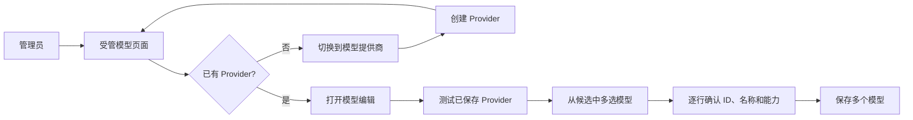
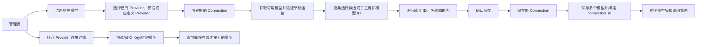
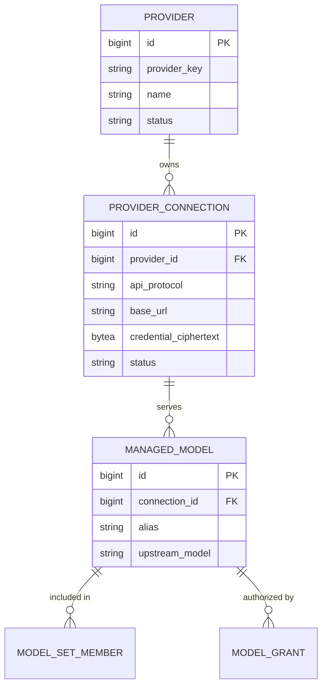

<!--
[INPUT]: 依赖当前 Provider/受管模型/模型集/授权 OpenAPI、Server 模型治理与网关、Console 模型工作台，以及 Magpie、cc-switch、Sub2API、Dify、LiteLLM、Portkey 的公开产品设计和实现。
[OUTPUT]: 提供 OwnDsh 模型接入向导、Provider/ProviderConnection/ManagedModel 边界、供应商预设、模型发现、全新切换边界、改动量、影响面和验收标准的详细设计。
[POS]: docs 的模型接入产品设计真源；约束 contracts/server/console 的后续实现，不宣称本文目标已经完成。
[PROTOCOL]: 变更时更新此头部，然后检查 CLAUDE.md
-->

# OwnDsh 模型接入流程详细设计

状态：`implemented`（代码、契约、迁移和控制台已按本设计切换；批量导入仍不在本期范围）

设计日期：2026-10-16（Asia/Shanghai）

本文设计第一阶段的“模型接入与维护”体验：一次新建连接可以从上游目录多选模型，并逐行确认受管模型配置；Provider ID、ManagedModel alias 和显示名称由后台生成，管理员不需要填写内部身份字段；常规模型行展示上游模型 ID 和显示名称，alias 继续隐藏；模型发现只负责提供候选，凭据仍归供应商连接管理。

**本期切换边界：项目尚未上线，不存在需要保护的历史数据、外部 API 消费者或旧客户端。本设计按全新模型实现，不增加旧字段映射、双写、兼容 shim、旧接口投影、历史数据回填或 AAD 迁移；现有代码只作为行为和安全边界的参考，不作为兼容约束。**

相关文档只作为历史背景和产品语义参考；“当前现状”以本仓库代码、contracts 和数据库迁移为准：

- [V1 产品功能清单](v1-product-feature-catalog.md)
- [第二阶段产品控制台设计](phase-2-product-console-design.md)
- [MVP 详细设计](owndsh-governance-mvp-design.md)
- [T08 模型管理验收](t08-model-management-acceptance.md)

当前实现闭环：Provider 仅保存名称、可选描述和后台生成的 providerKey；ProviderConnection 保存协议、Base URL、超时和加密 credential；ManagedModel 只接收 connectionId，alias 由 Server 根据供应商、连接和上游 modelId 生成。Console 复用现有 ProductDialog、ProductDataTable、TanStack Query 和生成 OpenAPI client，连接探测失败时仍可在统一模型维护表单中手动填写模型 ID。本轮统一新增与配置入口，单模型从列表定位到同一 ModelEditorDialog 表单。

本文中的代码事实锚点：

- [model.yaml](../contracts/components/model.yaml:75) 定义当前 Provider、ProviderConnection 和 `connectionId` 模型写入字段；
- [enterprise-openapi.yaml](../contracts/enterprise-openapi.yaml:86) 挂载当前 Provider、ProviderConnection 和模型管理路径；
- [AdminProviderController.java](../server/owndsh-modules/owndsh-enterprise/src/main/java/com/owndsh/enterprise/model/web/AdminProviderController.java:38)、[AdminProviderConnectionController.java](../server/owndsh-modules/owndsh-enterprise/src/main/java/com/owndsh/enterprise/model/web/AdminProviderConnectionController.java:9) 与 [AdminManagedModelController.java](../server/owndsh-modules/owndsh-enterprise/src/main/java/com/owndsh/enterprise/model/web/AdminManagedModelController.java:38) 是当前管理 API 入口；
- [ModelProvider.java](../server/owndsh-modules/owndsh-enterprise/src/main/java/com/owndsh/enterprise/model/domain/ModelProvider.java:15)、[ProviderConnection.java](../server/owndsh-modules/owndsh-enterprise/src/main/java/com/owndsh/enterprise/model/domain/ProviderConnection.java:11) 和 [ManagedModel.java](../server/owndsh-modules/owndsh-enterprise/src/main/java/com/owndsh/enterprise/model/domain/ManagedModel.java:11) 是当前领域字段；
- [V46__model_provider_connections.sql](../server/owndsh-modules/owndsh-enterprise/src/main/resources/db/migration/V46__model_provider_connections.sql:1) 定义当前 Provider/Connection/Model 三层关系；[V47__model_connection_audit.sql](../server/owndsh-modules/owndsh-enterprise/src/main/resources/db/migration/V47__model_connection_audit.sql:1) 补齐连接审计白名单；[V48__model_provider_description.sql](../server/owndsh-modules/owndsh-enterprise/src/main/resources/db/migration/V48__model_provider_description.sql:1) 增加供应商可选描述；
- [ModelGatewayService.java](../server/owndsh-modules/owndsh-enterprise/src/main/java/com/owndsh/enterprise/model/gateway/ModelGatewayService.java:165) 和 [GatewayRouteResolver.java](../server/owndsh-modules/owndsh-enterprise/src/main/java/com/owndsh/enterprise/model/gateway/GatewayRouteResolver.java:48) 定义当前请求选路和连接密钥解密位置。

## 0. 代码事实基线

这一节记录迁移前的代码事实，作为本次全新切换的改动对照基线。

### 0.1 当前对象边界

当前代码已经落定三层领域对象：`ModelProvider`、`ProviderConnection` 和 `ManagedModel`。Provider 只保存身份元信息，连接承载真实访问配置，模型通过 `connectionId` 路由：

| 事实 | 代码证据 |
|---|---|
| Provider 领域对象只持有后台生成的 `providerKey`、名称、描述、状态和 revision | [ModelProvider.java](../server/owndsh-modules/owndsh-enterprise/src/main/java/com/owndsh/enterprise/model/domain/ModelProvider.java:8) |
| ProviderConnection 持有 provider 归属、协议、Base URL、加密 credential、超时、状态和 revision | [ProviderConnection.java](../server/owndsh-modules/owndsh-enterprise/src/main/java/com/owndsh/enterprise/model/domain/ProviderConnection.java:8) |
| ManagedModel 持有 `connectionId`、派生 provider 信息、后台生成 alias、上游 `modelId` 和能力字段 | [ManagedModel.java](../server/owndsh-modules/owndsh-enterprise/src/main/java/com/owndsh/enterprise/model/domain/ManagedModel.java:8) |
| 连接列表、创建、更新、草稿探测和连接测试均有独立 API 与 Store | [model.yaml](../contracts/paths/model.yaml:72)、[ProviderConnectionService.java](../server/owndsh-modules/owndsh-enterprise/src/main/java/com/owndsh/enterprise/model/application/ProviderConnectionService.java:22) |

因此，“Provider 应只保存元信息、API Key 在连接中配置、模型绑定 connectionId”是本文的目标方案，不是当前代码已经做到的事实。

### 0.2 当前 API 和保存语义

当前管理 API 的真实路径包括 `/enterprise/admin/v1/providers`、`/enterprise/admin/v1/providers/{providerId}/connections`、`/enterprise/admin/v1/provider-connections/actions/probe` 和 `/enterprise/admin/v1/models`。Provider 写请求只收集名称和可选描述；连接创建/更新请求分别收集协议、Base URL、超时和 write-only credential。[ProviderConnectionService](../server/owndsh-modules/owndsh-enterprise/src/main/java/com/owndsh/enterprise/model/application/ProviderConnectionService.java:24) 负责凭据加密、审计和 revision。

连接测试路径是 `POST /enterprise/admin/v1/provider-connections/{connectionId}/actions/test`，草稿探测不需要先保存连接；[ProviderConnectionService](../server/owndsh-modules/owndsh-enterprise/src/main/java/com/owndsh/enterprise/model/application/ProviderConnectionService.java:27) 会在请求结束后清理临时 credential。模型创建和更新只提交 `ManagedModelWriteRequest`，其必填关联字段是 `connectionId`，由 [ManagedModelService](../server/owndsh-modules/owndsh-enterprise/src/main/java/com/owndsh/enterprise/model/application/ManagedModelService.java:16) 校验连接并生成 alias。

模型创建和更新只提交 `ManagedModelWriteRequest`，由 [ManagedModelService](../server/owndsh-modules/owndsh-enterprise/src/main/java/com/owndsh/enterprise/model/application/ManagedModelService.java:78) 先按 `providerId` 查询 Provider，再保存模型；创建模型会在同一事务中递增 bootstrap revision 并写模型审计。

### 0.3 当前数据和运行链路

当前数据库关系是“Provider → Connection → Model”：

```text
ent_model_provider
  └── ent_model_provider_connection
        ├── base_url / api_protocol
        ├── credential_ciphertext / credential_nonce / key_version
        ├── connect_timeout_ms / read_timeout_ms
        └── ent_managed_model.connection_id
              └── ent_model_set_member.model_id
                    └── ent_model_grant.resource_id
```

证据是 [V46 migration](../server/owndsh-modules/owndsh-enterprise/src/main/resources/db/migration/V46__model_provider_connections.sql)、[JdbcProviderConnectionStore](../server/owndsh-modules/owndsh-enterprise/src/main/java/com/owndsh/enterprise/model/persistence/JdbcProviderConnectionStore.java:1) 和 [JdbcManagedModelStore](../server/owndsh-modules/owndsh-enterprise/src/main/java/com/owndsh/enterprise/model/persistence/JdbcManagedModelStore.java:1)。`JdbcManagedModelStore` 通过 connection 关联 Provider 展示信息；网关按 `connectionId` 读取连接状态和上游路由事实。

当前代码事实是：[quota.yaml](../contracts/components/quota.yaml:23) 与 [QuotaPolicySpec](../server/owndsh-modules/owndsh-enterprise/src/main/java/com/owndsh/enterprise/quota/application/QuotaPolicySpec.java:47) 已移除 Provider 资源分支；[JdbcQuotaPolicyStore.findEffective](../server/owndsh-modules/owndsh-enterprise/src/main/java/com/owndsh/enterprise/quota/persistence/JdbcQuotaPolicyStore.java:79) 按模型或模型集匹配策略；[RedisQuotaRateLimiter](../server/owndsh-modules/owndsh-enterprise/src/main/java/com/owndsh/enterprise/quota/persistence/RedisQuotaRateLimiter.java:26) 按 `policyId` 建 RPM/并发 ZSET。当前没有供应商共享速率策略。

运行时的真实链路是：

```text
员工请求 alias
  → GatewayRouteResolver 校验设备、成员有效授权、ACTIVE ManagedModel 和 ACTIVE ProviderConnection
  → 通过 model.connectionId 查询 ProviderConnection
  → ModelGatewayService 从 ProviderConnection.encryptedCredential 解密
  → 使用 ProviderConnection.baseUrl/apiProtocol/timeout 转发到上游
```

证据是 [GatewayRouteResolver.java](../server/owndsh-modules/owndsh-enterprise/src/main/java/com/owndsh/enterprise/model/gateway/GatewayRouteResolver.java:69) 和 [ModelGatewayService.java](../server/owndsh-modules/owndsh-enterprise/src/main/java/com/owndsh/enterprise/model/gateway/ModelGatewayService.java:165)。

### 0.4 当前 Console 行为

[model-catalog.tsx](../console/src/features/models/model-catalog.tsx:102) 使用“模型与供应商 / 模型集”两个分段。模型与供应商工作台默认展示 Provider→Connection→ManagedModel 拓扑，也可以切换到全局模型表；Provider、Connection 和模型均来自真实 OpenAPI 查询。

当前 Provider 保存由 `createModelProvider`/`updateModelProvider` 完成，连接保存由 `createProviderConnection`/`updateProviderConnection` 完成；模型保存由 `createManagedModel`/`updateManagedModel` 完成，模型只通过 `connectionId` 绑定连接。

[model-editors.tsx](../console/src/features/models/model-editors.tsx:71) 将 Provider 元信息、Connection endpoint/API Key 和模型配置拆成独立对话框；模型发现通过连接探测获取候选，新增、配置和删除模型共用 ModelEditorDialog 维护表单；多模型接入由四步向导编排。

### 0.5 当前探针能力

[JdkProviderProbe.java](../server/owndsh-modules/owndsh-enterprise/src/main/java/com/owndsh/enterprise/model/application/JdkProviderProbe.java:24) 当前把 Base URL 拼成 `/models`，固定使用 `Authorization: Bearer ...`，禁止重定向，限制响应为 4 MiB，并只解析 OpenAI 风格 `data[]`。当前 `ProviderProbeCategory` 只有 `SUCCESS`、`AUTHENTICATION_FAILED`、`UPSTREAM_REJECTED`、`INVALID_RESPONSE`、`UNAVAILABLE`、`TIMEOUT`（[model.yaml](../contracts/components/model.yaml:187)），没有“模型目录不支持”分类。Console 对 `anthropic-messages` 不显示发现按钮，管理员只能手工填写模型 ID（[model-editors.tsx](../console/src/features/models/model-editors.tsx:519)）。因此“模型发现”不是所有供应商都具备的前提：DSH 当前目录发现也只覆盖 OpenAI-compatible 协议；没有目录端点、端点不兼容、权限不足或目录暂时不可用时，必须保留手工添加上游模型 ID 的兜底路径。

## 1. 结论

当前控制台在同一工作台中组织三个领域对象：Provider 只保存供应商元信息，Connection 保存端点、协议与凭据，ManagedModel 绑定 `connectionId`。拓扑视图的连接行可直接展开模型并打开统一模型维护表单；顶部“添加模型接入”向导负责创建新连接并连续保存多个模型。

本期把重点收敛到“让一次添加模型接入变成一个连续任务”，一次连接可提交多个模型：

```text
添加模型接入
  → 选择已有供应商、供应商预设或自定义供应商
  → 创建一条新的连接
  → 获取可用模型并逐条选择多个候选
  → 为每个模型确认自动生成的 ID、名称和能力字段
  → 一次确认并保存 Connection + 多个 ManagedModel
```

目标设计把 Provider 元信息、ProviderConnection 和受管模型作为三个明确的领域对象；向导只负责把三者编排在同一页面。当前代码只有 Provider 和受管模型两个对象，详见第 0 节。

系统内部继续保持三层边界：

```text
供应商元信息（Provider）
  └── 供应商连接（ProviderConnection）
        ├── Base URL / 协议 / 超时
        ├── 加密 API Key
        └── 受管模型（ManagedModel.connection_id）
```

这里必须把三个概念分开：**供应商元信息只描述“是谁”，连接描述“怎么访问”，模型描述“访问哪个上游模型以及对外叫什么”**。Base URL 虽然不是秘密，但它是运行时连接参数，不应放入纯元信息；API Key 更不能放在模型记录中。

API Key 的配置时机固定为“连接配置”步骤：

```text
已有供应商 → 本次“添加模型接入”创建一条新的 ProviderConnection，并在该连接上选择模型
新供应商   → 先填写 Provider 元信息，再创建第一条 ProviderConnection，并在该连接上选择模型
已有连接   → 不在“添加模型接入”入口选择；进入连接详情后维护该连接已绑定的模型
```

模型页面只显示 `已配置` 状态。替换 API Key 是连接管理动作，不是模型编辑动作。

模型接入不自动授予访问权限，不自动删除上游缺失的模型；模型集、授权、模型级 RATE、bootstrap 和网关协议分别由各自模块负责。

推荐把本次变更定为**较大规模的 Console/Contracts/Server 纵向变更**：当前代码没有连接边界，因此需要数据库、领域对象、OpenAPI、JDBC 查询和网关路由的同步迁移，再改造模型页面入口、连接管理、草稿探测和向导。员工插件和对外模型请求协议可以保持不变，但“网关协议不变”不等于“网关代码不改”。

### 1.1 前后流程示意

之前的流程围绕数据库实体展开，管理员需要在 Provider 页面和模型页面之间往返：



现在的流程分成“新建模型接入”和“管理已有连接上的模型”两条路径：



变化的核心是入口、连接边界和引用关系：之前是“先维护一个同时包含端点和密钥的 Provider，再维护模型”，现在全局“添加模型接入”始终创建一条新连接；已有连接的模型增删进入连接详情。模型明确绑定到连接，模型集、授权、模型级 RATE 和员工端协议分别按新契约实现。

## 2. 同类产品调研

### 2.1 对比结论

| 产品                                                             | 采用的做法                                                    | OwnDsh 的吸收方式                     | 不直接复制的部分                             |
| -------------------------------------------------------------- | -------------------------------------------------------- | -------------------------------- | ------------------------------------ |
| [Magpie](https://github.com/yetone/magpie)                     | Provider 融合端点、多个 Key 轮换池和路由/fallback；模型以 `provider/model` 形式映射 | 吸收模型身份与凭据分离、连接级密钥和可审查映射 | 本地网关、订阅账号集成、轮换池和路由组 |
| [cc-switch](https://github.com/farion1231/cc-switch)           | 先选供应商预设，再填写连接信息；支持自动获取 `/v1/models`；自定义供应商支持手工端点         | 预设、搜索、发现、手工兜底和未保存修改保护 | 本地配置文件切换、桌面端路由和聚合模式 |
| [Sub2API](https://github.com/Wei-Shaw/sub2api)                 | 上游账户/凭据、平台 API Key、公共模型和复合路由分层；公共模型可映射到具体上游模型 | 上游连接凭据与平台模型身份分离；模型映射显式可审查 | 计费、平台 API Key 和复合组路由 |
| [Dify](https://docs.dify.ai/en/guides/model-configuration)     | 先安装/选择 Provider，配置后该 Provider 的模型可用；自定义模型只在目录缺失时添加；凭据可复用 | Provider 卡片、模型目录和可复用凭据的概念分离      | Dify AI credits、Marketplace 和工作区计费语义 |
| [LiteLLM](https://docs.litellm.ai/docs/proxy/model_management) | 模型存储在数据库；管理端可增加、编辑、测试和退役模型；同一连接的凭据可复用                  | 数据库驱动的 day-2 管理、模型详情、连接测试和凭据复用边界 | LiteLLM 的大量网关配置和模型价格治理               |
| [Portkey Gateway](https://github.com/Portkey-AI/gateway)       | Provider、模型、路由、重试和负载均衡分层                                 | 保持连接与模型分层，为后续路由扩展留下位置            | 故障转移、权重负载和成本优化不进入本期                  |

### 2.2 设计原则

调研后冻结以下原则：

1. **预设是连接模板，不是供应商分类。** 预设可以填写协议、地址、默认模型目录和能力提示；供应商本身只承载稳定元信息。
2. **发现结果是候选集合，不是持久化指令。** 管理员可以连续添加多个候选；内部 ID 由后台生成并保留在契约中，模型行展示上游模型 ID和显示名称，能力字段展开后确认。
3. **模型和凭据可复用。** 同一个供应商连接下可以维护多个模型，凭据始终归 ProviderConnection，不复制到模型。
4. **模型接入和访问授权分开。** 保存模型不等于向全部成员开放模型。
5. **多选只解决同一连接下的重复录入。** 不引入跨连接一次性任务、路由编排、成员分配或运行时选择。

这次调研得到的共同边界不是“供应商卡片”，而是**上游连接与模型身份分离**。参照产品的分离深度不同：Magpie 偏向把端点、Key 池和路由融合在 Provider 体系内，cc-switch 把预设、端点和发现组织成连续配置，Sub2API 明确区分 Account 与公共模型路由。OwnDsh 选择 Provider/ProviderConnection/ManagedModel 分离，是为了让供应商元信息、连接凭据和模型路由各自承担单一职责；本期不引入供应商级或连接级速率限制。

### 2.3 研究事实到 OwnDsh 的映射

| 研究事实 | OwnDsh 结论 |
|---|---|
| Magpie 的 Provider 融合端点、Key 轮换池和路由/fallback | OwnDsh 只吸收模型身份与凭据分离；不复制轮换池和路由组，并把连接显式建模以满足多租户治理 |
| cc-switch 的 `providers` 与 `provider_endpoints` 分开，模型获取使用当前草稿的 Base URL/API Key | 草稿 probe 先使用连接输入；已保存连接复用密钥，模型保存不再次提交密钥 |
| Sub2API 的 Account 保存上游凭据，Composite Route 保存 public_model → upstream_model | OwnDsh 不把 API Key 放进 ManagedModel；`alias → upstream_model` 与 `connection_id` 同时成为受管模型的完整路由事实 |
| 多数产品允许模型目录缺失时手工填写 | 发现只是候选辅助，手工模型 ID 是一等兜底路径 |

研究依据：

- Magpie：[providers-accounts](https://github.com/yetone/magpie/blob/main/docs/subsystems/providers-accounts.md)、[provider.go](https://github.com/yetone/magpie/blob/main/internal/provider/provider.go)、[reference](https://github.com/yetone/magpie/blob/main/docs/reference.md)。
- cc-switch：[schema.rs](https://github.com/farion1231/cc-switch/blob/main/src-tauri/src/database/schema.rs)、[model_fetch.rs](https://github.com/farion1231/cc-switch/blob/main/src-tauri/src/services/model_fetch.rs)、[AddProviderDialog.tsx](https://github.com/farion1231/cc-switch/blob/main/src/components/providers/AddProviderDialog.tsx)。
- Sub2API：[account schema](https://github.com/Wei-Shaw/sub2api/blob/main/backend/ent/schema/account.go)、[composite route schema](https://github.com/Wei-Shaw/sub2api/blob/main/backend/ent/schema/composite_model_route.go)、[Composite Groups](https://github.com/Wei-Shaw/sub2api/blob/main/docs/COMPOSITE_GROUPS.md)。

## 3. 当前现状

### 3.1 Console 现状

当前模型工作台位于 [model-catalog.tsx](../console/src/features/models/model-catalog.tsx:102)，包含两个分段：

- 模型与供应商：Provider→Connection→ManagedModel 拓扑视图和全局模型表视图；
- 模型集：将已有模型组成集合。

当前操作关系如下：

```text
模型与供应商工作台
  ├── 新建供应商 → ProviderEditorDialog → createModelProvider
  ├── 新建连接   → ConnectionEditorDialog → createProviderConnection
  ├── 连接内维护模型 → ModelEditorDialog → create/updateManagedModel
  └── 添加模型接入向导 → Provider/Connection/ManagedModel 连续保存
```

工作台默认展开已加载的连接模型，搜索和状态筛选同时作用于拓扑视图；模型表视图用于跨供应商查看和复用既有 ProductDataTable 的排序、分页与行选择能力。

Provider 表单位于 [model-editors.tsx](../console/src/features/models/model-editors.tsx:71)，当前实际上把供应商资料和连接资料混在一张表单中，一次收集：

- Provider 类型、Provider ID、名称；
- API 协议和 Base URL；
- credential；
- 连接/读取超时；
- Provider 级 RPM 和并发容量。

从目标领域划分看，第一行是供应商元信息，其余连接参数和 credential 都属于连接；但当前代码把它们都持久化到 Provider，UI 也没有表达这个边界。当前模型实际绑定的是 Provider，而不是一条独立连接。

模型表单一次收集：

- Provider；
- 上游模型 ID modelId；
- 对外 alias；
- 显示名称；
- 上下文窗口和最大输出 Token；
- reasoningEfforts、thinking format、compat；
- 排序。

ModelEditorDialog 可以调用 `testModelProvider` 发现模型，但发现结果只写入 HTML `datalist`（[model-catalog.tsx](../console/src/features/models/model-catalog.tsx:536)、[model-editors.tsx](../console/src/features/models/model-editors.tsx:519)）。管理员仍需在单模型表单中确认一个模型 ID，再单独保存模型；当前没有把 Provider 草稿、探测和模型保存编排成一个连续流程。

### 3.2 OpenAPI 现状

模型契约位于 contracts/paths/model.yaml 和 contracts/components/model.yaml。

当前主要操作：

| 能力 | 当前接口 | 语义 |
|---|---|---|
| Provider 列表/创建 | `GET/POST /enterprise/admin/v1/providers` | Provider 单行 CRUD |
| Provider 查询/编辑 | `GET/PUT /enterprise/admin/v1/providers/{providerId}` | revision CAS |
| Provider 测试 | `POST /enterprise/admin/v1/providers/{providerId}/actions/test` | 测试已持久化 Provider，可带临时 credential |
| Provider 状态 | `POST /enterprise/admin/v1/providers/{providerId}/actions/enable|disable` | 启停 Provider |
| 模型列表/创建 | `GET/POST /enterprise/admin/v1/models` | 单模型 CRUD |
| 模型查询/编辑 | `GET/PUT /enterprise/admin/v1/models/{modelId}` | revision CAS |
| 模型状态/删除 | `POST .../actions/enable|disable`、`DELETE` | 单模型生命周期 |
| 模型集 | `/enterprise/admin/v1/model-sets` | 将已有模型组成授权集合 |

ProviderProbeRequest 已经允许探针接收临时 credential，但当前 HTTP 路径需要 Provider ID，因此“未保存的 Provider 草稿探测”尚未暴露。当前请求体也没有 `apiProtocol` 字段，探针层无法按协议选择不同的目录路径或认证头。

ProviderProbeResult.models 已经返回候选模型，字段包括 id、可选 name、contextWindow 和 maxTokens；当前结果适合用于单模型表单的候选选择。

### 3.3 Server 现状

模型领域的主要实现位于：

- ProviderService：Provider 创建、更新、密钥加密、连接测试、启停和审计；
- ManagedModelService：模型单项 CRUD、启停、删除阻塞、revision 和审计；
- JdkProviderProbe：JDK HttpClient 请求 /models，禁止重定向，4 MiB 响应上限，解析 OpenAI 风格 data[]；
- JdbcProviderStore、JdbcManagedModelStore：Provider 和受管模型 JDBC 持久化；
- GatewayRouteResolver、ModelGatewayService：按当前成员授权解析模型和 Provider，并在请求时解密 Provider credential（[GatewayRouteResolver.java](../server/owndsh-modules/owndsh-enterprise/src/main/java/com/owndsh/enterprise/model/gateway/GatewayRouteResolver.java:58)、[ModelGatewayService.java](../server/owndsh-modules/owndsh-enterprise/src/main/java/com/owndsh/enterprise/model/gateway/ModelGatewayService.java:175)）。

探针当前只实现 OpenAI-compatible 的 `/models` 读取；Anthropic Messages Provider 在 Console 中不显示“获取模型”按钮，管理员只能手工填写模型 ID。

### 3.4 数据与运行时现状

当前数据库核心关系为：

```text
ent_model_provider
  └── ent_managed_model.provider_id
        └── ent_model_set_member.model_id
              └── ent_model_grant.resource_id
```

ent_model_provider 当前保存一份 `base_url`、`api_protocol`、超时和 `credential_ciphertext/nonce/key_version`。这份 credential 与 Provider 绑定，多个模型通过 `provider_id` 间接共享它。

这反映的是当前实现，不是推荐的最终边界：Provider 同时保存供应商元信息、连接地址、协议、超时和秘密，职责过重；模型通过 `provider_id` 选择 Provider，而 Provider 当前恰好也是唯一连接。目标方案才会把 API Key 放入 ProviderConnection，并让模型显式引用 `connectionId`；这一步需要迁移，不是当前代码已有能力。

ent_managed_model 当前以租户内唯一的 alias 对外暴露模型。upstream_model 是模型的上游标识字段，本期不新增新的唯一索引或身份迁移；保存时仍由现有模型服务按既有校验处理。

运行时 bootstrap 只投影已授权模型的 alias、协议和能力，不暴露 Provider 路由、上游模型名或 credential。当前 Provider/模型写入会递增 bootstrap revision，但模型是否进入员工目录仍由模型集和 grant 决定。

### 3.5 现有设计的数据流

当前实现的完整调用链是：

```text
Console 模型工作台
  → 生成的 SDK 调用 Provider/Managed Model 单项 CRUD
  → Admin Controller 做权限、请求体和 revision 校验
  → ProviderService / ManagedModelService 执行业务校验、加密、审计
  → JdbcProviderStore / JdbcManagedModelStore 写入 PostgreSQL
  → BootstrapService 投影“已授权模型”目录
  → 员工端用 alias 请求，GatewayRouteResolver 按成员授权解析 ManagedModel
  → ManagedModel.providerId → ModelProvider
  → ModelGatewayService 解密 ModelProvider credential 并转发到上游
```

当前实现的运行链路是清楚的，但 Provider 的职责过重：Provider 保存元信息、连接地址、协议、超时和连接秘密，Managed Model 保存对外 alias 与上游模型 ID，Model Set/Grant 决定可见范围。本期设计建议先把 Provider 与连接拆开，再让 ManagedModel 显式绑定连接，最后在 Console 和探针入口上补任务编排。

### 3.6 DSH 当前模型配置事实

本地锁定的 DSH dsh-llm-pi-ai 版本为 0.1.2-rc.1。其 PiAiModelProfile 支持的模型字段包括：

- id、name、contextWindow、maxTokens；
- input：text、image 两种输入模态；
- reasoningEfforts：false 或“推理档位到 API wire 值”的映射对象；
- compat：协议兼容覆盖，其中包含 supportsReasoningEffort 和 thinkingFormat 等高级字段。

DSH 的默认输入模态是 text；模型声明 image 后，客户端才会把图片能力视为该模型的声明能力。DSH 支持 off、minimal、low、medium、high、xhigh、max 等标准档位，但管理页面默认只创建 `off/low/medium/high` 四行；点击“添加档位”时从这组标准档位中选择尚未使用的档位，不能重复，不把所有标准档位一次性铺开。off 表示关闭思考，默认 API 参数值为空且不可编辑；如果已有配置保存了 off 值，该值必须保留并继续发送。其他档位的 API 参数值默认与档位名相同，供应商有差异时以供应商文档为准。因此 OwnDsh 的管理表单不能只保存逗号分隔的档位列表，必须保存“档位 + API 参数值”的映射编辑。

当前 plugin/packages/llm-gateway/src/profiles.ts 对每个企业模型硬编码 input: ['text']，没有把服务端模型的输入模态投影给 DSH；这是新增 input 字段时必须同步修正的真实影响。

### 3.7 当前痛点的本质

现象层是两个页面和单模型输入框；本质层有三个问题：

1. UI 暴露了持久化实体，而不是管理员任务；
2. 探针是“测试已存在 Provider”的动作，不能服务于草稿配置；
3. Provider 的元信息、连接参数和 credential 在接口、领域对象和表中没有分离；
4. 当前 `providerId` 实际承担了“供应商身份”和“连接身份”两种语义，无法支持同一供应商下多条连接而不改变模型路由。

## 4. 目标与非目标

### 4.1 目标

1. 在受管模型页面提供一个主入口“维护模型”。
2. 在一个连续流程内完成已有 Provider 复用、预设选择或自定义连接。
3. 在保存前对草稿连接进行无持久化探测。
4. 从发现结果中逐条选择多个模型，并为每个模型自动带入可用的名称和能力字段。
5. 由后台生成不重复的 Provider ID、ManagedModel alias 和显示名称；发现结果中的上游模型 ID 只读，手工行允许填写上游模型 ID。
6. 允许管理员在同一页面调整容量、推理等级等模型能力字段，模型身份字段只读展示。
7. 让 ManagedModel 显式绑定 ProviderConnection，保持模型集、授权、模型级 RATE、bootstrap 和网关协议语义一致。
8. 让凭据始终挂在 ProviderConnection 之下，不复制到 Provider 元信息或模型。

### 4.2 非目标

- 本期不实现 Provider 负载均衡、故障转移或其他路由策略扩展。
- 本期每个模型由管理员明确绑定一条连接，保存后沿用该绑定，不定义额外的路由策略。
- 本期不实现价格、余额、成本中心或模型计费。
- 本期只实现模型级 RATE 限制；不实现 Provider 级或 Connection 级 RATE，也不把模型集作为 RATE 资源。
- 本期不实现任意供应商的专用协议转换；模型协议仍由现有三协议边界负责。
- 本期不自动将模型授权给全部成员、用户组或指定成员。
- 本期不自动删除上游目录中暂时消失的模型。
- 本期不引入新的前端状态库、UI 框架或 HTTP 客户端。

## 5. 目标领域模型（建议，不是当前实现）

### 5.1 供应商元信息

Provider 只表示供应商身份和展示信息：

- 提供商标识、名称和可选描述；
- 供应商级状态和 revision；
- 预设标识或展示标签。

Provider 不保存 Base URL、API 协议、超时或 API Key。预设只负责生成 Provider 元信息和连接草稿。Provider 的 `providerKey` 是稳定的供应商身份，不是一个具体连接地址；新建时不让管理员填写，后台根据供应商名称/预设生成并保证租户内唯一，创建后不可修改。

Provider ID 生成规则：官方预设使用后台保留的稳定 ID（例如 `deepseek-official`）；自定义供应商先把名称转成小写连字符 slug，替换非 `[a-z0-9-]` 字符并裁剪首尾连字符，空值回退为 `provider`，冲突时追加 `-2`、`-3`。该 ID 是管理域内稳定的供应商标识；审计仍按 Provider 资源关联，不把这个字符串直接当作其主键。当前 DSH 客户端使用按协议聚合的固定企业 route，也不把 Provider ID 直接暴露为客户端 route 名称。Provider ID 只保留在 API、审计和排障数据中，常规页面不展示，也不出现输入框。

Provider 只表示供应商身份和元信息，不承担速率限制。速率限制在本期只按 ManagedModel 配置，ProviderConnection 也不拥有独立限流策略。

供应商来源不再单独建模；需要约束协议时，在连接层校验。例如官方 DeepSeek 的连接必须使用 `anthropic-messages`，不能把这个连接事实放在 Provider 元信息里。

### 5.2 供应商连接

ProviderConnection 表示一条可实际访问上游的连接配置，是 API Key 的唯一归属：

- providerId；
- 连接名称或用途标签；
- API 协议和 Base URL；
- 连接/读取超时；
- 加密保存的 API Key；
- 连接状态和 revision。

ProviderConnection 通过 `providerId` 归属 Provider；本期允许管理员为同一 Provider 保存多条连接，但每个模型始终显式保存一条 `connectionId`，不把隐式连接约定当成路由。API Key 只在连接表单中以 write-only 方式提交，服务端加密后保存；Provider、连接摘要、模型、审计和日志都不返回 API Key。

连接的 `apiProtocol` 创建后不可修改；需要更换协议时必须新建连接，避免已绑定模型的协议能力约束被事后改变。当前应用层要求连接必须有 API Key，本期不支持无 Key 匿名连接；将来若支持其他认证模式，必须显式建模认证类型，不能用空字符串表示。

连接的状态是实际可用性；Provider 的状态是供应商资源的管理状态。网关运行门使用 `model ACTIVE && connection ACTIVE`，Provider 停用由管理动作批量停用其连接，不引入隐藏的“主连接”路由。连接测试失败只更新连接的健康/最近测试信息，不自动把连接切换到其他连接。

### 5.3 发现候选

候选模型是一次探测的短生命周期结果，不直接等同于 ManagedModel：

```text
DiscoveredModelCandidate
  id: upstream model id
  name?: upstream display name
  contextWindow?: positive integer
  maxTokens?: positive integer
  source: LIVE_API | PRESET | MANUAL
  selected: boolean
```

候选结果不持久化。Server 只返回上游原始候选和解析事实；过滤、可选资格和提示文案属于 Console 或预设层的派生状态，不形成第二套 Server 协议语义。管理员可以连续添加多个候选，系统为每个候选生成一份 ManagedModelWriteRequest；也可以跳过发现，手工增加一行模型。

### 5.4 受管模型身份

受管模型仍以现有数据库记录和租户内唯一 alias 对外暴露，但规范路由关系改为 `connectionId + upstreamModel`。Provider 名称和 providerId 是连接的派生展示信息，不再是模型的真实选路字段。

同一连接下维护多个模型时，管理员可以在新建向导中多选并一次保存，也可以进入连接详情的“维护模型”区域继续配置或移除模型；每个模型保存自己的 alias、能力和上游模型 ID，不复制连接参数。全局“添加模型接入”不选择旧连接，避免把新建资源和日常模型管理混在一起。

模型字段规则固定如下：

- 上游模型 ID：使用候选的 `id`，发现行只读；手工行允许输入。它是路由和排障事实，在模型摘要行中可见，内部 ManagedModel alias 仍不展示。
- 模型 ID（`alias`）：由后台使用规范化的供应商名、上游模型 ID 和连接 ID 生成，小写化，把非 `[a-z0-9._-]` 字符替换为 `-`、合并连续连字符并裁剪首尾连字符，末尾追加连接标识；为空时回退为 `model`。同一连接同一上游模型再次添加时由服务端唯一约束拒绝，避免不同连接的同名模型发生冲突。新建向导和模型列表不展示 alias，也不提供输入框；alias 继续作为员工请求和 DSH profile 的运行时标识，由 API/运行时保留，必要时仅在高级排障信息中查看。模型详情页是否提供复制 alias 的技术信息入口属于后续独立治理动作。
- 显示名称：由后台优先使用上游 `name`，否则使用上游模型 ID；同一提交或租户已有显示名称冲突时追加 ` · 2`、` · 3`。显示名称不是路由键，但为兑现“不重复”需要在 Server 增加租户级校验/唯一约束；新建向导只读展示生成结果。

容量和输入字段的默认规则也固定：代码现有字段名是 `contextWindow`（产品讨论中的 `modelContextWindow` 对应它），新导入行默认 `contextWindow=256000`（界面显示 `256K`）和 `maxTokens=32768`（界面显示 `32K`），即使上游没有返回能力字段也先填入这两个值；输入类型默认 `text`，管理员可以为支持视觉的模型增加 `image`。`input` 至少声明一种模态，页面只提供 DSH 支持的 `text`、`image` 选项。现有代码的容量解析是十进制 `K`，不能把 `256K` 误写成二进制换算。

推理配置与最新 DSH 模型目录保持一致：每个模型有推理开关；开启后默认展示 `off/low/medium/high` 四个档位，并通过“添加档位”从标准集合中追加尚未使用的档位。每一行的档位使用单选下拉框，同一模型内不能重复选择。`off` 默认显示为空且不可编辑；如果历史配置已有 off 的 wire 值，页面只读展示并保留发送。其他档位默认把 wire 值填成同名字符串，供应商有差异时以供应商文档为准，例如 `max → ultra`。保存编排层直接生成现有 Server/DSH 所需的 `reasoningEfforts` object；关闭时发送 `false`，未填写时省略。逗号分隔不作为本期表达方式，因为它无法表达 wire 映射。

DSH 官方 `PiAiModelProfile` 的基础模型配置确实只需要 `id`、`name`、`contextWindow`、`maxTokens`、`reasoningEfforts` 等字段；`thinkingFormat` 和 `supportsReasoningEffort` 位于 `compat` 高级配置中，用于端点无法被 DSH 自动识别时覆盖协议行为。新建向导与 DSH 客户端的常规添加模型路径保持一致，只展示基础字段，不展示这两个参数，默认由 DSH 根据 provider/base URL/已安装目录判断；连接详情只在探测失败或管理员明确进入高级设置时提供覆盖。契约保留 compat 字段作为显式高级配置。

代码核对还发现 thinking format 存在契约漂移：`contracts/components/model.yaml`、Server 的 `ModelReasoningCompat` 和生成的 Console 类型使用 `openai/deepseek/openrouter/together/zai/qwen/string-thinking/ant-ling`，而 `plugin/packages/platform-client/src/types.ts` 的 bootstrap 校验仍出现另一组 `qwen-chat-template/minimax/kimi/longcat`。本设计不在 UI 再造第三套映射；实施前必须以 contracts 为真源同步 Server、plugin bootstrap 校验和生成类型，未完成同步前只展示双方共同确认的格式。

### 5.5 凭据边界

API Key 属于 ProviderConnection，不属于 Provider 元信息，也不属于 ManagedModel。新向导不得把 API Key 复制进模型请求、模型表单、候选结果或模型持久化记录。模型表单只能接收 `connectionId`，不能接收 credential。

### 5.6 目标关系示意

本期数据库关系保持简单，但把真实路由显式化：



`Provider 1--N ProviderConnection` 是连接归属关系；每次添加模型时管理员明确选择一条连接，`ManagedModel.connection_id` 从第一天起就是网关转发的唯一连接字段。请求执行不会因为连接状态变化而静默改绑到另一条连接。

## 6. 目标用户流程

### 6.1 入口和页面结构

模型页面顶部保留两个统一动作：

> 新建供应商　　添加模型接入

“模型与供应商”工作台同时承载 Provider/Connection 管理和受管模型管理。用户可以在 Provider 下创建连接、测试连接、替换 Key；连接行展开后直接维护该连接上的模型。全局“添加模型接入”创建一条新连接并连续完成模型接入。

原型只用于表达信息架构、状态变化和业务闭环，不规定最终的像素布局、组件实现或交互细节。正式开发必须遵循 Console 已有模式：复用 `ProductDialog`、TanStack Form、生成的 OpenAPI client、现有查询/突变与缓存刷新方式、Button/Input/Select/Details 等 UI 组件和产品 tokens，并沿用权限、加载、错误、未保存离开保护和 revision/CAS 处理；不为本流程引入新的状态库、流程框架或第二套表单/请求封装。页面离开时沿用当前表单的未保存修改保护。

### 6.2 第一步：选择供应商

向导先选择“供应商是谁”，然后为本次接入创建一条新连接：

1. **已有供应商**：选择现有 Provider，本次接入创建一条新的 ProviderConnection；
2. **供应商预设**：按名称、域名和协议搜索预设，创建 Provider 元信息和新连接草稿；
3. **自定义供应商**：先填写供应商名称/标识，再创建第一条连接。

预设卡片至少显示：名称、默认协议、默认地址、模型发现方式和是否需要手工模型。官方 DeepSeek 预设固定使用代码约束的 `deepseek-official` Provider ID，后台自动使用该 ID，不展示可编辑输入框。自定义 Provider 的 ID 同样由后台根据名称生成。预设切换会明确提示会重置当前草稿，避免已填字段被静默清空。

### 6.3 第二步：配置和测试新连接

新建 Provider 时，表单分成两组：

供应商元信息：

- 名称；
- 可选描述。

连接配置：

- API 协议；
- Base URL；
- API Key；
- 连接/读取超时。

本步骤只配置本次新建的连接。预设字段自动填写，管理员补充连接名称、Base URL、协议和 API Key。独立的“连接管理”流程保留“测试连接”；模型接入流程不强制重复点击测试，下一步“获取可用模型”会直接使用当前草稿连接验证端点、凭据并读取目录。两种请求中的 API Key 只在当前请求生命周期内使用，不进入响应、审计或日志。

这一步就是 API Key 的配置时机：**在连接配置完成后、模型发现之前配置**。模型的 alias、模型 ID 和能力字段都不能承载 API Key。

测试结果分为：

- 连接成功；
- credential 无效；
- 上游拒绝；
- 模型目录不支持；
- 响应格式无效；
- 超时；
- 网络不可用。

“模型目录不支持”不应阻止管理员进入手工填写路径，但必须明确提示自动发现不可用。

### 6.4 第三步：多选模型并逐行配置

发现来源按以下顺序选择：

1. 预设提供静态目录；
2. Provider 支持的安全目录端点；
3. 目录端点不可用、协议不支持发现、权限不足或响应无法解析时，管理员手工填写上游模型 ID。

候选列表默认过滤出当前连接协议可接入的模型。管理员点击“获取可用模型”后看到候选列表，逐条选择即可连续维护多个模型；已经选择的候选显示为“已选择”，不使用勾选框。选中模型在下方独立列表中展示，误选时可以移除并重新选择。发现失败不能阻止继续，模型列表底部提供“手动维护模型”按钮；点击后新增一行手工模型，只有上游模型 ID需要管理员填写，显示名称和其他身份字段仍由后台生成。候选缺少能力字段时仍按本次导入默认填入 `256K/32K`、`text`，并标记为“平台默认”，不能伪装成上游事实。模型行默认只展示上游模型 ID和显示名称，点击展开后才显示容量、输入类型和推理配置；每个选中候选生成一行配置，且都写入当前连接的 `connectionId`。

每行配置收集：

- 上游模型 ID：发现候选行只读，手工行可填写；模型摘要行默认展示它，但不展示已生成的内部 alias；
- 模型 ID 由后台生成，不在常规页面展示；
- 显示名称由后台自动生成并作为页面主标识，冲突自动追加序号；
- 上下文窗口，默认 `256K`；
- 最大输出 Token，默认 `32K`；
- 输入类型：文本（默认）和图片；
- 推理开关，以及默认 `off/low/medium/high`、可追加且不能重复的标准档位 API 参数值映射行；档位使用单选下拉框，`off` 的输入框不可编辑，默认空值，已有值保留并发送；
- 排序。

推理输入直接对齐 DSH 的映射表达，不改变 Server 的 JSON object 契约：页面默认展示 `off`、`low`、`medium`、`high` 四行，每行通过单选下拉框选择档位，已被其他行使用的选项不可再次选择；可通过“添加档位”追加标准集合中的未使用档位。`off` 默认空且不可编辑，已有值保留并发送，其他档位的 API 参数值默认与档位名相同。若供应商参数不同，以供应商 API 文档为准。新建向导仍不要求管理员填写 `compat.thinkingFormat` 或 `compat.supportsReasoningEffort`，它们属于高级兼容覆盖。

高级字段只在每行展开后显示，默认路径保持短；没有选中模型时“继续”按钮不可用。

### 6.5 第四步：确认并保存

确认页只展示本次要保存的 Provider 元信息、新连接摘要和多个受管模型摘要。Provider ID、模型 ID 和 alias 不在确认页展示；API Key 只显示“已配置/未配置”，不显示原文：

```text
供应商：OpenAI Compatible / https://example.com
模型：3 个（gpt-4.1、gpt-4.1-mini、o4-mini）
显示名称：GPT-4.1、GPT-4.1 mini、o4-mini
显示名称：GPT-4.1、GPT-4.1 mini、o4-mini
```

保存语义：

- 选择已有 Provider：创建新的 ProviderConnection，再保存 ManagedModel 并写入新的 `connectionId`；
- 选择新 Provider：保存 Provider 元信息、第一条 ProviderConnection，再保存 ManagedModel；
- 进入已有连接的“维护模型”：只保存或移除该连接上的 ManagedModel，不创建新的连接；
- 新建 Provider：先保存 Provider 元信息，再保存连接，最后保存 ManagedModel；
- 模型 ID 或显示名称冲突：先按规则预览去重结果；并发或服务端校验仍冲突时，后台重新分配序号并返回新的预览，不要求管理员手工命名；
- 多模型保存按行返回成功/失败状态；成功行不重复提交，失败行保留配置并允许重试；Provider 或连接已创建但模型保存失败时不自动删除连接凭据；
- 保存成功后：提示前往模型集和访问策略，模型不会默认对成员开放。

这是有意选择的最小编排，不为了极低概率的半成品场景引入删除补偿。Provider 元信息和连接配置在领域层分开，页面仍保持一个连续流程。

## 7. 后端契约设计（建议，不是当前接口）

### 7.1 草稿探测

新增集合级草稿探测操作，避免先持久化 Provider 才能测试：

```text
POST /enterprise/admin/v1/provider-connections/actions/probe
```

请求定义为两种互斥形态：

```text
已有连接：connectionId
草稿连接：apiProtocol + baseUrl + connectTimeoutMs + readTimeoutMs + write-only credential
```

响应复用 ProviderProbeResult 的分类、延迟和候选模型。该接口不产生 Provider、连接、模型、配额或审计资源变更。已有连接的探测请求只需要 `connectionId`，服务端解密连接秘密；新连接/草稿探测才允许带一次性 API Key。

探针必须根据 `apiProtocol` 选择认证头和模型目录路径：OpenAI-compatible 使用 Bearer，Anthropic Messages 使用供应商约定的 API Key 头；无法安全推导模型目录时返回 `MODEL_DIRECTORY_UNSUPPORTED`，允许向导继续手工填写模型 ID。当前 `JdkProviderProbe` 读取 OpenAI 风格 `data[]`；可达但没有模型目录的响应明确返回 `MODEL_DIRECTORY_UNSUPPORTED`，向导保留手工添加，不由 Console 猜测上游格式。

新增 `POST /enterprise/admin/v1/provider-connections/{connectionId}/actions/test` 作为唯一连接测试入口；不保留旧 Provider 测试路径，也不做 Provider 到 Connection 的隐式解析。

### 7.2 保存语义

向导最终保存三类资源：Provider 元信息、ProviderConnection 和多个 ManagedModel。Provider/模型单项接口可以保留为管理入口，但写入契约统一采用明确的元信息、连接和 `connectionId` 字段；新向导接口应避免把连接秘密放进 Provider 元信息响应。

```text
POST /enterprise/admin/v1/providers
POST /enterprise/admin/v1/providers/{providerId}/connections
POST /enterprise/admin/v1/provider-connections/{connectionId}/actions/test
POST /enterprise/admin/v1/models
```

ManagedModel 的规范写入字段改为 `connectionId`；响应同时返回派生的 `providerId/providerName`，用于列表和模型集页面展示。新建向导写入不再要求管理员提供 `providerKey`、`alias` 或 `name`：Server 根据 Provider 名称/预设和上游模型 ID 生成它们，并在响应中返回最终值。高级 CRUD 和 Console 新建路径统一使用新契约，不接受旧字段或只含 `providerId` 的隐式路由；contracts、Server、Console 和 fixtures 同步重生成。多选保存第一阶段可以由 Console 循环调用单模型接口，保留每行状态；只有在实际需要原子提交时再新增原子 API，不把 UI 多选误称为跨资源事务。

各次调用之间由 Console 保留草稿状态；服务端要求 `Idempotency-Key` 使用 UUID v4 格式，但当前资源写入没有按该 key 建立幂等记录，重复请求的最终防线是 Provider `(tenant_id, name)`、Model `(tenant_id, alias)` 和新增的租户显示名称校验。连接创建成功后，模型创建失败时不自动删除 Provider 或连接，避免删除管理员可能已经开始使用的配置。

本次切换不维护隐式 `providerId → connectionId` 解析，不引入“主连接”概念，也不保留旧 Provider API 投影。Console 生成客户端、Java 契约测试和 fixtures 与 contracts 一起直接切换到元信息/连接两个明确资源。

### 7.3 契约限制

- 草稿 probe 的请求体和响应不得返回 API Key、Provider 路由中的秘密字段或上游完整响应正文；
- `MODEL_DIRECTORY_UNSUPPORTED` 是可继续手工录入的结果，不表示连接本身失败；
- 发现失败或不支持时，手工模型行只接受上游 `modelId`；Provider ID、alias 和显示名称仍由 Server 生成；
- 新建向导的 Provider ID、模型 ID 和显示名称由 Server 生成并返回；生成必须在租户唯一约束和并发冲突重试下保持稳定，不接受前端生成值作为最终身份；
- ManagedModel 与 bootstrap 增加 `input` 模态数组，只允许 `text`、`image`，默认值为 `['text']`；
- `reasoningEfforts` 保持 false/object 三态，object 的每个档位值就是发往上游的 wire 值，不能把档位集合压缩成无映射的字符串；
- 模型保存继续使用现有 alias、容量和请求体上限；协议从 `connectionId` 解析，不能由模型请求体单独覆盖；
- 生成客户端仍由 contracts/ 统一生成，禁止直接编辑 console/src/api/generated；
- 新增 `connectionId` 作为模型的真实连接身份，不新增第二套模型协议或路由规则。

## 8. 数据库和持久化设计（建议，不是当前表结构）

### 8.1 目标表结构

当前数据库把元信息和连接字段放在 ent_model_provider。本期按目标 schema 直接实现新的边界，不设计旧数据回填、双写或兼容迁移：

- Provider 继续写入 ent_model_provider，但只保留 id、tenant_id、provider_key、name、description、状态和 revision 等元信息；
- 新增 ent_model_provider_connection，保存 id、tenant_id、provider_id、name、api_protocol、base_url、连接超时、加密 API Key、状态、最近测试状态和 revision；
- ent_managed_model 将 `provider_id` 改为 `connection_id`，并通过连接 join 得到 providerId/providerName；
- ent_managed_model 增加 `input_modalities` JSONB（默认 `["text"]`），保存模型支持的 `text`/`image` 输入类型；
- `name` 若非空增加租户级唯一校验/索引，保证自动生成的显示名称不会重复；
- 模型集、授权、模型级 RATE 配额和用量继续复用现有表；
- API Key 由新连接边界使用 AES-GCM 保存，Provider 和 ManagedModel 不持有明文或可解密秘密；
- 现有 tenant + alias 唯一约束继续负责对外模型名称冲突。

连接与模型的约束：

- `ent_model_provider_connection.provider_id` 外键指向 Provider；
- `ent_managed_model.connection_id` 外键指向 ProviderConnection；
- 模型、连接和 Provider 的 `tenant_id` 必须一致；
- 删除连接前必须检查受管模型引用，不能靠 Provider 删除级联隐式改变路由；
- 本期不保存 Provider 或 Connection 级速率策略；RATE 只按 ManagedModel 匹配，模型集不作为 RATE 资源。
- Redis 限流器继续按策略 ID 工作，策略来源改为模型级策略，不需要 Provider 聚合 join。

### 8.2 预设存储

第一阶段预设作为版本化的只读产品资源，不写入租户数据库：

- 预设 ID、显示名称、默认协议和地址；
- 发现方式和可用模型过滤规则；
- 默认模型能力提示。

预设升级不自动修改已有 Provider 或连接。管理员需要显式重新选择预设或编辑连接；已有连接继续遵循保存时的协议和地址。这避免一个预设更新导致线上模型路由突然改变。

预设初期可以放在 Console 的静态注册表中；一旦需要 Server/Console/CLI 共用或管理员可管理，再提升为 contracts 资源。第一阶段不引入远程 Marketplace。

## 9. 组件和代码变更范围（建议）

### 9.1 Contracts

预计修改：

- contracts/paths/model.yaml：新增草稿 probe path；
- contracts/enterprise-openapi.yaml：挂载新 Path；
- 新增 ProviderConnection 列表/创建/更新/测试/状态 schema，复用现有 ProviderProbeRequest、ProviderProbeResult 和生成类型；
- ProviderProbeCategory 增加 `MODEL_DIRECTORY_UNSUPPORTED`，ProviderConnection probe request 明确携带 apiProtocol；
- ManagedModel 和 BootstrapModel 增加 `input` 模态数组，只允许 `text`、`image`，默认 `['text']`；
- ManagedModel 写请求把 `providerId` 改为规范的 `connectionId`，读响应保留派生 `providerId/providerName`；
- 新建向导请求允许省略 `providerKey`、`alias` 和 `name`，由 Server 生成并在响应返回；不保留旧写入形态或兼容字段；
- 新增对应的 TypeScript/Java operation 和 fixture。

不修改：

- bootstrap 模型响应的 alias、授权和协议语义；新增 `input` 能力字段并由 DSH gateway 消费；
- 员工模型请求协议；
- 模型授权、模型集和模型级 RATE 配额契约；
- 现有 Managed Model 列表的展示字段；Provider 元信息和连接使用两个明确资源，避免隐式兼容映射。

### 9.2 Server

预计新增或修改：

- model/web：Onboarding Probe Controller 和严格 write-only 请求边界；
- model/application：复用 ProviderProbe 的草稿探测入口；
- model/application：Provider 元信息、ProviderConnection 和 ManagedModel 的保存编排；
- model/application：集中生成 Provider ID、模型 alias 和显示名称，在租户唯一约束冲突时重试序号分配；
- model/persistence：新增连接存储和模型连接 join；不实现旧 Provider 数据迁移适配；
- model/gateway：按 ManagedModel.connectionId 读取 ProviderConnection 的地址、协议和加密 API Key，授权规则保持不变；
- model/gateway：把模型 `input` 和 reasoningEfforts 原样投影到 bootstrap/DSH profile，保持 wire 映射值不丢失；
- model/domain：拆出 ModelProviderConnection，并让 ManagedModel、EffectiveModelResolver、GatewayRoute 携带连接事实；
- model/persistence：同步修改 JdbcManagedModelStore、JdbcModelGrantStore 及模型到连接的查询 join；
- quota/persistence：移除 Provider 级策略分支，保留模型级 RATE 查询和限流回归；
- EnterpriseModelConfiguration：装配新路由；
- 现有 ProviderService、ManagedModelService 不删除，密钥加密和审计逻辑集中到 ProviderConnectionService；ManagedModelService 只接受 connectionId；运行时改为读取 ProviderConnection。
- 审计新增封闭枚举动作 `MODEL_CONNECTION_CHANGED`，覆盖连接创建、替换 API Key、连接停用/启用等敏感动作；对应 metadata 白名单为 connectionId、providerId、operation、secretReplaced、resourceRevision 和 bootstrapRevision，禁止写入 credential、Base URL 或上游响应。原有 `PROVIDER_CHANGED` 继续只表示 Provider 元信息变更。

### 9.3 Console

当前实现与职责：

- `console/src/features/models/model-catalog.tsx`：模型与供应商统一工作台、Provider/Connection 拓扑、模型列表入口，以及“维护模型”与“添加模型接入”两个明确入口；
- `console/src/features/models/model-editors.tsx`：Provider 元信息、Connection 配置、统一 ModelEditorDialog 维护表单和四步接入向导；新增与配置共用维护表单，配置已有模型时自动定位并展开当前卡片；
- `console/src/features/models/CLAUDE.md`：维护模块成员清单和边界说明；
- 复用现有 `ProductDialog`、`ProductDataTable` 和生成的 OpenAPI client，不增加 UI 依赖。

前端不实现秘密持久化、不直接请求供应商、不复制一套模型保存逻辑。

### 9.4 不受影响的模块

- plugin/packages/llm-gateway 和员工插件 UI；
- GatewayRouteResolver 的授权规则；
- 三协议上游转发和 usage 结算；
- 模型集、grant 和 activity 的现有页面语义；配额页面按新的模型级 RATE 资源实现；
- bootstrap DTO 和 Harness 模型列表协议。

## 10. 全新实现边界

### 10.1 数据和接口

- 按目标 schema 新建 Provider、ProviderConnection 和 ManagedModel，不设计旧表数据回填、双写或旧密文重加密；
- 新 API 只暴露元信息、连接和 `connectionId`，不提供旧 Provider 写入投影；
- 不保留 `providerId → connectionId` 隐式解析、“主连接”或旧测试路径；
- 不生成旧字段兼容响应，不为假想外部消费者增加 shim；
- contracts、Server、Console、fixtures 和生成客户端在同一变更中更新。

### 10.2 运行时边界

ManagedModel、网关和配额查询从第一版就使用 `connectionId`；速率限制只按模型匹配。实现不需要识别旧 Provider 字段、旧 API 请求或旧策略资源。

### 10.3 Provider 预设

预设只为新向导提供初始值。修改预设不会回写已保存连接；新连接遵循保存时的协议和地址。

### 10.4 Bootstrap 和运行时

每次模型或连接保存沿用现有服务对 bootstrap revision 的更新规则。员工下次 bootstrap 或主动刷新时看到新增的已授权模型；未授权模型不会进入员工目录。Bootstrap 继续只投影模型协议和能力，不投影连接 ID、Base URL 或 API Key。正在执行的请求继续使用请求开始时解析的 route，不被管理页操作中途切换。

## 11. 安全、错误和一致性（建议）

### 11.1 秘密处理

- 草稿 API Key 只允许 write-only 输入；
- 探测期间只构造局部 Authorization header；
- 不把 API Key 放入 Provider 元信息、连接摘要、候选、确认页、模型、审计、异常正文或日志；
- 不跟随重定向到其他 origin；
- Base URL 继续使用现有 HTTP(S)、host、query、fragment 和长度校验；
- 默认拒绝 loopback、private、link-local 和云 metadata 地址；企业内网 Provider 必须通过显式 CIDR allowlist 放行；DNS 解析后的连接目标也必须重新执行该策略，防止 DNS rebinding 绕过；Provider test 与草稿 probe 共用同一出网策略；
- 响应继续使用有界读取，拒绝过大模型目录；
- ProviderConnection 保存继续使用现有 AES-GCM 和密钥版本边界；Provider 和 ManagedModel 领域对象不持有可解密的明文。

### 11.2 失败策略

| 阶段 | 失败 | 结果 |
|---|---|---|
| 草稿探测 | 401、403、超时、无效 JSON、目录不支持 | 不产生资源，页面给出手工填写或修正建议 |
| Provider/连接保存 | 元信息、连接字段非法、名称冲突或权限不足 | 不创建资源，保留向导草稿 |
| 模型保存 | alias 冲突、字段非法或权限不足 | 保留草稿；若 Provider 或连接已创建则保留它们，允许重试 |
| 保存后请求 | 上游凭据失效或模型被上游拒绝 | 复用现有网关错误和审计语义，不回滚目录；连接标记为异常供管理员处理 |

### 11.3 不自动删除

探测只是帮助选择模型，不是上游目录同步。上游本次没有返回某个模型，不表示管理员要停用它；停用/删除继续使用现有显式操作和资源阻塞提示。

## 12. 改动量与影响分析

### 12.1 规模判断

| 区域 | 规模 | 主要工作 |
|---|---:|---|
| OpenAPI/生成代码 | 小到中 | 草稿 probe operation、ProviderConnection schema 和生成代码 |
| Server | 中到大 | 连接服务、草稿探针路由、模型连接 join、权限边界、路由解析和集成测试 |
| Console | 中 | 添加模型接入向导、已有连接的统一模型维护表单、多候选选择、逐行配置、保存编排和主入口改造 |
| 数据模型 | 中 | 新增连接表、模型 connection_id、显示名称唯一性校验；不设计历史数据回填或兼容迁移 |
| 员工端/网关 | 小 | 员工端和对外协议不变；网关服务端必须改为按 `connectionId` 读取连接并执行 Provider/Connection 状态门禁 |
| 文档与验收 | 小到中 | L2 地图、产品设计、Contracts/Server/Console/E2E 证据 |

预计涉及约 15–25 个源文件、1 个连接边界 schema 变更、若干生成文件和新增测试；具体数量以现有组件复用情况为准。增量主要来自把运行时的隐式连接约定改成显式模型连接引用。

### 12.2 工作量分解

以下是相对估算，用于排期，不是承诺工期：

| 阶段 | 估算 | 产出 |
|---|---:|---|
| 领域模型和数据模型 | 1–2 人日 | Provider/ProviderConnection 边界、模型 connection_id、全新 schema |
| UX 和契约确认 | 0.5–1 人日 | 向导状态、预设字段、草稿 probe path |
| Server 连接与探针 | 3–5 人日 | 连接服务、Controller、模型连接 join、后台身份生成、权限、秘密隔离和测试 |
| Console 向导 | 3–5 人日 | 四步流程、获取候选并逐条选择、折叠配置、自动命名、保存编排、错误恢复 |
| 自动化与真实 E2E | 1–2 人日 | API、受控上游桩、身份生成冲突、Playwright、秘密扫描 |
| 文档回环 | 0.5 人日 | CLAUDE、产品清单、验收记录 |
| **合计** | **9–15 人日** | 推荐本期方案 |

### 12.3 用户影响

| 用户 | 变化 | 风险控制 |
|---|---|---|
| 模型管理员 | 从两页切换变为一个模型维护工作区；一次连接可多选模型并逐行确认 | 高级 Provider/模型编辑仍保留，失败行可单独重试 |
| 访问策略管理员 | 无操作变化，模型仍需单独加入模型集/授权 | 不自动授予访问权限 |
| 审计员 | 看到 Provider 元信息变更、模型变更和新增连接变更审计记录 | `MODEL_CONNECTION_CHANGED` 只记录白名单 metadata，不记录 credential、Base URL 或上游正文 |
| 员工 | 无 UI 和请求协议变化 | bootstrap 只看到当前已授权模型 |
| 部署/运维 | 初始化新的连接边界 schema | 验证新 schema、probe 路由和前端流程；不执行旧数据兼容迁移 |

### 12.4 全新切换边界

- OpenAPI 直接使用资源化 probe、ProviderConnection 和 `connectionId`；不提供旧 Provider 写入投影、旧字段映射或旧测试路径；
- 不做历史数据回填、双写、旧密文 AAD 重加密或旧 quota 资源迁移；开发环境按目标 schema 初始化；
- 网关从模型 `connectionId` 解析连接，速率限制只按模型匹配；不执行 Provider 聚合或 Connection 聚合；
- contracts、Server、Console、fixtures 和生成客户端同步切换，禁止为了旧调用方增加兼容层；
- 预设只影响当前向导草稿，不自动修改已保存资源；
- bootstrap 只投影已授权模型的协议和能力，不投影连接 ID、Base URL 或 API Key。

## 13. 测试与验收设计

### 13.1 Contracts

- 草稿 probe 和 ProviderConnection 请求/响应通过 Java/TypeScript schema；
- write-only API Key 不出现在 Provider、模型或 probe 响应；
- ManagedModel 写入必须携带有效 connectionId，返回 providerId/providerName 只能作为派生展示字段；
- Base URL、超时、模型 ID 和模型容量非法输入被拒绝；
- 模型 ID 在租户内唯一，显示名称按租户规则校验；自动命名结果可重复计算；
- `contextWindow` 默认 256000、`maxTokens` 默认 32768，界面显示为 `256K`/`32K`；
- `input` 默认 `['text']`，只接受 `text`/`image`，新模型可正常 bootstrap；
- Console 的推理档位和 API 参数值映射可转换为现有 `reasoningEfforts` object，`off`、关闭和省略语义保持不变；
- 模型级 RATE 请求、超限和 Redis RPM/并发桶通过新的模型 fixture 验证；不保留旧 Provider/Managed Model CRUD fixture 兼容断言。

### 13.2 Server

- 草稿 probe 成功、401、403、重定向、超时、4 MiB 超限和无效 data[]；
- 草稿 probe 不写 Provider、连接、模型、配额或 bootstrap revision；
- 模型保存使用 `connectionId`，模型级 RATE 查询和限流按模型资源匹配；不执行旧 Provider 数据迁移或 Provider quota join；
- 真实配额回归覆盖模型 RPM/并发超限、恢复和 Redis 桶行为；不测试 Provider 共享桶或 Connection 级桶；
- 删除或停用被模型引用的连接有明确阻塞/状态语义，不会让模型静默改走其他连接；
- 新 Provider 创建失败时不留下资源；
- 新 Provider 或连接创建成功、模型创建失败时返回可理解错误，连接 secret 不泄露；
- Provider ID、alias 和显示名称由后台生成；并发冲突会重试序号，不要求客户端手工改名；
- 同一连接下创建多个模型不改变其他模型、模型集和 grant；
- 审计记录不包含 credential、URL 正文或上游响应；连接敏感动作使用 `MODEL_CONNECTION_CHANGED` 及其白名单 metadata。

### 13.3 Console

- 无 Provider 时“添加模型接入”仍可打开并选择新 Provider；
- 已有 Provider 可直接进入模型配置；
- 预设搜索、切换和未保存修改保护；
- 获取候选、逐条选择多个模型、已选模型移除、发现失败后的手工增加模型和折叠配置展开；
- 每个模型可配置文本/图片输入类型，并以档位 + API 参数值编辑 reasoningEfforts；
- 上游模型 ID 作为候选和路由事实保留；自动生成的模型 ID/alias 不在常规页面展示，显示名称可见且不重复；
- 保存失败后按行保留草稿并允许只重试失败行；
- 成功后刷新模型目录但不刷新访问授权为默认开放；
- 权限不足时入口和 API 均被保护；
- 页面无横向溢出、无控制台错误和无 credential 文本。

### 13.4 真实 E2E

使用当前受控上游桩完成：

1. 管理员打开“维护模型”；
2. 创建自定义 Provider 草稿并在连接步骤填写 API Key；
3. /models 返回多个候选；
4. 多选至少三个候选，检查默认容量、文本/图片输入类型和档位 + API 参数值映射；
5. 保存 Provider、ProviderConnection 和多个受管模型，检查每个模型绑定同一 connectionId；
6. 模型集/授权页面仍需显式授权；
7. 员工只看到已授权模型；
8. 网关调用成功；
9. 模拟模型 ID/显示名称冲突，检查自动序号和单行重试；
10. 日志、审计和 bootstrap 不泄露 credential。

Console 的真实浏览器流程必须新增或更新无密钥截图/GIF，符合控制台 GUI 变更的现有验收要求。

## 14. 实施顺序

### P0：冻结体验和契约

- 确认“维护模型”入口文案；
- 确认预设字段、候选资格规则和手工兜底；
- 确认 Provider/连接保存失败后的草稿保留语义；
- 确认目标 Provider/ProviderConnection/ManagedModel schema 和 ManagedModel.connectionId；
- 冻结草稿 probe path 并更新 OpenAPI。

### P1：连接边界和 Server 探针

- 新增 ProviderConnection 持久化、目标 Provider 字段和 ManagedModel.connectionId；
- 新增草稿 probe 路由；
- 复用现有 ProviderProbe、连接服务、权限和秘密隔离；
- 完成模型连接 join、错误映射、审计排除和接口测试。

### P2：Console 主流程

- “添加模型接入”向导与已有连接的“维护模型”表单；
- 供应商选择、连接配置和模型发现探测；
- 多候选选择、默认能力和自动命名；
- 现有 Provider/模型 CRUD 保存编排；
- 保存失败后的草稿恢复。

### P3：真实验收和文档回环

- contracts 生成无漂移；
- Server 集成测试；
- Console typecheck/build/Vitest；
- Playwright 真实 Server E2E；
- 秘密扫描、git diff --check、L2/L3/L1 回环；
- 更新产品功能清单和验收记录。

## 15. 冻结建议

本设计建议冻结以下决策：

1. 产品主入口使用“添加模型接入”，一次接入始终创建一条新的 ProviderConnection；
2. 默认使用四步向导：选择供应商、配置新连接、获取可用模型、确认保存；独立连接管理仍保留连接测试；
3. API Key 在新连接步骤配置；已有连接不在新建向导中选择，连接详情负责该连接的模型管理和 Key 替换；
4. 自动发现只产生候选；目录不可用时仍提供手工填写上游模型 ID 的兜底，管理员可以连续添加多个候选或手工增加模型后保存；
5. ManagedModel 规范绑定 `connectionId`，`providerId/providerName` 是派生展示字段；
6. 新 Provider、ProviderConnection 和受管模型继续复用现有单项 CRUD；多选首期由 Console 循环写入并逐行展示结果；
7. Provider ID、ManagedModel alias 和显示名称均由后台生成；Provider ID 和模型 alias 只保留在契约、运行时与排障数据中，常规页面不展示；上游模型 ID 作为模型行主标识可见，发现行只读、手工行可填写；ManagedModel alias 默认按 `providerKey-normalizedUpstreamModelId[-序号]` 生成；显示名称默认取上游名称或 ID 并追加序号避免租户冲突；新建向导不提供 alias 输入框；
8. 保存模型不自动授权、不自动删除；
9. Provider 页面保留连接测试、Key 替换和“维护模型”入口；已有连接上的模型增删不创建新连接；
10. 凭据始终归属于 ProviderConnection，不复制进 Provider 元信息或模型数据结构；
11. 连接的 `apiProtocol` 创建后不可变；本期不支持无 Key 匿名连接；
12. Provider 只保存供应商元信息；Connection 负责端点、协议、凭据和连接状态；网关运行门为 model、Connection 两层 ACTIVE；速率限制只按模型配置；
13. 草稿 probe 使用 `/provider-connections/actions/probe`，并与既有连接 test 共用出网目的地策略；
14. 本期不迁移旧表、旧密文或旧配额资源；按全新 schema 和新连接加密边界实现；
15. 连接敏感动作使用新增 `MODEL_CONNECTION_CHANGED` 审计动作及封闭 metadata 白名单；
16. 不维护隐式 `providerId → connectionId`、旧接口投影或“主连接”兼容约定；contracts、Server、Console、fixtures 和生成客户端直接切换到新契约；
17. 不增加新的前端依赖和第二套模型协议；模型能力增加 DSH 对齐的 `input` 模态和 reasoningEfforts wire 映射；
18. 不实现 Provider 级或 Connection 级 RATE，不实现模型集 RATE；本期只保留模型级 RATE。

本文已进入实现：Provider/ProviderConnection/ManagedModel schema、全新 quota 契约、草稿 probe、连接 CRUD、V46/V47/V48 迁移、Server 与 Console 已同步切换；真实 PostgreSQL 端到端验收仍需在具备 Testcontainers 的环境执行。单模型编辑仍保留旧流程表单，列表级编辑重设计不属于本轮实现。

## 16. 评审处理结果

本次评审逐条回到代码事实，确认并写回以下决策：

| 评审项 | 处理结果 |
|---|---|
| R1 | 不适用。项目未上线，不执行旧 Provider 密文迁移或 AAD 重绑定；新连接直接使用目标加密边界。 |
| R2 | 采纳。连接 `apiProtocol` 创建后不可变，更换协议必须新建连接。 |
| R3/R4 | 采纳。仓库内未发现需要双协议的外部消费者，采用干净切换；不保留隐式 `providerId → connectionId` 和“主连接”。 |
| R5 | 采纳。新增 `MODEL_CONNECTION_CHANGED` 审计动作和封闭 metadata 白名单。 |
| R6 | 采纳。草稿探测使用资源化路径 `/provider-connections/actions/probe`。 |
| R7 | 采纳。Provider test 与草稿 probe 共用私网、环回、链路本地和 metadata 地址防护及显式内网 allowlist。 |
| R8 | 不采纳。项目未上线，本期 Provider 只保存元信息，不引入 Provider 级 RATE；网关使用 model、Connection 两层状态门禁。 |
| R9 | 采纳。新建向导支持同一新连接下连续添加多个候选模型，并逐行确认能力字段。 |
| R10–R15 | 采纳。修正幂等措辞、官方 Provider ID 锁定、认证语义、网关服务端影响、候选资格归属和 Magpie 研究结论。 |
| R16 | 不采纳。Provider RATE 已从目标范围删除，不需要两跳配额 join 或 Provider 共享桶回归；速率限制只按模型匹配。 |
| 其余范围建议 | 不引入跨连接一次性任务、成员多 Key 导入分配、运行时选择或额外路由策略；本期多选仅限同一新连接下的模型配置。 |

[PROTOCOL]: 变更时更新此头部，然后检查 CLAUDE.md
