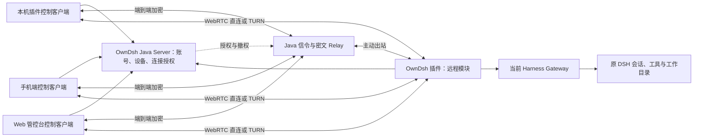

<!--
[INPUT]: ds-harness-remote 固定提交的 Server、协议、加密、WebRTC、client-core、Host 桥接和 Android 源码及组件验证；DSH Go 的独立客户端接线；OwnDsh 当前身份、设备、插件与控制台边界。
[OUTPUT]: 提供 OwnDsh 远程访问的最终技术路线、复用边界、安全要求和实施验收标准，区分已验证的上游组件与待实现的产品集成。
[POS]: docs 中远程访问的唯一方案入口，指导 Server、本机插件、手机和 Web 控制客户端接入；实际 Harness 版本与升级约束由 dsh-compatibility.md 拥有。
[PROTOCOL]: 变更时更新此头部，然后检查 CLAUDE.md
-->

# OwnDsh 远程访问方案

更新日期：2026-11-11。状态：P0 与 R1–R5 连接基础已落地，插件控制插件的 DSH 远程工作区已实现，当前通过加密 Relay 联调。业务实施与验收真源见 [DSH 远程工作区设计](remote-dsh-workspace-design.md)。独立 Web/Android 页面、真实 P2P/TURN 回落和生产 TLS 仍分别验收。

可直接拆任务开发的接口、状态机、Host capability、数据模型和验收真源见：[remote-access-implementation-design.md](remote-access-implementation-design.md)。本文保留产品路线、复用边界和技术取舍；两者冲突时，以后者的已确认实施决策为准。

## 1. 产品目标

用户登录 OwnDsh 客户端，在“设置 → 账号”开启“允许远程控制本机”；随后以同账号从手机端或 Web 管控台选择本人设备，操作该设备正在运行的 DSH。

远程访问沿用原 Host 的会话、工作目录、工具、模型配置和 OwnDsh 模型网关。目标体验覆盖会话管理、流式消息、打断、工具审批、问题回答、工作区文件、终端及适用设置。工作设备需要在线并保持 Host 运行。

2026-11-11 补充确认：本机插件也作为控制客户端，用户可以在本机 Harness 中打开本人另一台机器的 DSH 工作区，复用原有业务界面进行远程操作。工作区执行后端仅支持 DSH 原生 Harness，不接入上游的 Codex、ACP 或其它独立工作区；这不限制 DSH 自身的模型、工具和 MCP 能力。具体业务范围以 [产品决策](remote-access-product-decisions.md) 和实施文档为准。

当前首期先交付 Java Server、Host 插件与 Web 管控台的**产品级连接基础 P0 产物**：完成设备发现、ticket/lease、共享 wire 契约、控制面和连接生命周期骨架；LAN/P2P/TURN/Relay、Noise 和真实跨机联调按 R1 至 R5 完成。会话、文件、终端等具体业务和正式页面后置设计。范围可以收敛，安全、可靠性、跨机验证和生产部署标准不收敛。

**抽取 ds-harness-remote 的连接、端到端加密和原生 DSH 桥接能力，接入 OwnDsh。** 账号、设备归属、远程开关、服务端和控制台均由 OwnDsh 拥有。保留完整 WebRTC（LAN/P2P/TURN）与端到端加密 WebSocket Relay。

远程访问只有三类端：**Java Server、Host 插件、控制客户端**。同一插件可以同时承载 Host 和控制端角色；本机插件、手机端与 Web 管控台共享授权、连接状态、Noise 和业务 RPC 语义。手机使用移动端 WebRTC 适配器，Web 使用浏览器原生 `RTCPeerConnection`。它们不是两套服务端，也不是 DSH Go 手机 App 的原生插件系统。

## 2. 架构与职责



图中的信令与 Relay 由 Java 服务承载；WebRTC 和 Noise 在控制客户端与工作设备端运行。TURN 数据中转交给独立 coturn。Server 不需要解密业务 RPC。

这里有两个不同的 Remote 概念：OwnDsh Remote 是控制客户端与 Host 插件之间的公网连接、加密和授权协议；DSH Typert Remote/Gateway 是 Host 插件调用 Harness 原生会话、文件和终端能力的本机业务适配层。前者不依赖后者，首期连接基础可以先独立验收；后续开放 DSH 业务时，再按当前 Harness 版本验证 `ctx.typertGateway` 和相关 provider 的注入与调用契约。

| 层 | 职责与复用方式 |
| --- | --- |
| OwnDsh 身份与设备 | 复用账号、Host credentials 和 installation，维护租户、用户、目标设备、公钥与远程状态的绑定 |
| OwnDsh 插件 | 被控端在账号 tab 提供开关，主动连接 Server 并桥接本机 DSH；控制端选择本人远端 DSH 工作区，复用原生业务界面与共享加密传输 |
| Java Server | 实现受控设备目录、短期连接授权、兼容信令、密文 Relay、ICE 配置和 TURN 临时凭据 |
| 手机端 / Web 管控台 | 作为同一控制客户端的两个适配器，提供本人设备入口与 DSH 操作区；共享协议、授权和业务 RPC，分别适配移动端与浏览器 WebRTC |
| coturn | 提供直连失败时的 WebRTC 中继服务，使用受控的短期凭据 |

远程模块纳入现有 `owndsh-plugin` 生命周期。用户通过 OwnDsh 登录与开关完成接入，不增加第二套 Remote 账号、登录页或独立设备授权体系。

## 3. 连接与操作流程

1. Host 完成现有 OwnDsh 登录，获得对应 installation 的身份；远程开关默认关闭。
2. 用户主动开启后，Host 登记远程能力及设备公钥，并主动连接 OwnDsh 信令/Relay。设备归属由 Server 验证，不能信任客户端自报用户 ID。
3. 用户在手机端或 Web 管控台选择本人在线且允许远程的设备。控制客户端以各自的登录会话申请短期、绑定目标与客户端公钥的连接授权。
4. Host 校验授权、设备身份、公钥及本机开关，再与控制客户端建立加密通道。WebRTC 在可达时使用 LAN/P2P 或 TURN；按协商规则使用加密 WebSocket Relay 作为可用路径。
5. 控制客户端通过共享协议发送 RPC、订阅流；Host 白名单桥接到当前 Harness Gateway，继续操作原 DSH。
6. 关闭开关、退出或切换账号、账号停用、设备撤销时，阻止新连接并使已有授权和通道失效。断网重连必须重新满足授权条件。

Remote 已有自适应传输与回落逻辑，复用时保留其能力协商、身份绑定和消息顺序约束。原型可以先接通 Relay，再验证 WebRTC；最终验收必须包含 LAN/P2P/TURN/Relay。

## 4. 复用代码与控制客户端边界

本高层方案保留早期验证提交 [b689d7f8f837f6adfbf9728b4ebb47c39d8834d6](https://github.com/liguobao/ds-harness-remote/tree/b689d7f8f837f6adfbf9728b4ebb47c39d8834d6) 的链接与证据；可开发实施设计已按完整仓库当前研究 HEAD `90cd1889f85196ae71b1a3fa1ff789a106f4fdcd` 复核。早期插件版本为 0.6.3、Server workspace 版本为 0.5.21，不能代替 OwnDsh 当前 Harness 兼容门禁。

实际调用链：

```text
OwnDsh 手机端或 Web 操作区
  → 共享远程协议与加密传输核心（手机/Web 分别适配）
  → WebRTC / 加密 WebSocket Relay
  → Host ConnectionController
  → HarnessRemoteBridge 端点白名单
  → 当前官方 Harness Gateway
  → 原 DSH 会话与工具
```

| 源码入口 | 接入依据 |
| --- | --- |
| [harness-remote-bridge.ts](https://github.com/liguobao/ds-harness-remote/blob/b689d7f8f837f6adfbf9728b4ebb47c39d8834d6/packages/plugin/src/harness-remote-bridge.ts) | 原生 Gateway 调用、流与文件桥接，包含白名单及路径/传输约束 |
| [owner-peer.ts](https://github.com/liguobao/ds-harness-remote/blob/b689d7f8f837f6adfbf9728b4ebb47c39d8834d6/packages/plugin/src/owner-peer.ts) | 以 Owner Peer 执行获准操作，接入时必须审定暴露范围 |
| [noise.ts](https://github.com/liguobao/ds-harness-remote/blob/b689d7f8f837f6adfbf9728b4ebb47c39d8834d6/packages/crypto/src/noise.ts) | Noise IK 握手与端到端加密，复用 TS 实现 |
| [adaptive-transport.ts](https://github.com/liguobao/ds-harness-remote/blob/b689d7f8f837f6adfbf9728b4ebb47c39d8834d6/packages/webrtc/src/adaptive-transport.ts) | WebRTC、ICE 与 Relay 回落的连接状态机 |
| [gateway.ts](https://github.com/liguobao/ds-harness-remote/blob/b689d7f8f837f6adfbf9728b4ebb47c39d8834d6/apps/server/src/gateway.ts) | Java 信令与密文 Relay 的协议行为参考 |
| [Android connection.ts](https://github.com/liguobao/ds-harness-remote/blob/b689d7f8f837f6adfbf9728b4ebb47c39d8834d6/apps/android/src/services/connection.ts) | 自有移动 UI 组装传输、加密与共享操作客户端的参考 |

Android 已有真实的消息/流、停止、审批、会话/工作区、模型配置、文件读取/预览/下载和交互式终端接线；[DSH Go](https://github.com/ccch1mneyyy/dsh-Go/tree/cd5d32197a3e5674c7e49a6d0330a0f3188e04b6) 的 Dart Remote Carrier 也证明自有界面可以消费同类 Remote 协议。

Remote 完整网页源码尚未在公开仓库找到。公开网页构建产物能确认相应 RPC、Noise、文件和终端调用，但不作为 OwnDsh 可直接复制的页面源码。OwnDsh 需分别完成手机端与浏览器的身份存储、WebRTC、文件处理和操作界面适配；Node Client Mode 的文件系统凭据存储不能直接放进这两类客户端。

DSH 操作区优先使用共享客户端和既有组件；官方 Harness Web 的整块连接适配仅作为 Web 实施时验证的复用选项。手机端和 Web 端都必须是加密终点，避免将解密客户端放在 Server 后仍宣称控制客户端到 Host 的端到端加密。

## 5. Java 服务端实施范围

原 `apps/server` 拥有真实远程接入能力，但账号与设备存储采用单账号假设，不能直接承担 OwnDsh 多租户归属和权限。Java 重实现其需要的协议行为，并复用 OwnDsh 现有持久化、认证、日志和审计。

Java 负责 WebSocket Upgrade、连接认证、Peer/Link 状态、SDP/ICE 信令、密文转发、心跳、断线清理、大小/频率限制和慢消费者处理；提供 ICE 配置与 coturn 临时凭据。Noise 握手、密钥和业务 RPC 解密继续位于手机/Web 控制客户端与 Host 两个端点。

实现时保留每连接保序和有界队列；握手状态转换要有明确串行或同步机制，`ConcurrentHashMap` 不能替代状态机原子性。替换旧连接时，旧 Socket 的关闭事件不得误删新连接。严格 UTF-8、重复 JSON 字段拒绝、安全整数/计数器、帧字节上限和 capability 协商均应纳入协议对照测试。

截至 2026-11-06 的公开查询未找到作者对应 C# 服务端的可读源码，实施依据以公开 TS Server 为准。是否取得 C# 版本不影响本方案。

## 6. 授权、加密与撤权

### 6.1 身份与授权

Server 与 Host 都需验证同租户、同用户、目标 installation、账号/设备状态、远程开关及客户端公钥。本人远程能力与管理员治理权限分开，管理员角色不自动获得员工终端执行权。Console 需要新增 employee 可访问的本人设备入口。

控制客户端沿用各自的 OwnDsh 会话申请受控连接授权，Host Refresh Grant 保留在现有 credentials 中，不进入网页或 URL。授权需要绑定目标与客户端身份，防止通过替换 hostId、sessionId 或公钥越权访问。

登录与远程授权分两层：

| 层 | 复用现有能力 | Remote 增量 |
| --- | --- | --- |
| 身份认证 | Web 复用 Sa-Token HttpOnly Cookie；Host 复用 `dsh-desktop` 的 Access/Refresh Grant；手机复用同一 PKCE/身份源/会话后端 | 手机需要独立的 public client 与回调方式，不能伪装成 Web 管控台或 Host |
| 设备归属 | 复用 installation、设备表、ACTIVE/REVOKED 状态和现有撤销流程 | 远程连接按目标 device ID 做所有者/租户/远程开关检查 |
| 连接授权 | 使用当前登录会话作为签发依据 | 新增一次性短期 `RemoteLinkTicket`，绑定用户、目标设备、客户端公钥、linkId 和 capability；只放 Redis，不能把登录 Token 放进 URL |
| 通道存活 | 复用 logout、设备撤销和成员停用信号 | 握手成功后转换为短期 `RemoteLease`，心跳续租；撤权立即使 ticket、lease 和两端通道失效 |

因此不是重新做一套登录，也不是把现有 Access Token 永久交给 Relay。现有登录负责“你是谁”，Remote ticket/lease 负责“此刻允许你连接哪台设备、以什么能力连接”。

远控的最终授权判定固定为：

```text
remoteAllowed =
    controllerSession.active
    && hostSession.active
    && hostDevice.status == ACTIVE
    && hostPlugin.remoteEnabled
    && targetOwnershipMatches
```

登录是远控的必要兜底条件，插件开关是 Host 侧的显式业务闸门；两者都不是可互相替代的条件。控制端登录失效时立即停止签发新 ticket，Host 登录失效、Refresh 轮换失败、设备撤销或远控开关关闭时立即停止接受新连接并撤销已有 lease。Relay/P2P 通道由两端心跳感知 lease 失效后关闭，失效上界必须实测并写入验收标准。

### 6.2 端到端加密

Remote 使用 `Noise_IK_25519_ChaChaPoly_SHA256`，握手绑定连接及两端身份。Relay 转发密文，Host 验证双方身份后才向 DSH 派发操作；保留篡改、重放、乱序与解密失败后的断开行为。

初次公钥信任依赖服务端设备目录，后续 pinning 不能替代首次归属校验。网页代码由站点交付，E2EE 也不防止受损前端读取明文或错误授权的端点正常解密。密钥清理应遵循实际库能力，不能将释放引用宣称为已证明的内存擦除。

### 6.3 开关与撤权闭环

Remote 上游默认启用不符合产品要求，OwnDsh 必须显式默认关闭。开关与当前账号和设备身份绑定，切换账号不能沿用旧授权。

本机关闭时立即停止接入并清理本机通道；退出、账号停用、installation 撤销要同时覆盖 Server、Host 与既有连接。P2P 数据可绕过 Relay，因此不能仅断开中继就认为撤权完成。需统一授权租约，固定并实测失效上界，失去授权确认后停止控制。

上游 ControlLease 只在特定协商与连接条件下创建，不能直接认为所有链路已有统一撤权保证。撤权后重连不得恢复旧权限；关闭通道与此前已提交任务是否继续是两个行为，实施时需明确并验收。

### 6.4 操作范围与审计

上游 Owner 白名单包含 credentials、settings 和插件管理等高权限操作。接入时逐项审定，保留禁止修改远程模块自身关键设置及禁用承载插件等保护，不能把原白名单视作企业权限设计已经完成。

文件路径检查和终端 attachment/来源归属检查继续保留。路径检查不等于工具执行沙箱，工具权限仍归原 DSH。文件写入/编辑以及各类设置能力按实际原生接口逐项确认。

OwnDsh 私有本机 API 保留回环与 Origin 边界。技能/MCP 页面、OAuth 回调和本机文件选择器需按手机/Web 控制客户端与工作设备的位置设计桥接，聊天可用不代表这些页面已经可用。部署同时验收受控 Origin、HTTPS/WSS、WebSocket Upgrade 和 WebRTC 所需条件。

Relay 记录连接身份、目标、结果和流量等元数据；细粒度操作审计由 Host 提供。密文中继不承担正文审计，也不记录 Token、私钥或会话正文来弥补可观测性。

## 7. 实施与验收

| 阶段 | 必须证明的结果 |
| --- | --- |
| 产品级连接基础 | Web 管控台、Java Server、Host 插件完成身份绑定、LAN/P2P/TURN/Relay、Noise 建链、Lease 撤权和 capability 探测；业务 RPC 不计入本阶段，但生产级安全、可靠性和跨机验收必须完成 |
| 手机/Web 通路 | 手机端与 Web 管控台分别使用共享协议连接原 Host，完成消息、流、取消和一次工具审批，确认工作目录和模型请求仍归原设备 |
| 完整操作区 | 覆盖历史/会话管理、模型配置、问题回答、工作区文件、终端及适用设置；OwnDsh 私有页面逐项核对 |
| 身份隔离 | 两账号两设备，篡改目标、session ID、公钥均不能互访；普通员工通过本人入口使用，无需管理员角色 |
| 开关与撤权 | 默认关闭，重启遵循设置，退出/换号/停用/撤销影响新旧连接；各路径符合约定失效上界 |
| 完整传输 | 验证 LAN/P2P、真实 TURN、加密 Relay、回落及断网重连，不能只用本机或同一 LAN 代替跨网验收 |
| 发行与稳定性 | 锁定实际 Desktop/Plugin/Harness 组合，覆盖睡眠唤醒、附件、终端流、慢消费者和有界资源释放 |

先以 Relay 验证业务与授权，再覆盖完整选路。以首次连接耗时、重连耗时、直连比例、中转流量和受限网络成功率评估体验，现阶段不另加未经需求验证的传输状态机。

实际 Host、插件与 Harness 版本以 [DSH 依赖契约](dsh-compatibility.md) 和桌面 runtime 清单为准。上游版本范围不等于已完成兼容性验收，新增 Gateway 或本机路由接入时同步更新依赖契约。

## 8. 已有证据与待验证范围

预研已对固定提交阅读协议、身份、加密、桥接、传输及客户端接线，运行上游既有组件测试：

| 组件 | 结果 | 证据边界 |
| --- | --- | --- |
| Remote Server / crypto / ConnectionController / HarnessRemoteBridge | 93 项通过：52 / 8 / 4 / 29 | 覆盖本地 HTTP/WS、Noise、隔离、白名单与部分路径检查；Gateway 部分使用替身，未启动完整 Harness |
| Remote Android 服务组件 | 23 项通过 | 覆盖工具端点、加密传输与连接替换/事件流故障；未构建 Expo/APK 或运行真机 |

测试使用 Node 24.14.1 / Vitest 2.1.8，隔离安装 manifest 范围内依赖并关闭安装脚本，以源码 alias 组装；未按完整 workspace 锁文件重建。Android 验证环境未安装 Expo，测试时仅临时移除 checkout 中 tsconfig 的 Expo extends，结束已恢复，业务源码与测试未修改。

DSH Go 仅核对固定源码接线，本轮未运行 Dart/Flutter；网页仅核对公开静态产物，未登录操作。原始测试日志在本机临时研究目录，未作为长期验收制品提交。上游所读许可材料使用/声明 MIT，实际复用保留版权与依赖声明，完整依赖许可核对随实现完成。

**OwnDsh 手机/Web 控制客户端集成、Java Relay、统一撤权、真实跨机/NAT/TURN、三平台发行、长期负载与独立密码审计均未完成。** 上述组件结果支持技术路线，不计作 OwnDsh 产品验收。

## 9. Java 现成实现预研

结论：**Java 有现成的 WebSocket、ICE 和原生 WebRTC 组件，但没有能直接替代 ds-harness-remote 的 Java Remote Server。** OwnDsh 当前不需要让 Java 终止 WebRTC；Java 只需实现信令、授权和密文 Relay，手机/Web 控制客户端与 Host 继续使用各自端点的 WebRTC 和 Noise 实现。

| 能力 | 现成实现 | 适配结论 |
| --- | --- | --- |
| WebSocket 信令与密文 Relay | Netty WebSocket（独立 Remote pipeline） | **直接采用**。保留 JSON wire protocol；使用事件循环、写水位和有界发送队列处理顺序与背压，不引入 STOMP。Spring 的通用推送 WebSocket 不承载 Remote。 |
| Java ICE/STUN/TURN 端点 | [`org.jitsi:ice4j`](https://central.sonatype.com/artifact/org.jitsi/ice4j)（Apache-2.0；Central 当前版本为 `3.2-8-gfa5f931`） | Java ICE 实现，适合 Java 端点或 Java 媒体/数据通道。当前 Server 不终止控制客户端 WebRTC，故**不增加依赖**；TURN 由 coturn 提供。 |
| Java 原生 WebRTC 端点 | [`dev.onvoid.webrtc:webrtc-java`](https://central.sonatype.com/artifact/dev.onvoid.webrtc/webrtc-java)（Apache-2.0；Central 当前版本为 `0.10.0`，上游另有 `v1.0.0` 发布） | JNI 封装并携带按平台划分的 native library，适合 Java 桌面/服务端作为 Peer。会增加 native 装载、平台发行和资源生命周期成本，当前**不用于 Relay Server**。 |
| 独立 Java WebSocket 库 | [`org.java-websocket:Java-WebSocket`](https://central.sonatype.com/artifact/org.java-websocket/Java-WebSocket)（MIT；当前 `1.6.0`） | 与 Spring WebSocket 重复，**不引入**。只有脱离 Spring 的独立 Relay 进程才有选择它的理由。 |
| TURN 服务 | [coturn](https://github.com/coturn/coturn)（独立进程/容器） | **自行部署**。Java 只生成短时 TURN REST 凭据并下发 ICE server 配置，不在 JVM 内实现 TURN。 |

### 9.1 Java Relay 的最小实现边界

Java Relay 应从上游 `apps/server/src/gateway.ts` 移植协议行为，而不是重新设计一套消息格式：

1. WebSocket Upgrade 后先校验 Origin、OwnDsh 会话/设备身份和协议版本；Host 与手机/Web 控制客户端都必须使用服务端已登记的 device ID，不能信任客户端自报归属。
2. 保持上游 control frame、`connect.request`/`connect.incoming`、`signal.offer`/`signal.answer`/`signal.ice`、`transport.selected`、`secure.handshake`、`relay` 和关闭码语义；协议版本、能力交集和目标设备绑定必须逐帧校验。
3. 以每个连接一个显式状态机维护 `awaiting_hello → authenticated → pending/accepted/handshake/ready`，连接替换时只关闭旧 Socket；旧 Socket 的 close 回调不得删除新连接。
4. Relay 只转发 Noise/业务密文和必要的信令，不解析、记录或审计业务正文。沿用上游上限：control frame 64 KiB、Relay frame 1 MiB、ICE candidate 每连接有界、心跳/空闲超时、发送队列有界和慢消费者断开。
5. Java 日志只记录连接 ID、设备 ID、结果、计数器和错误码等元数据；不得记录 Access Token、TURN secret、Noise key、SDP 中的敏感扩展或业务帧内容。

Spring 的 WebSocket 支持已经提供握手、Origin 校验和会话抽象；它不会自动提供设备授权、连接状态机、Relay 协议或 E2EE。`ConcurrentWebSocketSessionDecorator` 只解决单会话发送串行化，不能替代连接状态和权限校验。

### 9.2 coturn 与 Java 的接缝

coturn 使用 TURN REST API 的短时凭据：

```text
username = <expiry-unix-seconds>:<user-or-connection-id>
password = base64(HMAC-SHA1(coturn-shared-secret, username))
```

Java ticket 接口在连接授权成功后生成该凭据，并在本次 ticket 响应中只返回 `urls`、`username`、`credential` 和明确的过期时间。R0 至 R5 不再提供第二个按 `linkId` 读取 ICE 凭据的接口。`coturn` 开启 `use-auth-secret`/`static-auth-secret`，关闭匿名模式；共享 secret 只在 Java 配置和 coturn 配置中存在，不能进入浏览器持久化、URL 或日志。生产部署还需锁定 `realm`、TLS 5349、UDP 3478、relay 端口范围、带宽/配额和监控，不能把默认开放 TURN 当作可交付配置。

TURN 只承载 WebRTC 的 ICE/TURN 数据路径；它不替代 Java 信令，也不改变手机/Web 控制客户端与 Host 之间的 Noise 身份认证。P2P/LAN 成功时业务数据不经过 Java 或 coturn，故撤权必须使两端租约和已有通道失效，单独断开 Relay 不足以完成撤权。

### 9.3 推荐落地顺序

1. **先做 Java Relay + 信令**：直接使用 Netty WebSocket，按上游协议 fixture 验收消息顺序、上限、心跳、连接替换和授权隔离；Spring 只承载 REST/API 与业务授权。
2. **再接手机/Web 与 Host WebRTC**：Java 返回 ICE 配置并转发 SDP/ICE；LAN/P2P 由端点协商，Java 不参与媒体或 DataChannel 实现。
3. **最后部署真实 coturn**：使用短时凭据完成跨 NAT、受限网络、断网重连和 Relay 回落验收；不能以同机或同 LAN 测试代替。
4. 只有产品以后要求 Java 自身成为 WebRTC Peer、媒体网关或录制端时，才重新评估 `ice4j`/`webrtc-java`；当前引入它们属于无需求的 native/协议复杂度。

本节为 2026-11-07 的依赖与职责预研，Central 的“当前版本”仅作检索结果，不构成 OwnDsh 依赖锁定；真正实现时仍需按许可证、平台 native 包、CVE 和目标运行时重新验收。

### 9.4 OwnDsh 的实现范围裁决

以“手机/Web 控制客户端跨局域网或公网操作已登录 Host，同时保证端到端安全和可用性”为目标，**需要完整交付传输回落链路，但不需要把所有能力都写进 Java**：

| 能力 | 是否需要 | 实际承担者 |
| --- | --- | --- |
| LAN/P2P WebRTC | 需要 | 手机/Web 控制客户端与 Host 的 WebRTC 适配器；Java 只转发 SDP/ICE 信令 |
| TURN | 需要 | 独立部署 coturn；Java 生成短时凭据并返回 ICE 配置 |
| 加密 WebSocket Relay | 公网产品需要 | Java Netty Relay 只转发已加密帧；不解密业务正文 |
| Java `ice4j` / Java 原生 WebRTC | 当前不需要 | 只有 Java 自身成为 Peer、媒体网关或录制端时才评估 |
| Server 解密业务 RPC | 永久不需要 | Noise 密钥和解密只存在手机/Web 控制客户端与 Host 端点 |

安全上必须保留：OwnDsh 身份与设备归属校验、客户端公钥绑定、短期连接授权、统一撤权租约、端点 Noise E2EE、HTTPS/WSS、Origin/协议/帧大小/频率校验、有限队列、元数据审计和秘密不落日志。TURN 与 Relay 可以看到地址、时间、流量大小等元数据，但不应看到业务明文。

可靠性上，直接 WebRTC 用于低延迟路径，TURN 解决 NAT 和 UDP 可达性问题，Relay 解决企业网络禁 UDP、代理限制或 TURN 不可用的最后回落；三者共享同一连接授权和撤权语义。心跳、断线重连、旧连接替换、慢消费者断开和跨机测试属于必做项，不能用“能连上一次”代替。

如果部署范围明确限制在同一内网或统一 VPN，可以先延后 coturn 和 Relay；这会牺牲公网穿透和受限网络可用性，不适合作为 OwnDsh 的通用远程访问发行基线。公网版本的最小安全可靠范围就是：**手机/Web 控制客户端与 Host 的 WebRTC（LAN/P2P）+ coturn TURN + Java 加密 Relay**，而不是 Java WebRTC 全家桶。

### 9.5 上游最小 Server 质量审查与 Java 移植结论

审查对象为 `ds-harness-remote` 固定提交 `b689d7f8f837f6adfbf9728b4ebb47c39d8834d6` 的 `apps/server` 和 `packages/protocol`。结论分成两层：**作为小型协议 Server，它的防护质量足够作为移植基线；作为 OwnDsh 生产后端，它的部署和身份模型不够。**

做得好的部分：

- wire JSON 拒绝重复字段，协议 schema 严格校验，control/relay 帧有字节上限、速率上限和 ICE candidate 上限。
- WebSocket hello deadline、连接状态机、连接替换、目标设备/角色校验、握手步序、Relay counter 防重放都有对应代码和测试。
- Server 不解密 Noise 业务；测试实际验证了密文 Relay、篡改、错误静态公钥、错误 prologue 和重放行为。
- Access/Refresh token 只以摘要持久化，Refresh 重放会撤销设备凭据；TURN 凭据默认短期并绑定连接参与者。
- Origin、反向代理 IP、请求体、登录/API 限流、心跳、慢消费者、关闭超时和日志脱敏覆盖较完整。

必须补足的部分：

- Store 是单账号、单进程 JSON 文件；Session、Peer、Link、限流桶都在内存，不支持 OwnDsh 的多租户、PostgreSQL/Redis、水平扩展或跨节点 WebSocket 状态。
- Server 自己不终止 TLS，依赖反向代理；这符合它的自托管边界，但 OwnDsh 仍需把 WSS、代理信任和健康检查纳入部署门禁。
- 测试主要是 Node 进程内的协议和伪客户端测试；上游 README 明确跨机器、真实 coturn、长期运行、负载和故障恢复仍待验证。
- 账号密码来自配置并在登录路径直接比较；静态 TURN 凭据也保留了兼容入口。OwnDsh 应接现有身份/设备授权，默认只允许短期 TURN 凭据。
- 这套 Server UI、单账号登录和设备 API 不能直接作为 OwnDsh Console/Enterprise API。

因此可以**直接翻译协议行为，不能直接翻译产品实现**。Java 端应保留控制帧和 REST wire contract，按以下边界重写：

1. `gateway.ts` → Netty WebSocket Handler + 每连接显式状态机；使用严格 Jackson 解析、重复字段拒绝、单连接串行发送和有界慢消费者策略。
2. `ice.ts` → Java `Mac` 的 HMAC-SHA1 短期 TURN 凭据生成；凭据授权接到 OwnDsh 的连接租约，不接单账号 Store。
3. `server.ts` → OwnDsh 现有 Sa-Token/设备/权限/审计/API 错误边界；不复制上游 cookie、账号登录和内存限流实现。
4. `store.ts` → PostgreSQL 持久化设备、公钥、撤销和审计，Redis 保存短期连接/限流/租约；WebSocket 所在节点只保留活跃 Socket 的进程状态。
5. `packages/protocol` → Java records/JSON Schema/协议 fixture；先用上游 Node Server 做差分测试，再加真实手机/Web 控制客户端、Host、coturn 和跨节点验收。

不应移植 Noise 实现、手机/Web WebRTC、Host Gateway 或上游 Web UI。这样得到的是一个 OwnDsh 自有的 Java Relay/信令服务，而不是一份难以维护的 TypeScript 逐行翻译；上游 wire fixture 只作为边界测试输入。

### 9.6 坑的数量与成熟度判断

上游不是未经验证的概念代码，但也还不是已经稳定多年的基础设施：仓库创建于 2026-08-14；最小自部署 Relay 在 2026-09-19 才加入；LAN/P2P/TURN 协调在 2026-11-05 才加入。固定提交前后仍有大量连接层修复，例如重复 JSON 字段、Control/Relay wire 校验、数据面分流、握手超时、关闭语义和能力交集校验，说明作者确实踩过并修过不少协议边界问题。

同时，固定提交附近仍有公开的连接/安全问题：

- [#297](https://github.com/liguobao/ds-harness-remote/issues/297)：静默断开的 Host 控制 Socket 长时间假在线，重连不再触发。
- [#339](https://github.com/liguobao/ds-harness-remote/issues/339)：心跳失联后的恢复延迟和残留 link 重试风暴。
- [#341](https://github.com/liguobao/ds-harness-remote/issues/341)：TUN/VPN 地址被错误选为 ICE host candidate，局域网直连退化为 Relay。
- [#310](https://github.com/liguobao/ds-harness-remote/issues/310)：首次见到新设备公钥时静默 pin，缺少人工确认点。
- [#241](https://github.com/liguobao/ds-harness-remote/issues/241)：TURN 连接超时曾以未处理 rejection 终止 Host 进程。
- [#258](https://github.com/liguobao/ds-harness-remote/issues/258)：大负载二进制帧仍在演进，当前文本/Base64 路径有额外开销。

其中部分是 Host/Client 或部署问题，不是 `apps/server` 单点缺陷；但它们都属于同一核心连接系统，说明只翻译 Server 代码不能自动得到可靠产品。该仓库当前仍有 57 个公开 issue，Server 测试虽有 52 个场景、协议测试另有约 66 个明确用例，却主要是进程内伪客户端验证，真实手机/Web 控制客户端、跨 NAT、长期运行、升级和故障恢复仍需 OwnDsh 自己证明。

最终判断：**可以高度参照它来降低设计踩坑概率，不能把它当作“坑已清空”的规范实现。** Java 移植应把上游 commit 历史、测试、issue 和 wire fixture 一起当作输入；每移植一个状态转换，都要先写并发/超时/撤权/重放测试，再接入 OwnDsh 的 PostgreSQL、Redis 和多租户授权。

### 9.7 Java 开箱即用库的实际选择

没有一个 Java 库可以直接替代 `ds-harness-remote` 的核心。可用组件的边界如下：

| 组件 | 能直接提供什么 | 不能提供什么 | OwnDsh 选择 |
| --- | --- | --- | --- |
| [Netty](https://netty.io/) | 高并发 TCP/TLS、HTTP Upgrade、WebSocket、ByteBuf、写水位、IdleState、事件循环和背压 | Remote 帧 schema、设备授权、Link 状态机、Noise、TURN 凭据和回落策略 | **直接作为专用 Relay 底座**；OwnDsh 自己冻结严格 JSON wire schema |
| Spring WebSocket | Spring Boot 内的 WebSocket Upgrade、Handler、Origin 和会话抽象 | Relay 协议、状态机、权限、重放和业务审计 | **不用于 Remote 核心**；保留给现有业务推送，避免把 Remote 状态机绑定到 Servlet 会话 |
| `org.jitsi:ice4j` | Java ICE/STUN/TURN 协议实现 | 手机/Web Remote 协议、DataChannel、设备授权和业务 Relay | 当前不引入；Java 不作为 WebRTC Peer |
| Jitsi Videobridge | 完整的 WebRTC SFU/媒体路由基础设施 | OwnDsh 的透明密文 Relay；会引入媒体服务器、信令和 WebRTC 终止复杂度 | **不采用**；这是视频会议基础设施，不是本需求的中继 |
| `dev.onvoid.webrtc:webrtc-java` | Java 进程作为原生 WebRTC Peer | Java Relay、手机/Web 控制协议和设备授权 | 当前不引入；需要 Java Peer 时再评估 |
| Java-WebSocket/Tyrus | 独立 WebSocket 客户端/服务端 | 高层 Remote 语义，且与当前 Spring 栈重复 | 不采用 |

Remote 核心直接采用 Netty，但只把它当作传输底座：`WebSocketServerProtocolHandler` 负责 Upgrade，严格 Jackson decoder 负责 wire JSON，`IdleStateHandler` 负责心跳，`WriteBufferWaterMark`/`isWritable` 负责慢消费者，单 Channel event loop 负责同一连接内顺序。设备授权、Link 状态、计数器、防重放和审计仍属于 OwnDsh 的协议核心，不能交给 Netty。

Netty Listener 先作为 Spring Boot 的生命周期 Bean 使用独立监听端口或反向代理路由；REST、设备授权和 TURN 凭据继续走现有 Spring MVC。Netty Handler 只依赖一个与传输无关的 `RemoteGateway`/`RemoteChannel` 边界，测试可直接驱动状态机，避免将来更换容器时重写协议逻辑。不要复用 `owndsh-common-push` 的 `WebSocketSessionManager`，它的用户广播、Redis 发布和静态会话表与 Remote 的设备对设备 Link 不同。

因此 Java 实现路线是：**Remote 直接用 Netty，Spring 保留业务控制面；先以目标连接数、Relay 吞吐、P95 延迟、24 小时心跳与重连、慢消费者和跨节点测试证明容量，再决定是否拆成独立进程。** Netty 解决传输层效率和背压，不能替代授权、状态机、撤权或分布式连接路由。

### 9.8 与 ds-harness-remote 的兼容策略

此前曾考虑与固定提交 `b689d7f8f837f6adfbf9728b4ebb47c39d8834d6` 保持 **v1 wire-compatible**。结合当前产品边界，实施真源已改为：**不追求上游业务互通，只提取连接核心和安全语义；若未来需要互通，另做 adapter。** 仍可沿用 envelope 和字段命名以减少理解成本，但这不构成兼容承诺。

当前保留的参考边界如下：

| 层 | 是否保持兼容 | 约束 |
| --- | --- | --- |
| WebSocket 与 JSON envelope | 参考 | 可沿用 `v`、`id`、`type`、`timestamp`、`payload` 和严格 JSON 边界，但 OwnDsh 自己冻结 schema |
| Control frame | 参考 | 可沿用 hello、建链、信令、传输选择、Noise 握手、relay、心跳和关闭语义；不承诺上游客户端可直接接入 |
| Link 状态机 | 参考 | 保留 pending/accepted/handshake/ready 的设计原则、方向约束、目标校验和 counter 防重放 |
| WebRTC 协调 | 参考 | Java 只转发 SDP/ICE；两端使用 OwnDsh capability 交集和自己的产品策略 |
| Noise/E2EE | 参考并固定参数 | OwnDsh 首版固定 Noise 参数、静态身份公钥和 prologue；业务 frame 由 OwnDsh 自己定义 |
| 业务认证与存储 | OwnDsh 自有实现 | 使用 Sa-Token、设备表、PostgreSQL/Redis、RemoteLinkTicket 和 RemoteLease，不复制上游 cookie、单账号 Store 和登录页面 |

上游 `hello.accessToken` 的位置说明了连接必须经过端点身份认证；OwnDsh 在 WSS Upgrade 使用 Host 的短期 Access Token 或 Web 的同源 Cookie，frame 内使用一次性 RemoteLinkTicket 绑定 link、设备和公钥。它不意味着未修改的上游 Client/Host 可以直接连接 OwnDsh；若未来需要这种互通，必须另做与其注册/刷新 API 等价的 adapter。

`identityKey`、`clientIdentityKey`、`targetDeviceId`、Noise 静态公钥和握手数据不是可有可无的业务登录字段，它们保证端点身份绑定和防止把一个已认证 Socket 接到错误设备。`connect.incoming.authorization: "account"` 可以继续作为兼容 wire 值，但实际授权必须由 OwnDsh 的设备归属和连接租约决定，不能信任客户端自报。

如果未来做上游 adapter，才需要同时满足双方协议版本、capability 名称、control 64 KiB、relay 1 MiB、ICE candidate 256、canonical Base64URL、关闭码分类和可选恢复扩展；这些是 adapter 的验收条件，不是 OwnDsh 首版的产品承诺。业务 RPC/事件还取决于 Noise 解密后的 capability、Harness 版本和 Host Bridge。

因此结论是：**OwnDsh 可以直接借鉴上游踩过的坑来实现自己的核心，但不把“剥除认证后的无缝互联”作为目标。** 实施时保留上游 conformance fixture 的边界测试价值，再验证 OwnDsh 自己的三端、授权、撤权以及 LAN/P2P/TURN/Relay 四条路径。

## 10. 未开源产品层的实现可行性

截图展示的是上游 Remote 的产品层：远程主机列表、会话/流式消息、工作区文件、终端，以及 P2P 和端到端加密状态。基于本方案可以实现同类能力，但应把它们接到 OwnDsh 自己的 Host Bridge 和业务 RPC 上；连接核心本身不包含这些页面和业务语义。

| 能力 | OwnDsh 是否可实现 | 必要条件 |
| --- | --- | --- |
| 远程主机列表、在线状态、P2P/Relay/E2EE 状态 | 可以 | Server 设备目录、Host 心跳、Link 状态和控制客户端状态映射 |
| 会话、流式消息、停止、工具审批 | 可以 | Host 插件桥接 Harness Gateway 的对应 RPC，并保留流序和取消语义 |
| 工作区文件读取、预览、上传、下载 | 可以 | Host 端路径边界、文件流分片和客户端文件选择/保存适配 |
| 交互式终端 | 可以 | Host 端 PTY/终端流桥接、attachment 归属校验和断线清理 |
| 模型/设置/插件操作 | 可以但需裁剪 | OwnDsh 逐项定义白名单；不能把上游 Owner 白名单直接暴露 |
| 与上游页面完全一致 | 不能直接保证 | 未开源页面、隐藏 RPC 和版本行为需要自行重建；这不属于连接层移植 |

浏览器端可以直接使用 `RTCPeerConnection`、WebSocket 和浏览器 Noise 实现，完成远程会话、文件交互和终端 UI；文件系统只能通过用户选择器或 File System Access API 访问。Android 端可以使用 Kotlin/Flutter 加 `flutter_webrtc` 或原生 WebRTC，复用同一套 Remote 协议、Noise、Lease 和业务 RPC；需要额外处理 Android 网络切换、后台限制、权限和文件 SAF。

因此结论是：**可以在 OwnDsh 上实现“浏览器远程控制”和“Android 远程控制”的功能等价版本，原作者未开源的页面代码不是阻塞项。** 不能承诺不读取其私有业务协议就得到完全相同的内部实现；若未来追求与上游客户端互通，必须另行补齐其业务 RPC、认证/注册 API 和版本兼容测试。
