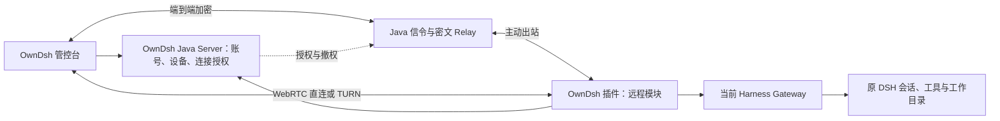

<!--
[INPUT]: ds-harness-remote 固定提交的 Server、协议、加密、WebRTC、client-core、Host 桥接和 Android 源码及组件验证；DSH Go 的独立客户端接线；OwnDsh 当前身份、设备、插件与控制台边界。
[OUTPUT]: 提供 OwnDsh 远程访问的最终技术路线、复用边界、安全要求和实施验收标准，区分已验证的上游组件与待实现的产品集成。
[POS]: docs 中远程访问的唯一方案入口，指导 Server/Console/Plugin 接入；实际 Harness 版本与升级约束由 dsh-compatibility.md 拥有。
[PROTOCOL]: 变更时更新此头部，然后检查 CLAUDE.md
-->

# OwnDsh 远程访问方案

更新日期：2026-11-07。状态：**技术路线已确定，OwnDsh 集成尚未实施。**

## 1. 产品目标

用户登录 OwnDsh 客户端，在“设置 → 账号”开启“允许远程控制本机”；随后以同账号登录 OwnDsh 管控台，选择本人设备，在网页操作该设备正在运行的 DSH。

远程访问沿用原 Host 的会话、工作目录、工具、模型配置和 OwnDsh 模型网关。目标体验覆盖会话管理、流式消息、打断、工具审批、问题回答、工作区文件、终端及适用设置。工作设备需要在线并保持 Host 运行。

**抽取 ds-harness-remote 的连接、端到端加密和原生 DSH 桥接能力，接入 OwnDsh。** 账号、设备归属、远程开关、服务端和控制台均由 OwnDsh 拥有。保留完整 WebRTC（LAN/P2P/TURN）与端到端加密 WebSocket Relay。

## 2. 架构与职责



图中的信令与 Relay 由 Java 服务承载；WebRTC 和 Noise 在浏览器与工作设备端运行。TURN 数据中转交给独立 coturn。Server 不需要解密业务 RPC。

| 层 | 职责与复用方式 |
| --- | --- |
| OwnDsh 身份与设备 | 复用账号、Host credentials 和 installation，维护租户、用户、目标设备、公钥与远程状态的绑定 |
| OwnDsh 插件 | 在账号 tab 提供开关，挂载远程模块，复用 TS 身份校验、Noise、传输、RPC/流与 Gateway 桥接 |
| Java Server | 实现受控设备目录、短期连接授权、兼容信令、密文 Relay、ICE 配置和 TURN 临时凭据 |
| OwnDsh Console | 提供本人设备入口与 DSH 操作区，适配共享 TS client-core，复用现有界面组件 |
| coturn | 提供直连失败时的 WebRTC 中继服务，使用受控的短期凭据 |

远程模块纳入现有 `owndsh-plugin` 生命周期。用户通过 OwnDsh 登录与开关完成接入，不增加第二套 Remote 账号、登录页或独立设备授权体系。

## 3. 连接与操作流程

1. Host 完成现有 OwnDsh 登录，获得对应 installation 的身份；远程开关默认关闭。
2. 用户主动开启后，Host 登记远程能力及设备公钥，并主动连接 OwnDsh 信令/Relay。设备归属由 Server 验证，不能信任客户端自报用户 ID。
3. 用户在管控台选择本人在线且允许远程的设备。浏览器以既有 HttpOnly Cookie 会话申请短期、绑定目标与客户端公钥的连接授权。
4. Host 校验授权、设备身份、公钥及本机开关，再与浏览器建立加密通道。WebRTC 在可达时使用 LAN/P2P 或 TURN；按协商规则使用加密 WebSocket Relay 作为可用路径。
5. 浏览器通过共享客户端发送 RPC、订阅流；Host 白名单桥接到当前 Harness Gateway，继续操作原 DSH。
6. 关闭开关、退出或切换账号、账号停用、设备撤销时，阻止新连接并使已有授权和通道失效。断网重连必须重新满足授权条件。

Remote 已有自适应传输与回落逻辑，复用时保留其能力协商、身份绑定和消息顺序约束。原型可以先接通 Relay，再验证 WebRTC；最终验收必须包含 LAN/P2P/TURN/Relay。

## 4. 复用代码与浏览器边界

上游基线为 [ds-harness-remote](https://github.com/liguobao/ds-harness-remote/tree/b689d7f8f837f6adfbf9728b4ebb47c39d8834d6)，提交 `b689d7f8f837f6adfbf9728b4ebb47c39d8834d6`，插件版本 0.6.3、Server workspace 版本 0.5.21。

实际调用链：

```text
OwnDsh 浏览器操作区
  → 共享 TS client-core 与加密传输
  → WebRTC / 加密 WebSocket Relay
  → Host ConnectionController
  → HarnessRemoteBridge 端点白名单
  → 当前官方 Harness Gateway
  → 原 DSH 会话与工具
```

| 源码入口 | 接入依据 |
| --- | --- |
| [harness-remote-bridge.ts](https://github.com/liguobao/ds-harness-remote/blob/b689d7f8f837f6adfbf9728b4ebb47c39d8834d6/packages/plugin/src/harness-remote-bridge.ts) | 原生 Gateway 调用、流与文件桥接，包含白名单及路径/传输约束 |
| [owner-peer.ts](https://github.com/liguobao/ds-harness-remote/blob/b689d7f8f837f6adfbf9728b4ebb47c39d8834d6/packages/plugin/src/owner-peer.ts) | 以 Owner Peer 执行获准操作，接入时必须审定暴露范围 |
| [noise.ts](https://github.com/liguobao/ds-harness-remote/blob/b689d7f8f837f6adfbf9728b4ebb47c39d8834d6/packages/crypto/src/noise.ts) | Noise IK 握手与端到端加密，复用 TS 实现 |
| [adaptive-transport.ts](https://github.com/liguobao/ds-harness-remote/blob/b689d7f8f837f6adfbf9728b4ebb47c39d8834d6/packages/webrtc/src/adaptive-transport.ts) | WebRTC、ICE 与 Relay 回落的连接状态机 |
| [gateway.ts](https://github.com/liguobao/ds-harness-remote/blob/b689d7f8f837f6adfbf9728b4ebb47c39d8834d6/apps/server/src/gateway.ts) | Java 信令与密文 Relay 的协议行为参考 |
| [Android connection.ts](https://github.com/liguobao/ds-harness-remote/blob/b689d7f8f837f6adfbf9728b4ebb47c39d8834d6/apps/android/src/services/connection.ts) | 自有 UI 组装传输、加密与共享操作客户端的参考 |

Android 已有真实的消息/流、停止、审批、会话/工作区、模型配置、文件读取/预览/下载和交互式终端接线；[DSH Go](https://github.com/ccch1mneyyy/dsh-Go/tree/cd5d32197a3e5674c7e49a6d0330a0f3188e04b6) 的 Dart Remote Carrier 也证明自有界面可以消费同类 Remote 协议。

Remote 完整网页源码尚未在公开仓库找到。公开网页构建产物能确认相应 RPC、Noise、文件和终端调用，但不作为 OwnDsh 可直接复制的页面源码。OwnDsh 需完成浏览器身份存储、WebRTC、文件处理和操作界面的适配；Node Client Mode 的文件系统凭据存储不能直接放进浏览器。

DSH 操作区优先使用共享客户端和既有组件；官方 Harness Web 的整块连接适配仅作为实施时验证的复用选项。浏览器端必须是加密终点，避免将解密客户端放在 Server 后仍宣称浏览器到 Host 的端到端加密。

## 5. Java 服务端实施范围

原 `apps/server` 拥有真实远程接入能力，但账号与设备存储采用单账号假设，不能直接承担 OwnDsh 多租户归属和权限。Java 重实现其需要的协议行为，并复用 OwnDsh 现有持久化、认证、日志和审计。

Java 负责 WebSocket Upgrade、连接认证、Peer/Link 状态、SDP/ICE 信令、密文转发、心跳、断线清理、大小/频率限制和慢消费者处理；提供 ICE 配置与 coturn 临时凭据。Noise 握手、密钥和业务 RPC 解密继续位于 TS 端点。

实现时保留每连接保序和有界队列；握手状态转换要有明确串行或同步机制，`ConcurrentHashMap` 不能替代状态机原子性。替换旧连接时，旧 Socket 的关闭事件不得误删新连接。严格 UTF-8、重复 JSON 字段拒绝、安全整数/计数器、帧字节上限和 capability 协商均应纳入协议对照测试。

截至 2026-11-06 的公开查询未找到作者对应 C# 服务端的可读源码，实施依据以公开 TS Server 为准。是否取得 C# 版本不影响本方案。

## 6. 授权、加密与撤权

### 6.1 身份与授权

Server 与 Host 都需验证同租户、同用户、目标 installation、账号/设备状态、远程开关及客户端公钥。本人远程能力与管理员治理权限分开，管理员角色不自动获得员工终端执行权。Console 需要新增 employee 可访问的本人设备入口。

浏览器沿用 OwnDsh Cookie 认证申请受控连接授权，Host Refresh Grant 保留在现有 credentials 中，不进入网页或 URL。授权需要绑定目标与客户端身份，防止通过替换 hostId、sessionId 或公钥越权访问。

### 6.2 端到端加密

Remote 使用 `Noise_IK_25519_ChaChaPoly_SHA256`，握手绑定连接及两端身份。Relay 转发密文，Host 验证双方身份后才向 DSH 派发操作；保留篡改、重放、乱序与解密失败后的断开行为。

初次公钥信任依赖服务端设备目录，后续 pinning 不能替代首次归属校验。网页代码由站点交付，E2EE 也不防止受损前端读取明文或错误授权的端点正常解密。密钥清理应遵循实际库能力，不能将释放引用宣称为已证明的内存擦除。

### 6.3 开关与撤权闭环

Remote 上游默认启用不符合产品要求，OwnDsh 必须显式默认关闭。开关与当前账号和设备身份绑定，切换账号不能沿用旧授权。

本机关闭时立即停止接入并清理本机通道；退出、账号停用、installation 撤销要同时覆盖 Server、Host 与既有连接。P2P 数据可绕过 Relay，因此不能仅断开中继就认为撤权完成。需统一授权租约，固定并实测失效上界，失去授权确认后停止控制。

上游 ControlLease 只在特定协商与连接条件下创建，不能直接认为所有链路已有统一撤权保证。撤权后重连不得恢复旧权限；关闭通道与此前已提交任务是否继续是两个行为，实施时需明确并验收。

### 6.4 操作范围与审计

上游 Owner 白名单包含 credentials、settings 和插件管理等高权限操作。接入时逐项审定，保留禁止修改远程模块自身关键设置及禁用承载插件等保护，不能把原白名单视作企业权限设计已经完成。

文件路径检查和终端 attachment/来源归属检查继续保留。路径检查不等于工具执行沙箱，工具权限仍归原 DSH。文件写入/编辑以及各类设置能力按实际原生接口逐项确认。

OwnDsh 私有本机 API 保留回环与 Origin 边界。技能/MCP 页面、OAuth 回调和本机文件选择器需按远程浏览器与工作设备的位置设计桥接，聊天可用不代表这些页面已经可用。部署同时验收受控 Origin、HTTPS/WSS、WebSocket Upgrade 和 WebRTC 所需条件。

Relay 记录连接身份、目标、结果和流量等元数据；细粒度操作审计由 Host 提供。密文中继不承担正文审计，也不记录 Token、私钥或会话正文来弥补可观测性。

## 7. 实施与验收

| 阶段 | 必须证明的结果 |
| --- | --- |
| 浏览器通路 | 共享客户端连接原 Host，完成消息、流、取消和一次工具审批，确认工作目录和模型请求仍归原设备 |
| 完整操作区 | 覆盖历史/会话管理、模型配置、问题回答、工作区文件、终端及适用设置；OwnDsh 私有页面逐项核对 |
| 身份隔离 | 两账号两设备，篡改目标、session ID、公钥均不能互访；普通员工通过本人入口使用，无需管理员角色 |
| 开关与撤权 | 默认关闭，重启遵循设置，退出/换号/停用/撤销影响新旧连接；各路径符合约定失效上界 |
| 完整传输 | 验证 LAN/P2P、真实 TURN、加密 Relay、回落及断网重连，不能只用本机或同一 LAN 代替跨网验收 |
| 发行与稳定性 | 锁定实际 Desktop/Plugin/Harness 组合，覆盖睡眠唤醒、附件、终端流、慢消费者和有界资源释放 |

先以 Relay 验证业务与授权，再覆盖完整选路。以首次连接耗时、重连耗时、直连比例、中转流量和受限网络成功率评估体验，现阶段不另加未经需求验证的传输状态机。

实际 Host、插件与 Harness 版本以 [DSH 依赖契约](dsh-compatibility.md) 和桌面 runtime 清单为准。上游版本范围不等于已完成兼容性验收，新增 Gateway 或本机路由接入时同步更新依赖契约。

## 8. 已有证据与待验证范围

预研已对固定提交阅读协议、身份、加密、桥接、传输及客户端接线，运行上游既有组件测试：

| 组件 | 结果 | 证据边界 |
| --- | --- | --- |
| Remote Server / crypto / ConnectionController / HarnessRemoteBridge | 93 项通过：52 / 8 / 4 / 29 | 覆盖本地 HTTP/WS、Noise、隔离、白名单与部分路径检查；Gateway 部分使用替身，未启动完整 Harness |
| Remote Android 服务组件 | 23 项通过 | 覆盖工具端点、加密传输与连接替换/事件流故障；未构建 Expo/APK 或运行真机 |

测试使用 Node 24.14.1 / Vitest 2.1.8，隔离安装 manifest 范围内依赖并关闭安装脚本，以源码 alias 组装；未按完整 workspace 锁文件重建。Android 验证环境未安装 Expo，测试时仅临时移除 checkout 中 tsconfig 的 Expo extends，结束已恢复，业务源码与测试未修改。

DSH Go 仅核对固定源码接线，本轮未运行 Dart/Flutter；网页仅核对公开静态产物，未登录操作。原始测试日志在本机临时研究目录，未作为长期验收制品提交。上游所读许可材料使用/声明 MIT，实际复用保留版权与依赖声明，完整依赖许可核对随实现完成。

**OwnDsh 浏览器集成、Java Relay、统一撤权、真实跨机/NAT/TURN、三平台发行、长期负载与独立密码审计均未完成。** 上述组件结果支持技术路线，不计作 OwnDsh 产品验收。
