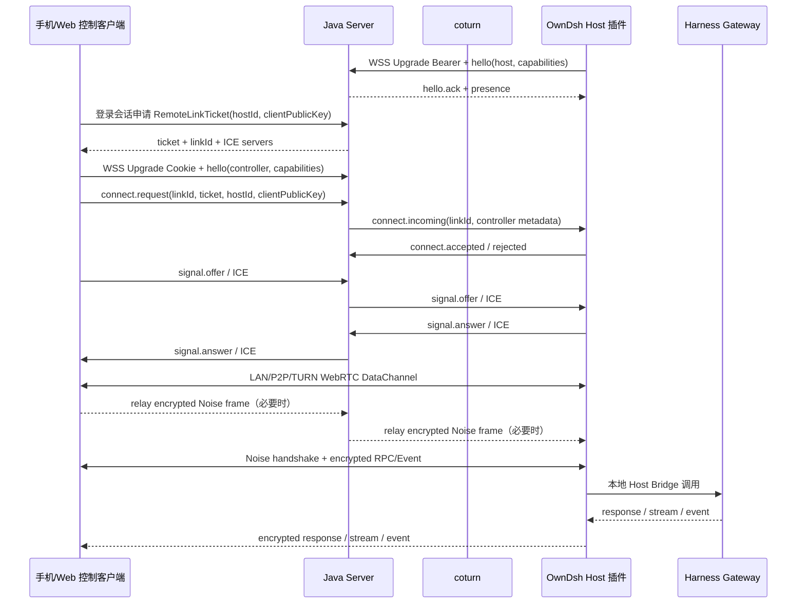
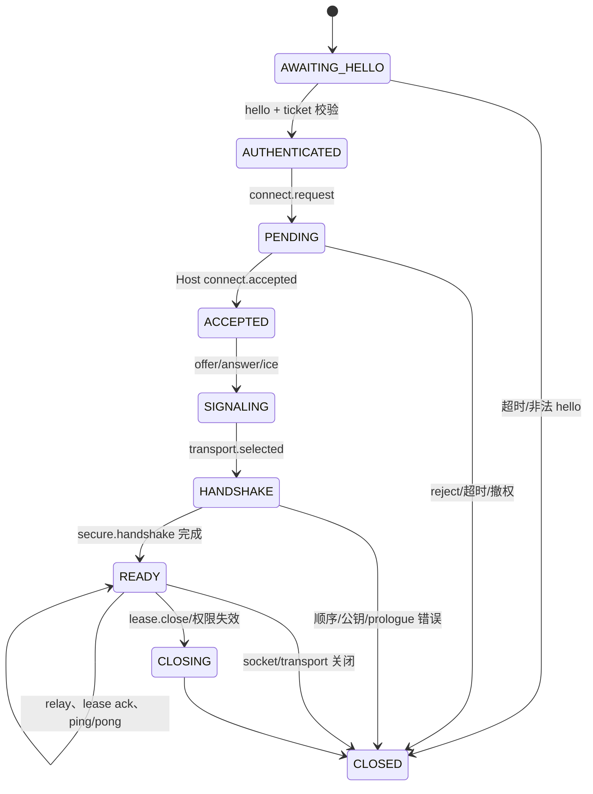

<!--
[INPUT]: docs/remote-access-design.md、产品决策中的仅 DSH 工作区范围、ds-harness-remote 固定研究提交 90cd1889f85196ae71b1a3fa1ff789a106f4fdcd 的协议/Server/Noise/WebRTC/Host Bridge/Android 实现，以及 OwnDsh 当前 Java 身份、设备、Redis、PostgreSQL、插件和控制台边界。
[OUTPUT]: 提供 OwnDsh 三端远程访问的可直接开发实施真源：模块、接口、状态机、能力探测、授权租约、传输回落、Host Bridge、客户端、数据模型、测试矩阵和待决策项。
[POS]: docs/remote-access-design.md 的实施展开；Server、Host 插件、手机端和 Web 控制台按本文开发，产品总路线仍由上层方案文档维护。
[PROTOCOL]: 变更时更新此头部，然后检查 CLAUDE.md
-->

# OwnDsh 远程访问实施设计

更新日期：2026-11-11。P0 与 R1–R5 的连接基础保留其原有验收边界。首个实际业务已经按 [DSH 远程工作区设计](remote-dsh-workspace-design.md) 实现，复用官方原生页面与 HTTP/mux，通过完整 Noise IK、lease 和加密 Relay 连接两个真实 npm rc.5 Harness。下文的业务 RPC 预留描述属于连接基础的历史范围，不替代新的业务实施契约。独立 Web/Android 页面、跨节点、跨 NAT 的 P2P/TURN 回落与生产证书仍未验收。

本文是 OwnDsh 远程访问的开发真源。它回答四个问题：三端各自负责什么、Host 到底支持哪些能力、连接如何安全可靠地建立与撤销、后续按什么顺序写代码和验收。

本轮已经把**产品级连接基础的核心代码**推进到可继续联调的状态：Java Server 完成身份绑定、原子 ticket/lease/revoke、Peer/Link/Relay 状态机；Host 完成平台会话、hello、presence、connect.accept 和 heartbeat carrier；Web 完成 Cookie WebSocket、ticket connect、Relay fallback 和 lease watchdog；remote-core 完成 Noise IK、counter、fragment、transport selection，bundle 提供 WebRTC DataChannel adapter。会话、文件、终端、审批、模型、插件操作等业务 RPC 只保留接口和 capability 预留，不实现具体业务；页面只做设备列表、连接状态和连接诊断面板，正式产品页面另行设计。

范围收敛不等于质量收敛。连接基础从第一天按产品标准设计：真实授权、真实撤权、真实超时和背压、真实跨机测试、版本化协议、迁移脚本、审计指标、故障恢复和安全审查都是后续签收门槛；当前 P0 不用 mock 认证、永久 token、无界队列、单机内存状态或“先返回成功”的空 endpoint 冒充已完成的生产连接。

本文使用 `ds-harness-remote` 的连接核心作为研究基线，但不承诺与其业务协议、单账号认证或页面直接互通。OwnDsh 的业务 RPC、账号、设备、权限和审计归 OwnDsh 所有；只有经确认的连接语义、边界检查和失败处理值得复用。

## 1. 冻结的总体决策

### 1.1 三端

```text
Java Server
  ├─ HTTPS 控制面：登录复用、设备目录、RemoteLinkTicket、RemoteLease、ICE 配置
  └─ Netty Remote Gateway：WebSocket 信令、心跳、密文 Relay、连接状态机

Host 插件（OwnDsh Plugin）
  ├─ 复用现有 Harness 登录、installation、credentials 和 Gateway
  ├─ 主动连接 Java Server
  ├─ 探测并上报 Host Bridge 能力
  └─ 在端点执行 Noise、连接基础 RPC，以及后续阶段的业务 RPC

控制客户端
  ├─ 本机插件：后续接入远端 DSH 工作区，复用 Harness 原有业务界面
  ├─ Web 管控台：浏览器 Cookie 登录、浏览器 WebRTC、连接诊断
  └─ Android：移动登录、移动 WebRTC、Foreground Service、SAF 文件访问
```

本机插件、手机端和 Web 管控台是同一种控制客户端的不同适配器。它们共享授权语义、Remote wire schema、Noise 参数、Lease 规则和业务 RPC；WebRTC、凭据存储、文件系统和生命周期按平台实现。本机插件的控制端角色属于后续业务目标，不改变 R0 至 R5 的交付边界。

### 1.2 传输

公网产品的最小可靠链路为：

```text
LAN / P2P WebRTC
        ↓ ICE 失败或策略禁止
TURN（独立 coturn）
        ↓ WebRTC 不可用、企业网络禁 UDP 或代理限制
Java 加密 WebSocket Relay
```

Java Server 不做 WebRTC Peer、不解密业务 RPC、不承载 TURN 媒体。它只做授权、信令、透明密文转发和租约撤销。TURN 由 coturn 独立部署，Java 只签发短时 TURN REST 凭据。

### 1.3 Host 能力原则

Host 是否支持某项功能，由 Host Bridge 在连接建立后实际探测并上报。Server 只保存脱敏的 presence/capability 摘要，控制客户端必须在端到端通道内再次取得 `host.describe` 的最新结果。

```text
Host Gateway / 本地服务
        ↓ 探测
HostCapabilityDescriptor
        ↓ Server presence（脱敏缓存）
控制客户端建链
        ↓ E2EE host.describe
Host capability ∩ Client capability ∩ Product policy
        ↓
UI 显示/隐藏；Host 每个 endpoint 仍做最终校验
```

能力宣告只用于发现和 UI gating，永远不是授权。一个恶意客户端即使伪造 capability，也必须通过 Host endpoint 的 scope、权限、路径和 attachment 校验。

### 1.4 产品首期连接基础不带入的内容

以下内容不因上游存在就自动进入产品首期连接基础：会话/消息/审批、workspace 文件、terminal、模型和插件操作、所有 ACP/Codex/Claude/Hermes/OpenCode backend、正式远程操作页面、管理员越权远控、Server 解密正文、Java 原生 WebRTC、服务器保存会话正文、任意文件删除和无限制插件设置。

开发时可以先用 **Web 管控台 ↔ Java Relay ↔ Host 插件** 打通端到端协议，但产品首期连接基础的最终验收必须包含 LAN/P2P、真实 coturn TURN 和加密 Relay 三条可用路径。WebRTC/TURN 不是临时占位，而是同一版连接基础的正式传输适配器。

### 1.5 后续业务只支持 DSH 工作区

2026-11-11 已确认：用户可以在本机 Harness 中选择本人另一台机器的 DSH 工作区，继续使用 Harness 原有会话、文件和终端界面。后续控制端适配将本地界面的业务请求送往远端 Host，由远端 DSH 执行；远程断线不能自动改成本机执行。员工插件的设备发现、ticket 申请与控制端认证需复用员工登录，并校验目标设备归属，不能要求员工取得管理员会话。

Host Bridge 只适配 DSH 原生服务。不引入 Codex、ACP 或其它工作区执行后端，不为它们设计通用 backend 路由、虚拟 Harness 或选择器。DSH 自身已有的模型、工具和 MCP 仍按原有机制使用。具体文件写入和终端权限在业务实施前单独冻结；完整的 UI Gateway 切换、加密业务通道和跨机操作仍需实现及验收。

## 2. 研究基线与现状

### 2.1 上游基线

研究仓库：[`liguobao/ds-harness-remote`](https://github.com/liguobao/ds-harness-remote)，本轮完整仓库 HEAD：`90cd1889f85196ae71b1a3fa1ff789a106f4fdcd`。

关键入口：

| 上游位置 | OwnDsh 采用的知识 |
| --- | --- |
| `apps/server/src/gateway.ts` | hello deadline、Peer/Link 状态机、连接替换、信令定向转发、Relay counter、心跳、慢消费者和关闭语义 |
| `packages/protocol` | control/relay frame envelope、消息顺序、大小限制、错误和关闭分类 |
| `packages/crypto/src/noise.ts` | `Noise_IK_25519_ChaChaPoly_SHA256`、静态 X25519 identity、prologue、握手 step 和 secure frame |
| `packages/webrtc/src/adaptive-transport.ts` | LAN/P2P/TURN/Relay 选路与 transport capability 交集 |
| `packages/plugin/src/harness-remote-bridge.ts` | Gateway endpoint 白名单、RPC/stream、权限和 Host 资源边界 |
| `packages/plugin/src/workspace-bridge.ts` | 文件路径 containment、文件流、terminal scope 与断线清理 |
| `packages/plugin/src/remote-terminal-controller.ts` | PTY 生命周期、attachment ownership、retain/follow、输入和尺寸限制 |
| `apps/android/src/services/connection.ts` | Android 连接生命周期、断线替换、后台恢复和端点加密 |

上游当前协议的可复用限制包括：control frame 64 KiB、Relay frame 1 MiB、Noise secure fragment 48 KiB、secure message 4 MiB、hello 5 秒、默认心跳 25 秒、75 秒无 pong 断开、ICE candidate 每连接最多 256、单连接 pending RPC 128、每方向 active transfer 2、transfer idle 2 分钟、单连接 alpha stream 16 条。OwnDsh 可以采用这些初始值，但必须变为自己的配置项并在压测后冻结。

### 2.2 OwnDsh 当前事实

当前 OwnDsh 已有：

- Java 21、Spring Boot、Sa-Token、PostgreSQL、Redis、审计和设备生命周期；
- `plugin/packages/bundle`、`platform-client`、`ui`，以及官方 Harness `webServer`、credentials、settings、pluginManager、pluginInventory 接缝；
- Host Access Token 在内存、Refresh Grant 由官方 credentials provider 持久化；
- Web 管控台的 Sa-Token HttpOnly Cookie 和 PKCE 身份接入；
- Session 持久化和企业控制面，但尚未有 Remote Gateway、Remote Host Bridge 或 Android Remote 工程。

因此本文是新增远程纵向能力的设计，不假定已有代码可直接调用 `ConnectionController` 或 Harness 业务 Gateway。这里要分清两条链路：

1. **OwnDsh Remote 链路**：手机/Web 控制客户端 ↔ Java Server ↔ Host 插件，负责登录后的 ticket、信令、WebRTC/Relay、Noise、Lease 和 OwnDsh Remote RPC；它不依赖 Typert。
2. **DSH Host 业务适配链路**：Host 插件 ↔ 当前 DSH Host，用于在后续开放会话、文件、终端等能力时调用原生 Harness 服务。它可以使用官方 `ctx.typertGateway`、`connection`、文件 provider 和终端 provider，但这是 Host Bridge 的依赖，不是 Remote 传输的前置条件。

进入 R6 会话、R7 文件/终端业务前，需对锁定的 Harness `0.2.1-rc.5` 做一次 Host Bridge spike：确认普通树外插件能通过官方注入拿到 `ctx.typertGateway` 及需要的原生 provider，并验证一个无副作用的能力查询调用。R0 至 R5 的连接基础不依赖这个 spike；这个 spike 也不验证或定义 OwnDsh Remote wire，不要求生成自定义 Typert Remote。

## 3. 领域对象与不变量

### 3.1 核心对象

| 对象 | 权威位置 | 作用 |
| --- | --- | --- |
| `UserSession` | Sa-Token | 证明控制端当前登录用户是谁 |
| `Installation` / `Device` | PostgreSQL | 证明 Host 属于哪个租户、用户和安装，维护 ACTIVE/REVOKED |
| `HostRemoteConfig` | Host settings 为开关权威，PostgreSQL 保存观察快照 | 远控开关、Host identity key、能力摘要、最后在线时间；服务端快照永远不能单独打开 Host 远控 |
| `RemoteLinkTicket` | Redis | 一次性、短时、绑定目标和客户端公钥的建链授权 |
| `RemoteLease` | Redis + 内存索引 | 已建立连接的短期存活租约，控制撤权和心跳续租 |
| `PeerConnection` | Netty channel + Redis presence | 一个已认证 Host 或控制端 WebSocket |
| `RemoteLink` | Netty event loop + Redis 索引 | 一个 Host/Controller 配对及其 transport/handshake 状态 |
| `HostCapabilityDescriptor` | Host 端权威，Server 脱敏缓存 | 运行中真实能力和限制 |
| `RemoteAuditEvent` | PostgreSQL | 连接、授权、撤销和结果元数据，不保存业务正文 |

### 3.2 远控必要条件

所有签发 ticket、接受 `connect.request`、续租和业务 RPC 前均适用：

```text
remoteAllowed =
    controllerSession.active
    && hostSession.active
    && hostDevice.status == ACTIVE
    && hostPlugin.remoteEnabled
    && targetOwnershipMatches
```

其中 `hostSession.active` 表示 Host 的 OwnDsh 登录/Refresh Grant 仍有效，不能只看 WebSocket 在线。`targetOwnershipMatches` 同时校验 tenant、user、installation、deviceId 和目标公钥。

不变量：

1. Server 永远不能把一个已认证 Socket 连接到另一个 deviceId。
2. Host 永远不能信任控制端自报的 sessionId、workspaceId、cwd 或 attachment owner。
3. Ticket 只使用一次；Lease 到期或撤销后不能恢复旧连接。
4. P2P/TURN 通道绕过 Server 时，Lease 仍由两端心跳和端点事件强制关闭。
5. Server、Relay、TURN 不持有 Noise 私钥，也不记录业务明文。
6. 能力宣告不扩大授权；实际 endpoint 白名单和 scope 校验是最后防线。

## 4. 总体数据流



控制面可读的是信令和密文 Relay frame；业务数据从 Noise handshake 之后只存在两个端点。

## 5. 授权与 HTTPS API

### 5.1 登录复用

| 端 | 登录事实 | Remote 增量 |
| --- | --- | --- |
| Host | 现有 Access/Refresh Grant、installation、device | 生成本地 X25519 identity；远程开关开启后注册 presence |
| Web | Sa-Token HttpOnly host-only Cookie | 生成浏览器 client identity；调用 ticket API，不把 Cookie 放 URL |
| Android | 现有 public client + PKCE 会话 | 使用安全存储保存 client identity 和短期会话；不复用 Host Grant |

登录负责“你是谁”；Remote ticket/lease 负责“现在能连哪台设备”。不得把登录 Token 当永久 Relay 凭据。

首期 Web 控制端不注册新的企业 `ent_device`。浏览器每个标签页在内存中生成一个 `ctl_` 前缀的控制端 ID 和 X25519 公钥；刷新页面或关闭标签页会生成新身份。`controllerDeviceId` 只表示这个 Remote 控制端实例，不是 `EnterpriseDeviceId`，服务端只在 ticket、link 和审计元数据中短期保存它。Android 后续阶段再定义持久控制端身份、密钥轮换和撤销。

Remote ID 格式固定为：`hostDeviceId` 使用现有十进制 `EnterpriseDeviceId` 字符串，`installationId` 使用现有 UUID，`controllerDeviceId` 使用 `ctl_` 加 26 位 Crockford ULID，`linkId` 使用 `rln_` 加 26 位 Crockford ULID，frame `id` 使用 `msg_` 加 26 位 Crockford ULID，业务 `requestId` 复用现有 `req_` 加 26 位 Crockford ULID。不能用一个 ID 类型替代另一个类型。

WSS Upgrade 的认证固定为两条路径：Host 使用当前内存 Access Token 的 `Authorization: Bearer`，Web 控制端使用同源 HttpOnly Cookie。Upgrade 通过后，`hello` 只携带与 Upgrade 身份一致的角色、设备或控制端 ID 和公钥摘要；Access Token、Cookie 和 Refresh Grant 不进入 WebSocket frame。Host 刷新或切换账号后必须用新 Access Token 重建 WSS，服务端拒绝旧会话继续续租。

首期的 `remoteEnabled` 只由 Host 插件设置控制。Host 在开启开关后通过 presence 上报，关闭开关时先撤销 lease 再断开 WSS；R0 至 R5 不新增服务端远控开关 API，设备撤销仍由服务端既有设备治理接口负责。

### 5.2 REST 接口

所有接口使用现有 `/enterprise/api/v1` 认证、请求 ID、错误 envelope 和 CSRF/Origin 规则。以下是新增接口的最小集合：

#### `GET /enterprise/api/v1/remote/devices`

返回当前用户可远控的 Host 摘要。下面只展示响应 `data` 的内容，外层仍遵循现有 `data` 与 `requestId` envelope：

```json
{
  "items": [{
    "deviceId": "9001",
    "installationId": "6f5f0f72-0f3d-4d1f-8f2b-6b0f7a4f8d11",
    "name": "工作站",
    "platform": "linux",
    "status": "ACTIVE",
    "online": true,
    "remoteEnabled": true,
    "lastSeenAt": "2026-11-07T02:18:00Z",
    "capabilities": ["remote.connect", "host.describe"],
    "capabilityRevision": 12
  }],
  "page": { "hasMore": false, "limit": 100, "nextCursor": null }
}
```

Server 不在此接口返回 identity private key、业务 workspace 路径、文件列表、登录 Token 或未脱敏的 Host 错误。

#### `POST /enterprise/api/v1/remote/links/tickets`

请求和响应都使用现有 `data` 与 `requestId` envelope。下面的 JSON 只展示 `data` 内容。`controllerDeviceId` 必须符合 `ctl_` 加 ULID 的格式，并由当前 Sa-Token 用户会话绑定；它不是设备表中的 Host ID。

请求：

```json
{
  "hostDeviceId": "9001",
  "controllerDeviceId": "ctl_01ARZ3NDEKTSV4RRFFQ69G5FAV",
  "controllerPublicKey": "base64url-32-byte-x25519",
  "requestedCapabilities": ["remote.connect", "host.describe"],
  "clientVersion": "0.1.0"
}
```

响应：

```json
{
  "linkId": "rln_01ARZ3NDEKTSV4RRFFQ69G5FAV",
  "ticket": "opaque-one-time-value",
  "ticketExpiresAt": "2026-11-07T02:18:30Z",
  "leaseTtlMs": 60000,
  "serverDeviceId": "server",
  "host": { "deviceId": "9001", "identityKey": "base64url..." },
  "iceServers": [{ "urls": ["stun:...", "turns:..."], "username": "...", "credential": "...", "expiresAt": "2026-11-07T02:19:00Z" }]
}
```

Ticket 必须绑定 `userId`、tenant、hostDeviceId、controllerDeviceId、controllerPublicKey、linkId、capability 交集和过期时间，并只存 Redis 摘要。Ticket 不能放进 URL、日志或前端持久化存储。

ticket 响应内的 `iceServers` 是本次 link 唯一的 STUN/TURN 配置来源。服务端为每个 ticket 生成短时 coturn REST 凭据；R0 至 R5 不再提供第二个按 `linkId` 读取 ICE 凭据的接口，避免重复授权和凭据刷新竞态。需要刷新 ICE 时必须重新申请 ticket。

#### `DELETE /enterprise/api/v1/remote/leases/{linkId}`

幂等撤销当前用户拥有的 lease，关闭 Server 上两个 WebSocket，并向仍存活的端点发送 `connection.lease.close`。Host 关闭开关、退出、设备撤销和账号停用走同一内部撤销服务，不依赖客户端主动调用此接口。

#### `GET /enterprise/api/v1/remote/devices/{deviceId}/capabilities`

返回 Server 最近的脱敏 presence 摘要。控制客户端仍必须在 E2EE 通道内调用 `host.describe`，以防缓存过期或 Host 后端刚刚变化。

### 5.3 错误码

Remote REST 和 control error 使用统一代码：

```text
REMOTE_AUTH_REQUIRED          登录会话不存在或已失效
REMOTE_PERMISSION_DENIED      用户、租户、设备或能力不匹配
REMOTE_DEVICE_REVOKED         目标设备已撤销
REMOTE_DISABLED                Host 远控开关关闭
REMOTE_TICKET_EXPIRED         ticket 过期或已消费
REMOTE_TICKET_REPLAYED        ticket 重放
REMOTE_LEASE_EXPIRED          lease 已过期
REMOTE_PROTOCOL_UNSUPPORTED   版本/能力不兼容
REMOTE_LINK_NOT_FOUND         link 不存在或已清理
REMOTE_TRANSPORT_UNAVAILABLE  所有候选传输均失败
REMOTE_BACKPRESSURE           慢消费者或队列超限
REMOTE_FEATURE_NOT_SUPPORTED  Host 未宣告该能力
REMOTE_SCOPE_DENIED           session/workspace/terminal/attachment 不属于当前 owner
REMOTE_INVALID_MESSAGE        JSON、字段、计数器或尺寸非法
REMOTE_INTERNAL               不向端点泄露栈信息的内部错误
```

## 6. WebSocket Control Protocol

OwnDsh v1 可以沿用上游 envelope 形状，但不承诺与上游客户端直接互通：

```json
{
  "v": 1,
  "id": "msg_01ARZ3NDEKTSV4RRFFQ69G5FAV",
  "type": "hello",
  "timestamp": 1786000000000,
  "payload": {}
}
```

规则：

- WebSocket control frame 只接受 text message；binary 直接关闭。
- 原始字节必须是有效 UTF-8 JSON；拒绝重复字段、`NaN`、`Infinity`、负零和未知必需枚举。
- `hello` 必须在 5 秒内到达；`hello.ack` 前只能发送 `hello`。
- control frame 上限 64 KiB；Relay envelope 上限 1 MiB。
- 每个连接使用单一串行执行队列；发送顺序、Relay counter 和 lease 状态在同一 Netty event loop 内更新。

首版 frame 类型：

```text
hello
hello.ack
presence.update
connect.request
connect.incoming
connect.accepted
connect.rejected
signal.offer
signal.answer
signal.ice
transport.selected
secure.handshake
connection.lease.request
connection.lease.ack
connection.lease.close
relay
ping
pong
error
```

`hello.payload` 最小字段：

```json
{
  "role": "host | controller",
  "deviceId": "9001",
  "protocols": [1],
  "clientVersion": "0.1.0",
  "harnessVersion": "0.2.1-rc.5",
  "capabilities": ["transport.lan", "transport.p2p", "transport.turn", "transport.relay"]
}
```

WSS Upgrade 已完成会话认证，服务端必须检查 `hello` 的 role、deviceId 或 controllerDeviceId 与 Upgrade 身份一致。任何 frame 都不能携带替代认证的 Access Token 或 Refresh Grant。

Host 的 `hello` 使用 `deviceId`，其值必须是现有十进制 `EnterpriseDeviceId`；controller 的 `hello` 使用 `controllerDeviceId` 和本次 ticket 绑定的公钥，不能把浏览器控制端伪装成 Host device。两种 role 的 payload 由 `contracts/remote/` 的 discriminated union 分别约束，不能共享一个可选字段泥团。

Host 完成 `hello` 后发送 `presence.update`，只包含 `deviceId`、`remoteEnabled`、`capabilityRevision`、连接能力、限制摘要和 `observedAt`。服务端把它写入 Redis presence，并把脱敏摘要异步写入 PostgreSQL；`remoteEnabled=false` 或 presence TTL 到期时，服务端立即拒绝新的 ticket。

首次 enrollment 的 Remote 配置默认关闭，因此 Host hello 的授权只检查 ACTIVE 设备、租户/用户/installation 绑定，不在此处检查 `remoteEnabled`；否则 Host 无法先上报 `presence.update(remoteEnabled=true)`。开关仍在 ticket、建链和已存在连接的撤权路径上强制执行。

`relay.payload` 必须包含 `linkId`、`direction`、单调 `counter` 和 opaque `ciphertext`。Server 只校验 link、方向、counter、大小和速率，不解析 ciphertext。

`connect.request` 必须携带本次 ticket。Server 在同一原子操作中校验并消费 ticket，然后把已校验的 `linkId`、controller 公钥和能力交集放入 `connect.incoming`；Host 不接受控制端再次自报的 owner、tenant 或能力范围。

### 6.1 状态机



状态转换必须由一个 Link owner 串行执行。`ConcurrentHashMap` 只能存索引，不能替代状态机原子性。旧 Socket 的 close 回调必须带连接代号；如果该 Socket 已被新连接替换，close 回调不得删除新连接。

### 6.2 心跳、关闭和重连

- 默认每 25 秒发送 `ping`；75 秒无 `pong` 关闭连接并标记可重试。
- `401/403`、设备撤销、远控关闭、租约失效是不可重试的业务关闭；网络错误、服务端 1013、慢消费者清理是可重试但必须退避。
- 重连重新申请 ticket、重新 hello、重新建 Link；不能拿旧 ticket 或旧 Noise session 恢复权限。
- 首版只做“断线重建”。上游最新 `transport.webrtc.resume.v1` 和 `transport.relay.resume.v1` 是否加入首版，列入待决策项；没有明确批准前不实现半成品恢复。
- Host-owned terminal process 可以在连接断开后保留；控制端必须重新 `terminal/retain`/`terminal/follow`，不能假设所有 RPC 会自动重放。

## 7. 传输选路与 coturn

### 7.1 capability 与选路

端点 capability：

```text
transport.lan
transport.p2p
transport.turn
transport.relay
```

Server 只转发信令，最终选择由两端根据候选和策略确认：

1. 同网可达候选成功，选择 `transport.lan`；
2. 公网 ICE 直连成功，选择 `transport.p2p`；
3. ICE 需要中继，选择 `transport.turn`；
4. WebRTC 不可建立、UDP 被禁或策略指定时，选择 `transport.relay`。

`transport.selected` 必须是双方 capability 交集中的值，并且 Link 当前状态允许该转换。WebRTC DataChannel 和 Relay 共用同一 Noise/Lease 语义，切换不能重新授予业务权限。

建立 WebRTC 直连后，两个端点仍保持各自到 Server 的 WSS 控制连接，用于信令、Lease 和撤权。业务密文走 LAN/P2P/TURN DataChannel；WSS 断开后端点在本地 Lease 到期前关闭 DataChannel，不把“直连成功”当作绕过撤权的理由。

WebRTC DataChannel 固定为 `ordered=true`、可靠传输、不设置 `maxRetransmits` 和 `maxPacketLifeTime`。应用层仍按 48 KiB secure fragment 分片；Relay、DataChannel 和 Noise 使用同一 fragment fixture。

### 7.2 coturn

生产 coturn 开启 `use-auth-secret`/`static-auth-secret`、固定 `realm`、TLS 5349、UDP 3478、受控 relay 端口范围和带宽/配额；关闭匿名模式。Java 生成：

```text
username = <expiry-unix-seconds>:<link-or-device-id>
password = base64(HMAC-SHA1(coturn-shared-secret, username))
```

共享 secret 只在 Server 配置和 coturn 配置中出现。日志、数据库、浏览器 IndexedDB、URL 和 Remote frame 不得出现该 secret。

TURN 只负责 WebRTC 数据路径。它不替代 Java 信令，也不替代 Noise 身份校验。LAN/P2P 成功时流量不经过 Java/coturn，因此撤权必须由 Lease 和端点关闭完成。

## 8. Noise 与端点安全

### 8.1 身份

Host 和每个控制端各有独立的 X25519 static key pair：

- 私钥在 Host 官方 credentials、Web 内存和 Android Keystore/Encrypted Storage；
- Host 公钥绑定到现有 `EnterpriseDeviceId`；Web 首期公钥只绑定到本次 `controllerDeviceId` 和 ticket，服务端不把它写入 `ent_device`；
- 一个 Host deviceId 不允许替换成不同公钥；账号切换必须生成新的 Web 控制端 identity；
- Host 在收到 `connect.incoming` 后，通过 Server 设备详情或已 pin 的公钥确认 controller identity。

### 8.2 Noise 参数

首版固定：

```text
Noise_IK_25519_ChaChaPoly_SHA256
initiator = controller
responder = host
prologue = UTF-8("owndsh-remote/v1\\0" + linkId + "\\0" + hostDeviceId + "\\0" + controllerDeviceId)
```

Controller 只使用 ticket 响应中的 Host 公钥启动 `Noise_IK`；Host 使用 ticket 中已绑定的 controller 公钥验证 initiator。`secure.handshake` 的 payload 是 base64url 编码的 Noise 二进制消息，只允许预定义的两步顺序。握手完成后进入 secure frame；解密失败、计数器回退、乱序超限或 prologue 不匹配立即关闭 Link。R1 至 R5 不做中途 rekey，重键必须新建 link。Server 不拥有解密所需的 static private key。

### 8.3 secure frame

Noise transport 外层采用有界 fragment/reassembly：fragment 48 KiB，完整 secure message 默认 4 MiB。每个 fragment 带 `messageId`、`sequence`、`offset` 和 `length`；每方向发送序列从 0 开始单调递增，解码器拒绝超限、重复、缺失和错误认证标签。发送必须串行化；同一 `NoiseSession` 不能被并发 Promise 交错写入。

安全边界：

- 业务审计只记录 `linkId`、endpoint、requestId、结果、字节数和错误码；不记录消息文本、文件内容、终端输出、Token、SDP 或密钥。
- 网页 E2EE 不能防止被篡改的前端读取明文；生产必须使用 HTTPS、严格 CSP、受控 Origin、SRI/发布完整性和依赖锁。
- 释放 JS 引用不等于经过证明的内存擦除；实现只承诺尽快清理引用和关闭会话。

## 9. Java Server 详细设计

Java Server 的模块、Netty pipeline、处理顺序和不实现边界见 [remote-access-java-design.md](remote-access-java-design.md)。主文档只冻结它与 REST、Remote wire、Redis、Host 和控制客户端的边界。


## 10. 数据模型与 Redis 键

### 10.1 PostgreSQL

优先复用现有 `ent_device`、installation、member 和权限表；新增表只保存 Remote 自有事实：

```sql
ent_remote_device_config(
  device_id bigint primary key references ent_device(id),
  remote_enabled boolean not null default false,
  identity_public_key bytea,
  capability_revision bigint not null default 0,
  capability_summary jsonb not null default '{}'::jsonb,
  last_presence_at timestamptz,
  updated_at timestamptz not null
)

ent_remote_audit_event(
  id uuid primary key,
  tenant_id varchar not null,
  actor_user_id bigint,
  controller_device_id varchar,
  host_device_id bigint,
  link_id varchar,
  action varchar not null,
  outcome varchar not null,
  error_code varchar,
  bytes_in bigint,
  bytes_out bigint,
  created_at timestamptz not null
)
```

首次迁移只允许 `identity_public_key` 为空。Host 首次启用远控并完成 WSS hello 后写入公钥；公钥为空、设备已撤销或公钥发生变化时，服务端拒绝建链。公钥轮换必须先撤销设备并重新 enroll，不能由 heartbeat 无条件覆盖。开关快照、公钥和能力摘要的更新必须带设备 revision，不能用无条件覆盖隐藏换号或重绑。

不把 ticket 明文、TURN secret、Noise private key、业务正文、终端输出和文件内容落 PostgreSQL。

### 10.2 Redis

```text
remote:ticket:<hash>              一次性 ticket，TTL 10 秒
remote:lease:<linkId>             lease JSON，TTL 60 秒
remote:presence:<deviceId>        Host presence，TTL 90 秒
remote:link-node:<linkId>         linkId → gateway node，TTL 90 秒
remote:rate:<scope>:<bucket>      新建连接/ICE/帧限流
remote:revoke:<deviceId>          撤销 epoch，TTL 至少覆盖旧 lease
```

Ticket 消费使用 Redis 原子脚本或 Lua：读取、校验 target/public key、标记 consumed 必须一次完成。Lease 续租使用 compare-and-renew，旧 epoch 不能续新 lease。

## 11. Host 插件实施设计

### 11.1 目标模块

在 `plugin/packages/bundle/src/remote/` 增加 Host 侧组合。首版先把 wire、crypto、transport 放在该 Host 组合内；当 Web 控制台需要复用同一套实现时，再抽成独立 workspace package。连接基础首版的最小成员如下：

```text
remote-runtime.ts       账号状态、远控开关、连接和撤销生命周期
server-connection.ts    Host → Java Server WSS、心跳、重连和 ticket
capability-probe.ts     OwnDsh 连接能力和 host.describe 探测
host-bridge.ts          endpoint allowlist、scope、RPC/stream/event
remote-audit.ts         Host 本地安全元数据日志
```

Host Runtime 只在平台状态 `READY/REFRESHING`、当前 Access Token 或 Refresh Grant 仍可用且 `remoteEnabled=true` 时建立连接。`REFRESHING` 只表示正在续期，不改变 `hostSession.active`；续期失败、进入 `FAILED/SIGNED_OUT`、退出、换号、设备撤销或关闭开关时，先停止接受新 RPC，再发送 lease close，最后关闭底层 transport。

### 11.2 Host capability discovery

R3 至 R5 只探测连接基础，不触碰后续业务 provider：

1. OwnDsh Remote runtime 是否已完成身份、开关、Server 连接和心跳初始化；
2. Harness 版本和 `host.describe` 连接能力；
3. 端点可用的 transport、Noise、Lease 和消息限制；
4. 每项连接限制和版本兼容性。

R6 会话、R7 文件/终端和后续业务阶段再探测 DSH 的 `ctx.typertGateway`、`connection`、workspace/session、文件、PTY、plugin route、model catalog 和 attachment。不探测或宣告其它工作区执行后端。未进入对应阶段的 provider 不得阻塞连接基础。

推荐 `HostCapabilityDescriptor`：

```json
{
  "schemaVersion": 1,
  "revision": 12,
  "harnessVersion": "0.2.1-rc.5",
  "remoteGateway": true,
  "features": ["remote.connect", "host.describe"],
  "limits": {
    "maxControlFrameBytes": 65536,
    "maxRelayFrameBytes": 1048576,
    "maxSecureMessageBytes": 4194304
  }
}
```

探测失败时只上报缺失能力和稳定错误码，不把本机路径、环境变量、完整 shell 命令或异常栈发送给 Server。

### 11.3 Host Bridge 业务扩展

首期只实现 `host.describe` 和统一的 `REMOTE_FEATURE_NOT_SUPPORTED`。R6 会话/工作区与 R7 文件/终端的候选 endpoint、scope、传输和生命周期约束见 [remote-access-business-extension-design.md](remote-access-business-extension-design.md)。


## 12. 控制客户端设计

### 12.1 共享核心边界

共享的最小抽象：

```text
RemoteSchema       JSON schema、错误、限制、fixture
RemoteIdentity     deviceId、公钥、prologue 绑定
RemoteAuthorization ticket/lease、撤权、重连分类
SecureChannel      Noise handshake、fragment、counter、串行发送
RemoteRpc          request/response/event/stream、operation receipt
CapabilityModel    Host/client/product capability intersection
```

平台差异只在 `SocketAdapter`、`WebRtcAdapter`、`SecureStorage`、`FileAdapter`、`LifecycleAdapter`。如果 Android 最终使用 Dart/Kotlin，至少共享 schema、错误码和 conformance fixture；不要复制三套业务 RPC 名称和授权判断。

### 12.2 Web 管控台连接基础

- 继续使用现有 Sa-Token HttpOnly Cookie；首期 Web Remote client identity 私钥只放内存，禁止 IndexedDB、localStorage、URL 和日志。
- 连接基础使用浏览器原生 `WebSocket`、`RTCPeerConnection` 和 Noise；Relay 可以作为开发阶段先行路径，但产品首期验收必须覆盖 LAN/P2P/TURN/Relay。
- Host 列表读取 REST 脱敏摘要；建链后调用 `host.describe`，展示设备、连接阶段、transport、Lease 和 capability 摘要。
- 不实现会话、文件、终端和模型页面；业务入口显示为未启用或完全隐藏。
- 断线、标签页隐藏、网络切换和页面刷新均重新判断 lease；页面关闭发送 best-effort close，但安全性依赖服务端 TTL。
- 首版仍需 HTTPS、WSS、CSP、Origin、WebSocket Upgrade 和静态资源完整性门禁。

### 12.3 Android（后续产品阶段）

Android 本轮只冻结接口，不进入产品首期 Web 连接基础代码。后续需要独立的控制客户端生命周期：

- 登录使用 public client + PKCE；device identity 私钥存 Android Keystore 或等效安全存储；
- 前台连接和终端/流式会话使用 Foreground Service；Activity 与连接 runtime 分离；
- 网络切换、休眠、进程回收后按可重试关闭分类重连；不可重试错误必须停止服务并要求重新登录；
- 文件使用 Storage Access Framework，不把 Host 路径映射成本机绝对路径；
- WebRTC native plugin 负责 ICE/DataChannel，Remote core 只消费平台无关 adapter；
- 通知只显示设备名、连接状态、错误码，不显示 session 正文或终端输出。

Android 技术栈（Kotlin 原生或 Flutter）必须在实现前冻结，避免同时维护两套生命周期和 WebRTC binding。

## 13. 可靠性与资源控制

### 13.1 重连

客户端采用指数退避 + 抖动：1s、2s、4s、8s、16s、30s，上限 30s；收到业务撤权、设备撤销或登录失效立即停止。每次成功连接重置退避；连接尝试必须带 generation，旧回调不能覆盖新连接。

### 13.2 背压

- RPC request 数量受 pending 上限约束；超过返回 `REMOTE_BACKPRESSURE`。
- stream/event 消费者必须有界；客户端 UI 不消费时暂停或关闭订阅。
- 文件和 terminal 输出不能无界缓存；Relay 慢消费者直接关闭该 Link。
- Host Bridge 的进程、终端、transfer、session follower 都有显式上限。

### 13.3 租约失效上界

首期固定 Lease TTL 60 秒，控制端每 20 秒发送 `connection.lease.request`，Server 以 compare-and-renew 原子续租并返回绝对 `expiresAt`。Host 和控制端各自运行 watchdog；没有收到有效 ack、收到 `connection.lease.close`，或本地时间超过 `expiresAt` 时，立即停止新 RPC 并关闭 DataChannel/Relay。服务端撤权后，WSS 控制连接先发送 close，两个端点最迟在 60 秒内关闭直连通道。跨机测试必须测出 P95/P99 关闭延迟并写入产品 SLA，不能只看 UI 的“已退出”。

### 13.4 撤权矩阵

| 事件 | Server 新 ticket | Host 新 RPC | 已有 Relay | 已有 P2P/TURN |
| --- | --- | --- | --- | --- |
| 控制端 logout | 立即拒绝 | lease 到期前关闭 | 立即关闭 | 两端收到 lease close 后关闭，最迟 TTL |
| Host logout/Refresh 失败 | 拒绝 | 立即停止 | 立即关闭 | 两端关闭，最迟 TTL |
| Host remoteEnabled=false | 拒绝 | 立即停止 | 立即关闭 | 两端关闭，最迟 TTL |
| Device REVOKED | 拒绝 | 立即停止 | 广播撤销并关闭 | 两端关闭，最迟 TTL |
| User/tenant disabled | 拒绝 | 立即停止 | 广播撤销并关闭 | 两端关闭，最迟 TTL |
| 普通网络断开 | 重新授权后可重连 | 连接级关闭 | 关闭 | 关闭 |

此前已经 dispatch 的 Harness mutation 是否继续执行，必须在业务 RPC 设计中明确；连接关闭不能伪造为 mutation 已取消或已成功。

## 14. 审计、监控和隐私

审计事件：`ticket_issued`、`ticket_rejected`、`link_started`、`link_ready`、`link_closed`、`lease_revoked`、`capability_changed`、`rpc_result`。字段只包含 tenant/user/device/link/action/outcome/error/bytes/timestamps/requestId。

指标：在线 Host 数、各 transport 成功率、建链 P50/P95、Relay bytes、TURN bytes、重连次数、lease revoke latency、慢消费者数、RPC pending、transfer/terminal 数、capability probe 失败数。

禁止日志：Access/Refresh Token、ticket 明文、TURN secret、Noise key、SDP 正文、文件正文、session message、terminal output、完整异常栈中的业务 payload。

## 15. 版本与兼容策略

OwnDsh 首版协议版本为 `v=1`，遵守以下规则：

- 可新增 optional field/capability，不能改变现有字段语义；
- 新 endpoint 必须由 capability 宣告，并在 Host/Client 双方交集内使用；
- 不承诺上游 `ds-harness-remote` 的业务 RPC、认证 API、device registration、membership、页面或私有扩展可直接接入；
- 可以在 control envelope 中沿用上游命名，减少理解成本；
- 若未来需要上游互通，单独实现 adapter 和 conformance fixture，不把兼容层污染 OwnDsh 核心授权模型；
- Harness 版本变化必须更新 `docs/dsh-compatibility.md`，能力变化必须更新 Host capability fixture 和本文件。

## 16. 开发阶段与交付物

| 阶段 | 交付物 | 完成门槛 |
| --- | --- | --- |
| R0 协议冻结 | `remote-protocol` schema、错误码、limits、fixture | 重复字段、大小、counter、状态转换测试通过 |
| R1 Java Relay | Netty listener、hello、Peer/Link、心跳、opaque relay | **已验证网络级**。真实 loopback `ws://`、自签名 `wss://`、TCP/HTTP Upgrade、Bearer、Origin、hello.ack 与伪端点建链、替换、关闭、Relay counter 和边界测试通过 |
| R2 OwnDsh 授权 | ticket/lease、设备归属、Redis 原子消费、撤权广播、ICE 配置接口预留 | **已验证真实存储**。Testcontainers 启动 Redis 8/PostgreSQL 17，验证两租户 ticket 绑定与一次消费、lease renew/revoke fencing、presence TTL 和设备归属隔离 |
| R3 Host runtime | Host WSS、开关、presence、capability probe、Bridge skeleton | **已落地 adapter，并完成部署 listener 联调**。平台状态会关闭 carrier；Java listener 已通过真实 JDK WebSocket 的 `ws://` 与自签名 `wss://` loopback 网络级门禁，`.audit/live-remote-e2e.mjs` 又在当前 Java 进程上完成 Host/controller presence、ticket、lease、Relay 和 revoke 关闭闭环；插件收到 `ENT_DEVICE_REVOKED` 后会清理平台凭据、进入粘性 `DEVICE_REVOKED`，并阻止普通 `SIGNED_OUT` 覆盖；真实插件 `RemoteRuntime` 进程接入、换号和 Refresh 失败仍待执行 |
| R4 Web 连接客户端 | Web 设备列表、ticket、Noise、Lease、连接状态面板 | **已落地 Relay carrier**。Vite 开发环境的 `/remote/ws/v1` Upgrade 已验证会转发到 Java listener；浏览器可发 hello/connect/lease，真实认证浏览器与 Host 的 Noise/WebRTC 跨进程验收待跑 |
| R5 完整传输基础 | SDP/ICE adapter、LAN/P2P、真实 coturn、加密 Relay fallback | **已落地核心 adapter**。Noise IK、WebRTC DataChannel、Relay fallback 已有代码；本机 coturn 4.6.3 已接受 Java ticket 返回的短时凭据并完成 Allocate；跨 NAT、禁 UDP、浏览器 WebRTC 协商和生产 TURN 硬化仍未验证 |
| R6 Session/Workspace | session catalog、文件 read/transfer、scope/路径校验 | 由产品页面设计后再冻结 schema |
| R7 Terminal | PTY、attachment、retain/follow、resize、断线恢复 | 由产品页面设计后再冻结 schema |
| R8 Android 客户端 | Android 登录、transport adapter、Foreground Service | 另行确认 Kotlin/Flutter 后实施 |
| R9 生产门禁 | 24h、压测、故障注入、审计、备份/恢复、CVE/许可证 | 明确 SLA、资源上限和回滚路径 |

实现顺序必须先 R0/R1/R2，再做 Host Bridge 和 UI；不要先写完整页面后再补授权和传输。

## 17. 验收矩阵

### 17.1 安全

- 两租户、两用户、两 Host 互相替换 `hostDeviceId`、`sessionId`、workspaceId、公钥和 ticket 均失败；
- ticket 重放、过期、绑定错误 controller key、绑定错误 linkId 均失败；
- Noise 错公钥、错 prologue、错 step、密文篡改、counter 回退均关闭 Link；
- Server、TURN、Relay 日志和数据库无 Token、密钥、正文；
- logout、换号、设备撤销、账号停用和 remoteEnabled=false 影响已有 P2P/TURN/Relay；
- Host 收到 `ENT_DEVICE_REVOKED` 后立即清除内存 Access Token 和持久化 GrantRecord，Remote/Host presence 保持 `DEVICE_REVOKED`，直到显式重新登录或切换 Server；
- Host capability 伪造不能获得 endpoint 权限。

### 17.2 可靠性

- Host/Client WebSocket 同 device 重连不会被旧 close 回调删除；
- Relay 慢消费者、队列超限、帧超限、RPC 超限、transfer idle 能有界关闭；
- 网络切换、睡眠唤醒、Server 1013、coturn 不可用和浏览器刷新均按分类重连；
- terminal retain/follow 可恢复 Host-owned process，RPC mutation 不被盲目重放；
- Java 单节点和多节点（若启用）都验证撤权广播和 Link owner 一致性。

### 17.3 产品首期连接基础验收

- Web 管控台能列出本人 Host、显示在线/远控开关/能力摘要，并取得短期 ticket；
- Web 管控台、Java Server、Host 插件完成 hello、connect、Noise handshake、Lease 和密文 Relay；
- LAN/P2P、真实 TURN 和 Relay fallback 均能承载同一条连接协议；
- Host 能力探测结果可通过 `host.describe` 返回，未实现业务 endpoint 明确返回 `REMOTE_FEATURE_NOT_SUPPORTED`；
- 连接断开、Host 退出、远控关闭、设备撤销和控制端 logout 能在约定 TTL 内关闭通道；
- Relay 慢消费者、超限帧、重复 ticket、错误公钥、错误 prologue 和旧连接替换均有测试；
- 业务页面和业务 RPC 不属于本阶段范围，但连接基础必须达到生产部署门槛。

## 18. 已确认范围与后续决策

首期连接基础的确认范围和进入业务阶段前的待决策清单见 [remote-access-product-decisions.md](remote-access-product-decisions.md)。本文后续章节仍以该附录中的首期范围为准。


## 19. 直接开发就绪度

结论：**P0 的协议、生成链、Java 授权/Relay 核心、Host carrier、Web controller carrier 和 R5 transport adapter 已进入仓库；生产连接仍需真实 WSS、跨节点、跨 NAT、UDP 禁用和 TURN 硬化验收；本机 coturn Allocate 已验证，Redis/PostgreSQL 已完成真实 Testcontainers 验收。** R6 会话/Workspace、R7 Terminal 和 R8 Android 仍不进入本轮，因为它们的业务 schema 和页面范围尚未冻结。

### 19.1 首期连接基础必须先补齐

| 优先级 | 缺口 | 直接开发前的具体产物 |
| --- | --- | --- |
| P0 | Remote wire 没有唯一真源 | **已落地**。`contracts/remote/` 已冻结 control/relay/RPC schema、错误码、limits、close code、crypto vector 和正反 fixture；TypeScript Zod 与 `remote-core` 有回归测试。 |
| P0 | HTTP 契约没有进入现有生成链 | **已落地**。`enterprise-openapi.yaml` 已加入 Remote paths/components 和 ticket request body，生成产物已刷新；Java Controller、设备快照查询、Redis 幂等 ticket、TURN 临时凭据和 lease revoke 已接入现有管理员会话。 |
| P0 | Host presence 和 WSS 生命周期没有落成契约 | **已落地 carrier**。Host runtime 跟随现有平台状态，WSS Upgrade 使用平台会话身份，发送 hello/presence/connect.accept 和 heartbeat；部署中的 Java listener 已由 live Host/controller fixture 验证 ticket、lease、Relay 和 revoke 关闭，真实插件 socket factory、换号和 Refresh 失败联调仍待补齐。 |
| P0 | WebSocket payload 仍是示例级别 | **已落地核心**。strict schema、字段上限、关闭码、Java frame parser、Relay 转发、Host/Web connection state machine 和 Lease watchdog 已有；多节点 fencing 仍未完成。 |
| P0 | Noise 和 WebRTC 实现归属未冻结 | **已落地归属与 adapter**。`plugin/packages/remote-core` 提供 Noise IK、fragment、counter、lease 和 transport selection；bundle 提供 WebRTC DataChannel/Relay adapter，Java 仍不解密。 |
| P0 | Java Netty 运行基础尚未接入 | **已落地核心**。`owndsh-enterprise` 已加入 Netty、Spring lifecycle、TLS/Origin/大小边界、Bearer/Cookie Upgrade 边界、Sa-Token peer adapter、Peer/Link、Relay、lease 和优雅关闭；listener 默认关闭，健康检查和多节点 owner fencing 仍需实现。 |
| P0 | 持久化与原子操作没有落到现有版本 | **已落地并通过真实存储验收**。`V57__remote_core.sql` 使用 `ent_device(id) bigint`，Java 已有 Remote device snapshot store、ticket/link/idempotency 原子写、绑定 ticket consume、lease acquire/renew/release、revoke epoch、presence TTL Lua；真实 Redis 8/PostgreSQL 17 Testcontainers 已执行全部 Flyway migration 并通过 Remote 集成测试。 |
| P1 | 运行与验收环境未写成可执行配置 | **已落地配置键**。`application.yml` 已有 listener/TLS/Origin/frame 配置；coturn、双节点、受限 UDP 和真实 WebRTC 仍需验收拓扑。 |
| P1 | 控制台连接面板没有代码落点 | **已落地骨架**。`console/src/features/remote/`、route、query key、ticket、状态机和诊断面板已存在；页面暂不宣告 Session/File/Terminal 能力。 |

R0 的最小可审计文件清单已经落地为：`contracts/remote/control-frame.schema.json`、`relay-frame.schema.json`、`rpc-envelope.schema.json`、`close-codes.json`、`limits.json`、正反 fixture、`remote-core` exports 和 `crypto-vectors.json`。它们现在可以作为 R1 至 R5 的唯一协议输入；真实跨网络验收仍是实现门槛。

Typert、`ctx.typertGateway`、`connection`、文件 provider 和 PTY provider 属于 R6/R7 的 Host Bridge 接缝。它们必须在进入业务阶段前完成 spike 并写入 `docs/dsh-compatibility.md`，但不再阻塞 R0 至 R5 的连接基础。

### 19.2 可以直接进入实现的部分

现在可以按 R1 至 R5 并行实现：Java Relay/Lease 状态机、Host 开关与 presence、WebRTC/TURN adapter、Web 连接面板和跨节点 owner fencing。业务 endpoint 继续返回 `REMOTE_FEATURE_NOT_SUPPORTED`，不会阻塞连接基础验收。

### 19.3 需要冻结的实现默认值

以下值已按产品决策进入代码边界：Web 首发、只允许设备所有者、内嵌 Netty listener、断线重新建链、不做上游业务互通、Server 不保存正文、Lease TTL 60 秒且 20 秒续租。剩余差异属于实现验证，不再是产品分支。

### 19.4 文档与代码的接入边界

远控 HTTP 契约属于 `contracts/enterprise-openapi.yaml`，远控 WebSocket/Noise 契约属于 `contracts/remote/`，Java 实现属于 `server/owndsh-modules/owndsh-enterprise/.../remote/`，Host 实现属于 `plugin/packages/bundle/src/remote/`，Web 面板属于 `console/src/features/remote/`。新增或修改这些目录时，必须同步维护各自的 L2/L3 文档和测试入口。

### 19.5 R1-R5 当前验证状态

本轮验证把“代码已落地”和“部署环境已证明”分开记录：

| 范围 | 当前结论 | 证据与边界 |
| --- | --- | --- |
| R1 Java carrier | VERIFIED LOCALLY + CONTAINER | JDK 21 下真实 listener 门禁与 `RemoteGateway`、WebSocket parser、设备边界和 ticket request 共 17 个 Java carrier 测试通过；另有 1 个真实 Redis/PostgreSQL 集成测试；当前源码还用 `deploy/compose/Dockerfile.server` 构建了非 root、只读根文件系统的 Server 容器并通过映射端口完成认证 Remote Relay 验收。覆盖同 JVM 与独立 JVM 的 loopback TCP/HTTP Upgrade、Bearer、Origin、`ws://`、自签名 `wss://`、hello.ack、Peer/Link、Relay counter、替换、公钥边界和关闭语义。 |
| R2 授权与 Lease | VERIFIED | `RemoteControlServiceIntegrationTest` 在真实 Redis 8/PostgreSQL 17 上通过；覆盖两租户、64 位 actor ID、ticket 一次性消费与重放拒绝、lease renew/revoke fencing、presence TTL 和设备隔离。Colima 环境需显式设置 `DOCKER_HOST`，并因 Ryuk 无法挂载 Colima socket 设置 `TESTCONTAINERS_RYUK_DISABLED=true`。 |
| R3 Host carrier | VERIFIED LOCALLY + DEPLOYED FIXTURE | Host WSS Bearer Upgrade、hello/presence、平台生命周期关闭和 capability probe 的 bundle 测试/build 通过；当前 Java listener 上的 live fixture 已完成设备 online、ticket、connect.accept、lease acquire/renew、双向 Relay 与 revoke 后双方 4008 关闭；真实 Host 插件 `RemoteRuntime` 部署进程和跨浏览器接入仍未执行；Server 容器本身已通过认证 Relay/Lease/revoke 门禁。 |
| R4 Controller carrier | VERIFIED LOCALLY | Remote core 的 Noise、fragment、counter、lease 和 bundle Relay carrier 测试通过；Vite `/remote/ws/v1` 开发代理在无认证负例中记录了上游 socket close；真实认证浏览器与 Host 的跨进程握手未执行。 |
| R5 transport | PARTIAL DEPLOYMENT VERIFIED | WebRTC DataChannel、coturn 临时凭据计算、Relay fallback 和固定 Noise vector 已有代码与测试；本机 coturn 4.6.3 已用 Java ticket 凭据完成 Allocate；跨 NAT、禁 UDP、浏览器 WebRTC 协商、生产 TURN 硬化和双节点 owner fencing 未执行。 |

完整审计记录见 `.audit/remote-r1-r5.todo.md` 与 `.audit/remote-r1-r5.tsv`。因此 R1-R5 已具备继续开发的代码基础，但不能把本轮本地绿灯误报为生产网络验收完成。

### 19.6 本轮真实网络门禁

`RemoteNettyServerLifecycleTest` 在随机本地端口启动 `RemoteNettyServerLifecycle`，使用 JDK 21 `java.net.http.WebSocket` 客户端通过 loopback 连接 `/remote/ws/v1`。测试分别覆盖同一 JVM 内和独立 JDK JVM 内的明文 `ws://` 与临时自签名 `wss://`，发送 `Authorization: Bearer host-token` 和允许的 `Origin`，再发送合法 `hello`，并断言收到带固定 `protocolSha256` 的 `hello.ack`。独立客户端由 `RemoteWebSocketProbeMain` 通过 `ProcessBuilder` 启动，并使用测试运行时 classpath。临时证书和 trust-all 只用于测试。该门禁证明真实网络栈上的 Java listener 控制面、TLS pipeline 和本机进程边界可用，不证明独立部署、生产证书链、Host 插件运行时、浏览器 WebSocket、WebRTC P2P 协商、跨 NAT、UDP 禁用网络或多节点路由；本机 coturn Allocate 另有 `.audit/remote-turn-evidence.json` 证据。

## 20. 设计自检

- **SRP**：Netty 只处理连接与帧；Spring 处理授权；Host Bridge 处理本机能力；控制客户端处理 UI 和平台生命周期。
- **DIP**：Remote 状态机依赖 channel/lease/store 抽象，不依赖 Netty、Redis 或 React 细节。
- **KISS/YAGNI**：Java 不引入 WebRTC native、媒体服务器或业务解密；首期只收敛业务范围，不削弱连接基础的生产质量。
- **安全边界**：所有信任输入在 Server、Host endpoint 和控制端 schema 三处校验；capability 只发现，不授权。
- **GEB**：本文件新增后必须更新 `docs/CLAUDE.md`；进入实现时，新增 Java/Plugin/Console 模块必须分别创建或更新 L2，业务文件补齐 L3 头部。

本轮已经落地 Java、Host、Web 和共享 core 的代码骨架；本机 Relay 和 coturn Allocate 已有真实证据，但没有声称完成浏览器 WebRTC、跨 NAT、UDP 禁用网络、生产 TURN 硬化、Noise 端到端建链、跨节点 Relay 或业务 RPC。真正开始开放 DSH 会话、文件或终端业务前，仍需把锁定 Harness 版本的 Host Bridge spike 结果写入 `docs/dsh-compatibility.md`：验证官方 `typertGateway`/原生 provider 的注入、调用和版本签名。这个 spike 只验证插件到 DSH 的业务接缝，不验证 OwnDsh Remote 传输。
