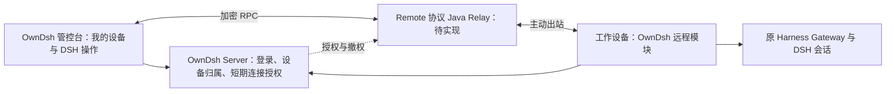

<!--
[INPUT]: Remote（含 Android/client-core）、DSH Go、DSH Desktop、Agents Anywhere 固定提交源码及组件测试；Remote 网页公开构建产物、传输方案官方资料与 GitHub 公开性查询；OwnDsh 当前身份、设备、插件、控制台与桌面版本边界。
[OUTPUT]: 提供 Remote/AA 的源码证据、自有 UI/连接层复用边界、安全接缝与验证门槛；最终选型与 Paseo 对照由 remote-vs-paseo-research-20261107.md 汇总。
[POS]: docs 的远程能力预研，供现有客户端与管控台接入决策使用；依赖契约仍由 dsh-compatibility.md 和桌面 runtime 清单拥有。
[PROTOCOL]: 变更时更新此头部，然后检查 CLAUDE.md
-->

# OwnDsh 远程访问源码预研

阅读入口：后续 [Remote 与 Paseo 选型结论](remote-vs-paseo-research-20261107.md) 已收敛为抽取 Remote 核心能力、接入 OwnDsh 身份与控制台；本篇保留 Remote、Android、DSH Go、AA 与 C# 公开性查询的详细证据。两篇均为预研，远程能力尚未在 OwnDsh 实现。

核对日期：2026-11-06。产品链路已经明确：**用户登录 OwnDsh 客户端 → 主动开启远程 → 同账号登录 OwnDsh 管控台 → 选择本人设备 → 打开完整 DSH 网页操作界面。** 目标是接近本地的会话、工具审批、工作区/文件、终端及适用设置体验；操作同一台设备上的原会话、工具和工作目录。用户不需要额外的跨 Agent 工作台，但这不意味着只交付几个聊天操作 API。

UI 职责应区分：OwnDsh 负责登录、导航、设备与权限；DSH 操作区域复用 Remote 的共享 TypeScript 客户端与原生 Gateway 能力，接入自有界面，能复用既有组件或官方 Harness Web 的部分先复用。DSH Go 已提供“自有 UI＋可替换连接层”的真实实现参考；整块复用官方 Web 只是待验证选项，不是唯一路线。完整 OwnDsh 浏览器集成尚未验证，少量消息/流测试仅是技术探针，不是最终产品验收。

## 1. 核心结论

**优先复用 `ds-harness-remote` 的 DSH 桥接、加密通道与 Relay，由 OwnDsh 继续拥有账号、设备归属、远程开关和浏览器入口。不能原样部署 `apps/server` 就视为完成集成。**

源码依据：Remote 的请求通过端点白名单进入原生 Harness Gateway；Agents Anywhere（下称 AA）则把 DSH 操作转换为自己的 Runtime RPC，并同步、持久化自己的会话投影。AA 的方向适合跨 Agent 工作台，本次只需要其中的 DSH 通路。

AA 也可以只接 API、不使用其网页。但沿用原实现仍需 Bridge、Python Connector、AA Server 及会话/时间线体系；抽掉这些则需要重做模块间接口。不能把“不用 AA UI”估算成“只装一个插件”。

**Remote 已有可参考的完整客户端接入链路，OwnDsh 需要完成浏览器与自身身份体系的集成。** Remote Android 通过共享 `client-core` 操作原 DSH，DSH Go 用独立 Dart Carrier 接同一类 Remote RPC；真实网页公开 JS 也确认了 Remote RPC、Noise、文件和终端调用。此前只看 Node Client Mode，低估了客户端复用基础，应以本轮补充为准。公开 `apps/server` 确实提供远程访问的服务端能力，其附带设备页不是全部客户端能力的边界；公开仓库中仍未找到截图所示完整网页源码。

安全结论有条件：Remote 可以减少 Relay 持有明文的范围，但企业授权未闭合，获准连接使用 Owner 权限；AA 有实际的归属检查、一次性票据、工具审批和撤销实现，但 Server 参与读取业务正文。**两者都不能不经改造直接充当 OwnDsh 企业远程服务。**

## 2. 固定源码快照

| 对象 | 提交 | 实际核对范围 |
| --- | --- | --- |
| [ds-harness-remote](https://github.com/liguobao/ds-harness-remote/tree/b689d7f8f837f6adfbf9728b4ebb47c39d8834d6) | `b689d7f8f837f6adfbf9728b4ebb47c39d8834d6` | Server、Host/Client 插件、协议、加密、传输、Android、client-core 及部分既有测试；插件 `0.6.3`、Server workspace `0.5.21`。 |
| [DSH Go](https://github.com/ccch1mneyyy/dsh-Go/tree/cd5d32197a3e5674c7e49a6d0330a0f3188e04b6) | `cd5d32197a3e5674c7e49a6d0330a0f3188e04b6` | Flutter App 的 Remote 后端与连接切换、Dart RemoteAccount/Carrier/Noise 实现、能力白名单及上游验证记录；未运行 Dart/Flutter。 |
| [DSH Desktop](https://github.com/anywhere-labs/dsh-desktop/tree/a8b98656fd8bcaa888bcc63489b2ecda68a61084) | `a8b98656fd8bcaa888bcc63489b2ecda68a61084` | 发行清单及 vendor provenance；内置 AA 提交 `c1883dad3ff4308092b38d2b52b6d5de6c35020b`、Bridge `2.1.0` 派生包。 |
| [Agents Anywhere](https://github.com/anywhere-labs/Agents-Anywhere/tree/801a2494316fa6eef930f29bdf8b98fa13d6f51b) | `801a2494316fa6eef930f29bdf8b98fa13d6f51b` | 主线 Server、Connector、DSH Bridge、身份与存储；Server/Bridge `2.2.0`。 |

Desktop 远程来自独立 AA Bridge 与同提交 Connector，见 [provenance](https://github.com/anywhere-labs/dsh-desktop/blob/a8b98656fd8bcaa888bcc63489b2ecda68a61084/vendor/agents-anywhere/provenance.json)，不必更换 OwnDsh 桌面壳。下文 AA 结论针对上述 `2.2.0` 主线，不自动代表 Desktop 内置 `2.1.0` 制品已经过相同审查。README 下载入口又是 `2.0.3`，三种版本应分开。

## 3. Remote：实际通道与授权

```text
OwnDsh 浏览器接入层（可参考 Android/client-core；产品集成待补）
  → ClientSecureTransport：Noise IK、加解密、分片
  → WebSocket Relay / WebRTC
  → 工作设备 ServerConnection：设备目录、公钥与身份校验
  → ConnectionController：登记已认证 Peer、RPC 路由
  → HarnessRemoteBridge：白名单、流与文件传输约束
  → 官方 Typert Gateway + 每连接 Owner Peer
  → 原 DSH 会话与工具
```

### 3.1 Server 是单账号实现

[server.ts](https://github.com/liguobao/ds-harness-remote/blob/b689d7f8f837f6adfbf9728b4ebb47c39d8834d6/apps/server/src/server.ts) 自己处理密码登录、8 小时 Web Session、设备注册和 Access/Refresh Token，不能直接消费 OwnDsh Cookie。[store.ts:19](https://github.com/liguobao/ds-harness-remote/blob/b689d7f8f837f6adfbf9728b4ebb47c39d8834d6/apps/server/src/store.ts#L19) 只有一个账号的设备空间，JSON 文件同步原子写入，没有企业 tenant/member/installation 关系。

实际防护包括 scrypt 密码校验、Token 摘要落盘、Refresh 轮换和旧 Token 重用检测，但这些不解决企业隔离。[gateway.ts:392](https://github.com/liguobao/ds-harness-remote/blob/b689d7f8f837f6adfbf9728b4ebb47c39d8834d6/apps/server/src/gateway.ts#L392) 校验 Client→Host 角色、目标、阶段及 Relay counter，在内存维护 Peer/Link；增加一个登录跳转并不能使它成为多用户服务。

[DevicesPage.tsx](https://github.com/liguobao/ds-harness-remote/blob/b689d7f8f837f6adfbf9728b4ebb47c39d8834d6/apps/server/web/src/DevicesPage.tsx) 只有状态、改名与退出，没有完整操作页。它说明此目录附带的页面范围，不代表 Server 无法中转远程 DSH；实际 Android 和独立客户端都可连接该类 Server。

### 3.2 Host 依据服务端目录信任新客户端

[server-connection.ts:474](https://github.com/liguobao/ds-harness-remote/blob/b689d7f8f837f6adfbf9728b4ebb47c39d8834d6/packages/plugin/src/server-connection.ts#L474) 收到连接后再次查询设备目录，比较 ID、role、公钥；已有 pin 的公钥改变默认拒绝，`rotatePinnedPeerKey` 默认 false。新设备依据目录自动加入信任，并非每次都需要本机确认。

因此“谁属于谁”是安全根：OwnDsh 必须核对同租户、同用户、目标 installation、远程开关以及账号/设备状态，再允许握手。不能让全公司共用一个 Remote 账号，也不能让管理员角色天然获得员工终端执行权。

### 3.3 原生桥接比业务协议转换更贴合需求

[harness-remote-bridge.ts:112](https://github.com/liguobao/ds-harness-remote/blob/b689d7f8f837f6adfbf9728b4ebb47c39d8834d6/packages/plugin/src/harness-remote-bridge.ts#L112) 列出真实远程 API；`call()` 检查白名单后派发官方 Gateway，`openStream()` 传递会话/事件流，另有分片顺序、并发和大小限制。它仍有 Harness 版本适配，并非无需维护的透明隧道。

[owner-peer.ts:60](https://github.com/liguobao/ds-harness-remote/blob/b689d7f8f837f6adfbf9728b4ebb47c39d8834d6/packages/plugin/src/owner-peer.ts#L60) 创建 `principal: { kind: 'owner' }, interactions: 'answer'`。允许项不止聊天，还包括 credentials 写入/删除、settings 修改、插件启停/更新、工作区和文件操作。这适合本人控制自己的 DSH，但不是现成的企业细粒度 RBAC。

源码已有防护值得保留：禁止远程修改 Remote 自己的 settings，禁止禁用/更新承载 Remote 的插件；终端检查设备及输入 attachment 归属；[原生文件读取](https://github.com/liguobao/ds-harness-remote/blob/b689d7f8f837f6adfbf9728b4ebb47c39d8834d6/packages/plugin/src/harness-remote-bridge.ts#L852) 检查 `..`、符号链接、realpath 和路径包含关系。它不等于文件沙箱：已获准 DSH 工具的执行权限仍由 DSH 管理，路径检查也未在本轮做并发文件替换攻击验证。

### 3.4 E2EE 有价值，但不是完整授权

[noise.ts](https://github.com/liguobao/ds-harness-remote/blob/b689d7f8f837f6adfbf9728b4ebb47c39d8834d6/packages/crypto/src/noise.ts) 使用 `@lukeburns/clatterjs 1.0.0`，固定 `Noise_IK_25519_ChaChaPoly_SHA256`，验证远端静态公钥后进入 Transport，prologue 绑定 connectionId、Host ID、Client ID。[client-secure-transport.ts](https://github.com/liguobao/ds-harness-remote/blob/b689d7f8f837f6adfbf9728b4ebb47c39d8834d6/packages/plugin/src/client-secure-transport.ts) 校验两端身份，加密发送，解密/重组失败关闭通道。

在可信端点和正确公钥绑定下，Relay 转发密文；但初次信任依赖服务端目录，浏览器 JS 也由站点交付。服务端被攻陷后替换网页 JS、首次身份绑定出错或浏览器自身被攻陷，都不由 E2EE 自动解决，不能宣称“服务端永远无法攻击”。

`destroy()` 释放 provider 引用，源码说明 clatterjs 无密钥擦除 API，不能当作可证明的内存清零。本轮没有独立密码审计或长期 rekey 安全证明。

### 3.5 撤销及默认开关要接入 OwnDsh

[gateway.ts:126](https://github.com/liguobao/ds-harness-remote/blob/b689d7f8f837f6adfbf9728b4ebb47c39d8834d6/apps/server/src/gateway.ts#L126) 把 Store invalidate 接到活动连接断开，Host 也在终态认证错误/stop 时清理隧道，不能说它没有撤销。

不过 [server-connection.ts:631](https://github.com/liguobao/ds-harness-remote/blob/b689d7f8f837f6adfbf9728b4ebb47c39d8834d6/packages/plugin/src/server-connection.ts#L631) 只在协商恢复能力、取得 ticket 且满足传输条件时创建 ControlLease；协议的 `300_000ms` 不能证明所有链路都已具有统一撤权上界。OwnDsh 的关闭、退出/停用、installation 撤销必须同时作用于新连接和旧通道。断开远程访问也不等于自动终止此前提交的任务。

[config.ts:208](https://github.com/liguobao/ds-harness-remote/blob/b689d7f8f837f6adfbf9728b4ebb47c39d8834d6/packages/plugin/src/config.ts#L208) 默认 `enabled=true`，未显式配置/未设置环境变量时终端也启用。仍需 Server 和授权才能连接，不能称为安装即公网裸奔；但不符合“用户主动开启”，OwnDsh 接入必须显式默认关闭并限定能力。

### 3.6 浏览器集成：复用共享客户端，替换平台适配

[index.ts:261](https://github.com/liguobao/ds-harness-remote/blob/b689d7f8f837f6adfbf9728b4ebb47c39d8834d6/packages/plugin/src/index.ts#L261) 为 Client Mode 创建 IdentityStore、ServerCredentialStore 和 ClientModeRuntime；[identity-store.ts](https://github.com/liguobao/ds-harness-remote/blob/b689d7f8f837f6adfbf9728b4ebb47c39d8834d6/packages/plugin/src/identity-store.ts) 依赖 Node 文件系统、环境变量与 home 目录，不能原样放进浏览器。

Node Client Mode 不是浏览器 SDK，但不能据此推断浏览器没有现成接入基础。Android 的 `connection.ts` 已直接组装 `AdaptiveTransport → SecureTransport → RemoteClientCore → RemoteTypertGateway/HarnessAlphaClient`；共享协议、crypto、client-core 可以作为 OwnDsh 浏览器适配的主要基础。Android 的 SecureStore、expo-crypto、WebRTC 和附件/文件保存仍需浏览器替代，不能把整个 App 原样导入 Console。

正式需求是完整 DSH 网页操作体验。可在 OwnDsh 自有界面消费共享客户端，也可验证官方 Harness Web 的连接适配，按实际复用成本选择。不能承诺已有公开完整页面可直接嵌入；发消息、接流、打断和一次工具审批只是首个技术探针。

也可实验官方 Harness Web + Node Client 插件，但若 Node Client 在服务器，解密终点就在服务器，不能称为浏览器→工作设备 E2EE，并且每用户 profile/凭据/运行时必须隔离。本轮未验证这种组合，不作为默认部署建议。

### 3.7 Android 与实际网页提供的功能证据

Remote 自带 Android 是 Expo/React Native 客户端，不是把完整操作页套在 WebView 中。[connection.ts:113](https://github.com/liguobao/ds-harness-remote/blob/b689d7f8f837f6adfbf9728b4ebb47c39d8834d6/apps/android/src/services/connection.ts#L113) 组装加密连接与共享客户端；[prompt-actions.ts:164](https://github.com/liguobao/ds-harness-remote/blob/b689d7f8f837f6adfbf9728b4ebb47c39d8834d6/apps/android/src/state/prompt-actions.ts#L164) 将用户发送、停止和审批动作接到真实 RPC。只有终端渲染等局部使用 WebView。

| 能力 | 已读真实实现 | 证据边界 |
| --- | --- | --- |
| 会话与工作区 | `HarnessAlphaClient` 和 Android session actions：列表、历史、新建、fork、改名、归档、置顶；工作区增删改 | 已接线，不只是类型声明；不代表所有 Host 版本都支持 |
| 消息与交互 | `prompt-actions.ts`：文字/图片、队列、流式会话、停止、工具审批、用户问题回答 | 网页公开 JS 另有 `session/prompt`、`session/list`、`session/follow` 调用 |
| 模型与权限 | `HarnessAlphaClient`：模型目录/选择、reasoningEffort、权限与 Agent preset | 网页公开 JS 可见 `session/modelCatalog`；截图可见模型、推理档位和权限入口 |
| 工作区文件 | `session-tools.ts` 与 files panel：目录、stat、文本/字节读取、预览/下载；Office 转 PDF 预览接口 | 网页公开 JS 可见 `workspaceFiles/list`；不扩大成已验证完整文件编辑器或任意写入 |
| 交互式终端 | `session-tools.ts:202` 与 terminal panel：创建、retain/follow、输入、resize、关闭 | 网页公开 JS 可见 `terminal/list/create`；实际执行权限仍由 Host 控制 |
| 插件与设置 | plugin inventory：列表、启停、schema 设置修改；共享客户端 settings describe/mutate | 不能推定任意插件自定义 UI、OwnDsh 私有本机路由均已支持 |
| 自动化任务 | schedule actions：列表、更新/删除和历史 | 属于可参考的扩展能力，不据此扩大 OwnDsh 本次交付范围 |

2026-11-06 还读取了截图站点 [dsh.r2049.cn](https://dsh.r2049.cn/) 公开 HTML 和静态 JS，未登录或读取私人会话，未执行下载的 JS。其中 `RemotePage-DdHRyk65.js` 出现文件与终端调用；`useRemotePageModel-CSxBGWvg.js` 出现 `harness.remote.call`、`harness.remote.stream.open`、`session/follow`、settings 调用和 `Noise_IK_25519_ChaChaPoly_SHA256`。这支持“网页走同类 Remote 协议与加密链路”的判断，不证明网页源码与 Android 完全共用，也不等于操作端到端实测。公开构建未映射到固定 Git 提交；不能把产物等同开源 Web 源码或直接复制进 OwnDsh。

### 3.8 DSH Go：自有界面接 Remote 的独立范例

DSH Go 使用 Flutter/Dart。它不是另一套与 Remote 竞争的服务端，也不是打开 Remote 网页，而是在独立 `packages/dsh_remote` 中实现 Remote 客户端，并接回自己的统一 DSH 操作接口：

```text
Flutter 自有界面
  → HostConnection.client（统一 DshClient）
  → 本地 HTTP Carrier 或 RemoteTunnelCarrier
  → Noise 安全通道＋WebSocket Relay / 可选 WebRTC
  → Remote Host 插件 → 原 Harness Gateway
```

四个实际接线点：

1. [dsh_remote_backend.dart:283](https://github.com/ccch1mneyyy/dsh-Go/blob/cd5d32197a3e5674c7e49a6d0330a0f3188e04b6/app/lib/remote/relay/dsh_remote_backend.dart#L283) 的 `connectHost()` 返回 `Future<DshClient>`，委托 `RemoteAccount`，绑定 Host fingerprint 确认回调。
2. [remote_account.dart:768](https://github.com/ccch1mneyyy/dsh-Go/blob/cd5d32197a3e5674c7e49a6d0330a0f3188e04b6/packages/dsh_remote/lib/src/account/remote_account.dart#L768) 创建 `RemoteTunnelCarrier`，调用 `DshClient.withCarrier(...)`，等待事件通道就绪；Host 公钥 pin 改变拒绝连接。
3. [tunnel_carrier.dart:443](https://github.com/ccch1mneyyy/dsh-Go/blob/cd5d32197a3e5674c7e49a6d0330a0f3188e04b6/packages/dsh_remote/lib/src/carrier/tunnel_carrier.dart#L443) 把 Gateway 端点包装为 `{endpoint, payload: {args}}`，调用 `harness.remote.call`；流映射为 `harness.remote.stream.open/close`，本地先检查端点白名单。
4. [connection_state.dart:414](https://github.com/ccch1mneyyy/dsh-Go/blob/cd5d32197a3e5674c7e49a6d0330a0f3188e04b6/app/lib/state/connection_state.dart#L414) 按 local/ssh/relay 切换连接，返回给界面的 `HostConnection.client` 始终是 `DshClient`。

这证明“自有 UI＋Remote 通道＋原 DSH 操作接口”已有独立实现。OwnDsh 更适合借鉴这个职责边界，直接复用 Remote 的 TypeScript 通信能力；不需要搬 Flutter 界面、重写 Dart SDK 或将端侧密码学翻译成 Java。Go 在此是项目名称，当前所读 Remote 客户端实现语言为 Dart。

限制不能忽略：该 Carrier 要求 Host 的 `harness.remote.v3`；拒绝白名单外端点，`supportsUplink=false`；工作区上传另走按 capability 开启的专用协议，不等于支持全部本机文件上传 API。统一 `DshClient` 不代表本地与远程拥有百分之百相同的能力。独立 Dart Noise 状态机与上游 golden vectors 对齐，是跨语言互通的参考，不能充当独立密码审计。

[VERIFICATION.md](https://github.com/ccch1mneyyy/dsh-Go/blob/cd5d32197a3e5674c7e49a6d0330a0f3188e04b6/packages/dsh_remote/VERIFICATION.md) 记载上游曾以 Android 35 模拟器连接自建 Remote Server、Host 插件 `0.6.0` 与 Harness `0.2.1-rc.5`，验证 P2P/Relay、会话读取和 settings 响应；这是上游历史记录，并非本轮实测，也未覆盖公网 NAT、真实 TURN 或真机。

## 4. AA：实际业务链路与安全取舍

```text
Web 或 OwnDsh 自建界面
  → AA API：user JWT、会话/Connector 归属、capability、takeover
  → SessionRunService → ConnectorRpcManager
  → JSON Runtime RPC 经 WS 到 Python Connector
  → DSH Runtime → 本地 meshcall → Bridge router → native.send
  → 原 DSH；原生事件投影为 AA timeline 再上传 Server
```

### 4.1 能操作 DSH，但承担第二套业务语义

[session_run.py:580](https://github.com/anywhere-labs/Agents-Anywhere/blob/801a2494316fa6eef930f29bdf8b98fa13d6f51b/server/agent_server/services/session_run.py#L580) 发消息前读取用户所属会话，检查 archived、takeover、online、Runtime 状态和能力，再发 `session.send_message`。[connector_rpc.py](https://github.com/anywhere-labs/Agents-Anywhere/blob/801a2494316fa6eef930f29bdf8b98fa13d6f51b/server/agent_server/infra/connector_rpc.py) 将 content 等 params 作为 JSON 发往 Connector。

Connector 转为 [startTurn](https://github.com/anywhere-labs/Agents-Anywhere/blob/801a2494316fa6eef930f29bdf8b98fa13d6f51b/connector/connector/runtimes/dsh/runtime.py#L415)，Bridge [router.ts:139](https://github.com/anywhere-labs/Agents-Anywhere/blob/801a2494316fa6eef930f29bdf8b98fa13d6f51b/dsh-bridge-next/src/host/dsh-runtime/router.ts#L139) 解析附件、namespace/会话 ID、选项后调用 `native.send`。AA 与 DSH 两套 ID、状态、能力、错误语义需要共同维护。

反向数据同样转换：[sync.ts:230](https://github.com/anywhere-labs/Agents-Anywhere/blob/801a2494316fa6eef930f29bdf8b98fa13d6f51b/dsh-bridge-next/src/host/dsh-runtime/sync.ts#L230) 上传 `timeline.itemUpsert`，另有 inventory/snapshot/checkpoint。Server 的 PostgreSQL session/timeline、Redis 待刷数据、文件卷或 S3 因而进入业务数据生命周期。TLS 保护链路，但 Server 能读取正文，并不是只转密文。

[process.ts:260](https://github.com/anywhere-labs/Agents-Anywhere/blob/801a2494316fa6eef930f29bdf8b98fa13d6f51b/dsh-bridge-next/src/host/connector/process.ts#L260) 通过 uv 启动 Python Connector，本地 rendezvous 与 meshcall key 保护插件/Connector 通信。源码注释估计 wheel 约 235MiB，非本轮实测。企业发行仍要处理 Python/uv、下载/离线、升级与子进程生命周期。

### 4.2 已有值得肯定的具体防护

- [ws_tickets.py](https://github.com/anywhere-labs/Agents-Anywhere/blob/801a2494316fa6eef930f29bdf8b98fa13d6f51b/server/agent_server/infra/ws_tickets.py) 签发默认 60 秒随机票据，绑定用户/client/scope；Redis `GETDEL` 或内存 pop 保证一次消费，错误 scope 也消耗票据。申请会话票据前检查归属。
- [approvals.ts:76](https://github.com/anywhere-labs/Agents-Anywhere/blob/801a2494316fa6eef930f29bdf8b98fa13d6f51b/dsh-bridge-next/src/host/dsh-runtime/approvals.ts#L76) 只接受 allow-once/reject，重检可见性、待决状态及异步竞态，再回应 DSH approval stream。不能声称 AA 绕过工具审批。
- [connectors.py:190](https://github.com/anywhere-labs/Agents-Anywhere/blob/801a2494316fa6eef930f29bdf8b98fa13d6f51b/server/agent_server/api/connectors.py#L190) 轮换 Connector 长凭据，同时断开活动连接并移除终端 Relay；RPC 管理器还有分布式 ownership/lease。它比最小 Remote Server 具备更多多用户服务基础。

### 4.3 企业授权失效仍有缺口

[deps.py:161](https://github.com/anywhere-labs/Agents-Anywhere/blob/801a2494316fa6eef930f29bdf8b98fa13d6f51b/server/agent_server/deps.py#L161) 的 `current_user_id` 只验签取身份并记录 presence，另一个 `current_user` 才检查用户存在和 disabled。会话操作、票据申请等使用前者；[get_session](https://github.com/anywhere-labs/Agents-Anywhere/blob/801a2494316fa6eef930f29bdf8b98fa13d6f51b/server/agent_server/infra/repositories/sessions.py#L1322) 检查 Connector 归属/revoked，未检查 user.disabled。管理员停用接口更新用户状态，在该链路未见统一撤销旧 JWT/活动 WS。

这是静态定位到的授权失效接缝，尚未完整运行复现“停用后继续操作”；不能因有多用户功能就断言 OwnDsh 的实时停用要求已满足。

[auth.py](https://github.com/anywhere-labs/Agents-Anywhere/blob/801a2494316fa6eef930f29bdf8b98fa13d6f51b/server/agent_server/core/auth.py#L13) 的用户 JWT 默认 7 天，secret 缺失时使用公开开发默认值，Compose 也有生产前需替换的占位值。生产必须设置强随机 secret 并校验，不能原样公开默认部署。Connector 短 Token 绑定 credential hash，是另一项有效防护。

## 5. OwnDsh 适配成本与推荐边界

| 维度 | Remote 路线 | AA 路线 |
| --- | --- | --- |
| 核心复用 | 原生 Gateway 桥接、协议、Noise、Relay | DSH Runtime 适配、Connector、操作 API |
| 浏览器 | 复用 client-core；Android 有组装参考，DSH Go 证明自有 UI 接入；OwnDsh 浏览器适配待做，完整公开 Remote Web 源码未找到 | 可复用 Web 或调用现有 API，已有完整工作台实现 |
| 身份 | 替换单账号目录，接 OwnDsh 归属与短期授权 | AA 身份/Connector 映射，并统一停用/撤销 |
| 端侧 | Node 插件；WebRTC 有可选原生依赖 | Node Bridge + uv/Python Connector |
| 数据 | Relay 可只处理授权/路由元数据；Host 提供操作审计 | 另存明文会话投影、配置、附件，需生命周期治理 |
| 长期维护 | 原生 API 适配 + 浏览器/授权接缝 | Runtime 映射 + 双平台状态/存储 + Connector 发行 |
| 本次匹配度 | **较高：为原 DSH 增加远程入口** | 可行，但对本需求带入更多体系 |

正式产品可以由 OwnDsh Java 服务实现兼容 Remote 的信令与密文 Relay，复用现有身份、设备、持久化和审计；端侧 TypeScript 的 Noise 与 DSH 桥接保持原语言。此前保留 Node Relay 的建议用于降低首轮协议验证成本，不是长期架构的必选项。两种部署都必须替换单账号假设，避免另一套长期凭据在 OwnDsh 退出后独立存活；均为待实现边界。

Remote 当前也含 CodeX/ACP 扩展，接入不必一起带入。若浏览器 PoC 无法利用公开组件形成可维护闭环，再评估 AA 纯 API 路线；不能用托管站点演示代替自托管证据。此表不是工作量报价或绝对安全评分。

OwnDsh 现有接缝：

1. **员工入口：** [product-routes.ts](../console/src/app/product-routes.ts) 当前没有 employee 可用页面；新增“我的设备/远程”，不授予管理员角色。治理与操作员工终端是不同权限。
2. **登录模型：** [session.ts](../console/src/auth/session.ts) 用 HttpOnly Cookie；Host Refresh Grant 归现有 credentials。浏览器用现有会话申请一次性、短期、绑定目标与客户端公钥的连接授权，不把管理 Token/Host Refresh Grant 放进 URL 或远程脚本。
3. **发行基线：** 主插件 `beta.20` / Harness `0.2.1-rc.5`，同级 Desktop runtime 仍为 Harness `0.1.7-rc.1` / 插件 `beta.11`，候选开发基线在 `0.2.2-rc.1`。安装范围不等于实际兼容，见 [依赖契约](dsh-compatibility.md)。
4. **私有配置页：** [local-api.ts](../plugin/packages/platform-client/src/local-api.ts) 严格校验回环与 Origin；Remote [plugin-route-bridge.ts](https://github.com/liguobao/ds-harness-remote/blob/b689d7f8f837f6adfbf9728b4ebb47c39d8834d6/packages/plugin/src/plugin-route-bridge.ts) 只开放指定 api/bot POST。远程聊天成功不等于 OwnDsh 账号/技能/MCP 配置页可用，不能删除本机安全检查。完整体验需逐项设计授权桥接，本机文件选择与 OAuth 回调也需按远程浏览器/工作设备的实际位置适配。
5. **网关/UI/审计：** [nginx.conf](../deploy/nginx/nginx.conf) 需新增受控 WS Upgrade；Console React 19 与 Harness 插件 React 18 需保持依赖边界。Relay 不解密时只直接记录连接元数据，细粒度操作审计由 Host 提供。

### 5.1 Java 重实现的范围与难点

服务端的 `gateway.ts` 做 WebSocket Upgrade、hello 认证、Peer/Link 状态维护、握手及密文转发、心跳、帧大小/频率限制和慢消费者断开。这些可用 Spring WebSocket 与现有 Java 基础设施实现，服务端无需完成 Noise 握手或解密业务 RPC。WebRTC 由端点建立连接，Java 转发 SDP/ICE；TURN 需独立 coturn，Java 可签发其短期凭据，不自行实现 TURN。推荐产品能力保留 LAN/P2P/TURN 与 E2EE Relay，分步验证不表示删除其中的传输或安全能力。

| 层 | 实施归属 |
| --- | --- |
| 账号、设备归属、开关、连接授权和审计 | 复用 OwnDsh，补远程访问授权生命周期 |
| 信令与密文 Relay | Java 按固定 Remote 协议重实现 |
| ICE 配置、TURN 授权与服务 | Java 提供受控配置及短期凭据，独立 coturn 承担 TURN 数据中转 |
| Noise、分片/RPC、官方 Harness Gateway 桥接 | 复用 TypeScript 实现，适配 OwnDsh Host；不翻译成 Java |
| 管控台操作界面 | OwnDsh 提供导航、设备入口和 DSH 操作区域；复用共享 TS 操作客户端，界面优先复用已有组件，官方 Harness Web 整块连接适配为可验证选项 |

难点在行为等价而非语言语法：Node 单事件循环中的状态变更到 Java 后需要每连接串行或明确同步，ConcurrentHashMap 本身不能保证握手转换原子性；发送要保序、有界，不能让慢连接拖垮进程；旧 Socket 关闭不能误删新连接。还需保持重复 JSON 字段拒绝、严格 UTF-8、JS 安全整数/计数器、帧字节上限和 capability 协商等线协议约束。

技术原型可以先验证 Relay，再验证完整选路；每一步只通告真实实现的能力，不虚报 P2P、恢复票据或租约。利用现有 TypeScript 客户端及上游协议场景对照验证 Java 端，覆盖跨用户隔离、替换连接竞态、重放、乱序和撤销。前述 93 项测试仅证明原 TypeScript 组件，不能计作 Java 移植通过。当前尚无 Java 原型或吞吐验证。

### 5.2 整套传输方案是否有更合适的替代

比较对象是 **WebRTC（LAN/P2P/TURN）＋端到端加密 Relay** 的组合，不是单独一个 P2P。按 OwnDsh“工作设备开启后，普通浏览器登录即可操作”的要求，目前推荐沿用这套组合，没有实测证据支持另换网络底座会全面改善体验。

Remote 已有自适应选路，而非只支持直连。[adaptive-transport.ts:399](https://github.com/liguobao/ds-harness-remote/blob/b689d7f8f837f6adfbf9728b4ebb47c39d8834d6/packages/webrtc/src/adaptive-transport.ts#L399) 尝试 WebRTC，在失败且协商允许时回落 Relay；`:467` 探测浏览器 RTC 后端并取得 ICE 配置；无 ICE 服务时缩短等待。不能把已有回落机制包装成 OwnDsh 新发明。

| 替代方向 | 相对取舍 | 本需求判断 |
| --- | --- | --- |
| 仅加密 WebSocket Relay | 少维护 WebRTC/TURN，但所有数据走中转；延迟和带宽成本取决于部署 | 可作联调或受限网络路径，不能据此删掉产品的直连能力 |
| Tailscale/Headscale 等组网 | 增加网络客户端或浏览器接入网关、节点与组网授权治理；普通浏览器不能直接作为 WireGuard 节点 | 已有企业组网时可利用，当前不建议为 DSH 额外引入一套组网体系 |
| Cloudflare Tunnel 等反向隧道 | 工作设备需要隧道进程与额外平台集成；隧道自身不替代浏览器到 Host 的应用层 E2EE | 可解暴露服务的问题，但不是当前完整连接与授权方案的直接替代 |
| QUIC/WebTransport | WebTransport 提供浏览器到 HTTP/3 服务端的传输，不自行解决对工作设备的 ICE/NAT 穿透 | 可研究中转性能，当前没有必要替换已存在的 Remote 通路 |

官方资料核对：[Tailscale 连接类型](https://tailscale.com/docs/reference/connection-types) 同样使用直连及中继回落，均保持 WireGuard 端到端加密；[Cloudflare Tunnel](https://developers.cloudflare.com/cloudflare-one/networks/connectors/cloudflare-tunnel/) 通过 cloudflared 主动出站；[MDN WebTransport](https://developer.mozilla.org/en-US/docs/Web/API/WebTransport) 明确其 HTTP/3 服务端连接模型。此处是部署/接口边界比较，未做候选方案性能或穿透率对照测试。

OwnDsh 应优先改善现有身份与设备绑定、各路径一致的撤权、连接失败诊断，以及按实际网络调节回落等待。将首次连接耗时、重连耗时、直连比例、中转流量和受限网络成功率作为验证指标。中转先接通、后台探测再迁移直连可列为后续候选，但需要处理会话绑定、消息顺序和计数器；未证明存在慢连接问题前不新增该状态机。

### 5.3 作者 C# 服务端的公开性核对

2026-11-06 按用户提供的“作者以 C# 重写服务端”线索查询，**尚未找到可公开读取的对应 C# 源码**。这不是对作者本地或私有仓库是否已提交的判断，也未验证托管站点后端的实际语言。

- GitHub API 返回 Remote 唯一公开分支 `main`，仍指向本报告固定的 `b689d7f8f837f6adfbf9728b4ebb47c39d8834d6`。完整文件索引中未发现 `.cs`、`.csproj`、`.sln` 或 `.slnx`；公开 Server 的 package/scripts 仍使用 TypeScript、Node、ws 和 zod。
- 查询[作者公开仓库列表](https://github.com/liguobao?tab=repositories)未发现对应的 C# 服务端；公开组织列表为空。仓库搜索 `ds-harness-remote language:C#` 无结果；名称限定的 `"deepseek-harness-server" in:name` 仅命中另一作者的 TypeScript 插件，不能视作本项目 C# 重写。
- [web/UPSTREAM.md:3](https://github.com/liguobao/ds-harness-remote/blob/b689d7f8f837f6adfbf9728b4ebb47c39d8834d6/apps/server/web/UPSTREAM.md#L3) 写明页面来源是“`deepseek-harness-server/web/src`（用户提供的本地 Server 仓库）”。作者名下 `liguobao/deepseek-harness-server` 的公开 API 返回 404；GitHub 私有仓库也可能如此，不能将其解释为仓库不存在或一定尚未提交。
- [自部署说明:7](https://github.com/liguobao/ds-harness-remote/blob/b689d7f8f837f6adfbf9728b4ebb47c39d8834d6/apps/server/README.zh.md#L7) 明确暂不承诺在此仓库开源完整站点。这只限定完整站点的公开范围，并不直接证明 C# 后端的发布状态。Issue/PR 关键词查询未找到可确认的 C# 源码入口。

目前 Java 移植仍以公开 TypeScript Server、协议和既有测试场景为依据。若后续取得 C# 版本，可用它核对类型划分、并发和连接生命周期实现；是否更易移植取决于协议覆盖、版本与测试，不由语法相似单独决定。相关成功 API 查询保留在临时研究目录的 `verify/github-csharp-search/`；本轮未获取或运行 C# 项目。

## 6. 最小验证门槛



图展示 Relay 路径；WebRTC 直连与 TURN 路径由端点建立，沿用同一身份授权与端到端加密边界。浏览器组装、OwnDsh 授权适配与撤权传播均待开发。可以先以加密 WebSocket Relay 验证身份和操作通路，再覆盖 LAN/P2P/TURN，不将原型顺序视为产品裁剪；流与附件消耗中转带宽，需要实测。

1. **先证浏览器操作：** 以 Android/client-core 为参考，在 OwnDsh 网页通过加密远程连接进入目标设备的原 DSH 会话，先用发消息、接流、打断、一次工具审批检验通路；可同时评估官方 Harness Web 的连接适配复用。正式验收还须覆盖历史/会话管理、工作区与文件、终端、适用设置及 OwnDsh 插件页面，不能只以聊天链路通过宣布交付。核实原工作目录与模型请求仍归原 Host/OwnDsh 网关。
2. **再证隔离：** 两名员工两台设备，篡改 hostId/sessionId/client key 不能互访；默认关闭、重启遵循开关，管理员不自动拥有终端控制权。
3. **再证撤权：** 本机关闭、退出/切换账号、停用、installation 撤销均阻止新连接，并在约定上界内停止旧通道；断网/重连不得恢复已撤权限。区分通道关闭与先前任务是否继续。
4. **最后证发行：** 固定实际桌面/插件组合，检查重启、睡眠、断网、流清理、附件和带宽。终端、文件页以及 LAN/P2P/TURN/Relay 的可达性、回落和撤权均属于完整体验验收，不扩展为跨 Agent 平台。

## 7. 验证证据与限制

已完成固定提交调用链、授权/加密/撤销/存储实现阅读及 OwnDsh 接缝核对。源码和测试依赖位于隔离临时目录，未运行候选项目安装脚本，未修改业务代码。

AA：Python 3.12.14 直接加载未修改 core/auth.py，7 个断言通过，覆盖用户签名/篡改/过期、Connector credential hash 绑定/过期、签名 secret 更换。此为组件自检，未覆盖账号禁用、数据库、HTTP/WS 全链路。

Remote：Node `24.14.1` / Vitest `2.1.8`，对未修改源码运行 6 个既有测试文件，共 **93 项通过**：Server 52、crypto/Noise/golden vectors 8、ConnectionController 4、HarnessRemoteBridge 29。覆盖真实本地 HTTP/WS、Noise 密文中转、篡改/重放拒绝、Origin/凭据边界、连接隔离、白名单及文件路径等；DSH Gateway 部分使用测试替身，未启动完整 Harness。

Remote Android：另运行 `session-tools.test.ts`、`secure-transport.test.ts`、`connection.test.ts`，**23 项全部通过**。覆盖工具端点映射、加密传输和连接替换/事件流故障等服务组件行为；测试使用替身，未构建 Expo、APK 或在真机运行。隔离环境未安装 Expo，测试期间仅临时移除 checkout 中 tsconfig 的 Expo `extends`，结束已恢复原文件；业务源码和测试未修改。结果保留在 `verify/android-results.json`。

DSH Go：固定源码与接线静态核对；本机没有 Dart/Flutter，未运行其测试、analyze、构建或 APK。上游验证记录与本轮执行结果分别陈述，不合并计数。Remote 网页仅核对公开静态产物，未登录实操，也未独立验证全部功能。

测试在隔离目录用源码 alias 组装，安装脚本关闭。依赖采用 manifest 允许的精确版本，包括 zod `4.6.7`、ws `8.21.3`、clatterjs `1.0.0`、noble ciphers/curves/hashes `1.1.3/1.7.0/1.6.1`、xterm headless/serialize `6.0.0/0.14.0`；并非按整个上游 workspace 锁文件重建或全量构建。测试配置与 bridge JSON 结果保留在 `/tmp/owndsh-remote-research.7ICipD/verify/`。已通过的组件检查未再无理由重复运行。

未验证：OwnDsh 浏览器产品集成、身份/设备授权、账号停用端到端复现、真实跨机/NAT/TURN、三平台发行、长期负载及独立密码审计。推荐的是技术路线，不是可上线声明。

Remote、Desktop、AA 所读许可材料使用/声明 MIT；DSH Go 的 Remote 源码保留 Remote MIT 来源注释。实际复用需保留对应版权和依赖声明，本轮未完成所有子目录、发行制品及依赖的许可证审计。
